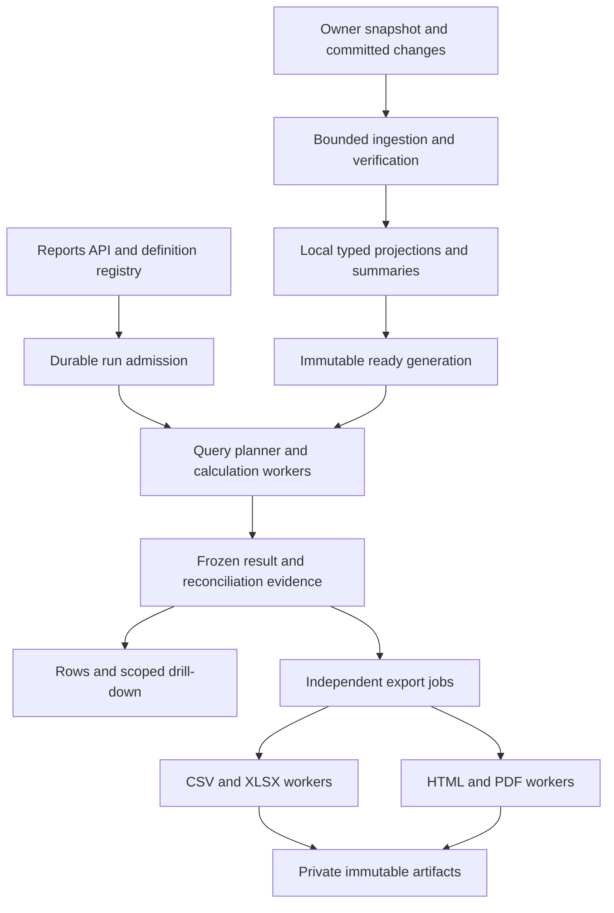

# Reports framework implementation plan

Status: **APPROVED implementation plan; phased implementation in progress.**
Execution: user approved phased implementation on 2026-10-14; progress and verified results
are maintained in the [execution record](reports-framework/execution.md).
Date: 2026-10-14.
Scope: evolve the existing Reports API into a reusable reporting and export framework.
User-selected capacity: **1 million transaction lines per company; 10 million-line stress test.**
Required exports: **PDF, HTML, CSV and Excel (.xlsx)**, with shared, professionally designed layouts.
Priority: performance, while preserving exact money, tenant isolation, immutable evidence and reconciliation.

This plan supplements the [technology contract](tech-stack.md),
[posting/reporting design](voucher-posting-reporting-design.md),
[account recording design](voucher-account-recording-design.md),
[API conventions](api-conventions.md), [design system](design-system.md) and
[B45 verification contract](voucher-phase8-execution.md). Existing domain decisions and
unsupported producer/profile gates remain authoritative. This plan does not mark a voucher
batch complete or authorize production activation, new financial rules or infrastructure provisioning.

## 1. Outcome and boundaries

Build one framework inside `apis/reports` that can register a report, validate its inputs,
select an efficient local query, execute it under a resource budget, freeze the result,
and render the same values in four formats. New reports supply domain-specific definitions,
queries/calculations, presentation metadata and tests; they reuse execution and delivery.

The existing Python/FastAPI/Pydantic/SQLAlchemy/MySQL stack remains. Use the agreed RabbitMQ
and Celery worker architecture; Redis remains optional cache only. No extra reporting service,
warehouse or alternative database is selected. Reports never queries another service database
and never fans out owner calls during ordinary report execution.

Accounting continues to own financial truth; Vouchers owns document workflows; Catalog owns
master definitions. Reports consumes signed, versioned owner feeds and keeps reconstructible
projections. Existing Accounting feeds are the initial implementation boundary. Additional owner
adapters require their own completeness contracts; readiness is a vector of owner checkpoints,
not an assumed globally synchronized timestamp.

The first release covers the currently implemented report catalogue, shared rendering and
performance foundations. A public SQL endpoint, executable user formulas, drag-and-drop report
builder, cross-company consolidation, automatic statutory filing and new report domains are
outside this release. Saved parameter sets and scheduling are later extensions of the same engine.

## 2. Current implementation and bottlenecks

These are code observations, not measured production timings. RF0 captures the baseline.

| Existing implementation | Consequence | Planned treatment |
|---|---|---|
| [Run execution](../apis/reports/src/reports/tasks/runs.py) calls `current_facts`, reconciles all inputs, builds all result rows and a `StringIO` CSV | Per-run work and memory depend on the entire generation; CSV is generated even when only rows are needed | Reuse verified generation evidence, query required projections, persist bounded row batches, export on request |
| [Worker](../apis/reports/src/reports/tasks/worker.py) synchronizes generations before processing runs, serially visits scopes and sleeps for 10 seconds | A large refresh delays other work; polling adds latency | Separate ingestion, calculation and rendering queues with durable scheduling |
| Worker holds `company_lock` across `runs.complete` and its transaction | Same-company report work and admissions contend for a long lock | Brief job claims and publication transactions; no company lock during calculation/rendering |
| [Ingestion](../apis/reports/src/reports/tasks/ingest.py) loads whole staged bundles/generations and looks up facts/claims per item | Memory growth and many SQL round trips | Bounded staging, set-based checks, batch projection writes and invisible build state |
| [Models](../apis/reports/src/reports/models/core.py) check generation/run state while flushing individual immutable rows | Bulk workloads can incur repeated validation queries | Validate each distinct parent once per batch with locking and equivalent invariant enforcement |
| [Accounting snapshots](../apis/accounting/src/accounting/tasks/reporting_feed.py) collect all wire facts in memory under a company write fence | Increasing the limit alone can stall posting and exhaust memory | Versioned owner snapshot job with consistent read/barrier contract and bounded materialization |
| Accounting snapshot and Reports staging/current-fact readers cap at 100,000 facts | A million transaction lines cannot pass through the current contract | Raise negotiated bounds only after both owner and consumer scale gates pass |
| Typed `report_line` and daily/monthly `report_account_total` projections already exist | Useful data is available, but the report runner still evaluates general fact dictionaries | Reuse and extend these projections before creating competing representations |
| One `RunRequest`, branch-based dispatch and hand-built field metadata | Each report increases coupling across validation, execution and UI metadata | Typed registry, per-report parameters and generated capability metadata |
| One `report_artifact` per run, with text stored in MySQL; frozen-run guards forbid later artifacts | Binary/multiple/on-demand formats need more than a renderer function | Independent export lifecycle and immutable binary artifact metadata; preserve legacy artifacts |
| Shared guarded sessions reject unfilterable SQL and unreviewed bulk DML | A naive SQL/Core optimization would bypass or fail required protection | ORM-aware query builders and reviewed bounded write mechanisms with isolation tests |

Preserve the strengths already delivered: generation pinning, signed manifests, checksums,
duplicate handling, financial controls, exact decimals, current authorization on retrieval,
signed cursor pagination and CSV injection protection.

## 3. Capacity and performance contract

### 3.1 Workload definition

One transaction line is not one source fact. A transaction may contribute journal, invoice,
tax, settlement, stock and dimension facts. Fixtures must record both business-line count
and every fact-grain count, row width, index size and total stored bytes. Never equate the
existing 100,000-fact cap with a 100,000-transaction capacity.

Benchmark tiers:

| Tier | Data and use |
|---|---|
| S | Small correctness fixture and a separate fixture below the current 100,000-fact cap; compare old/new engines |
| M | 1 million transaction lines for the main company, at least two financial years and realistic related facts; initial release target |
| L | 10 million transaction lines with proportionate facts; supervised stress, resource and recovery validation |
| Isolation | At least 10 companies across 3 tenants, two noisy companies, skewed accounts/products and restricted readers |

Use realistic selective and unselective filters, backdated corrections, reversals, large
open-item sets, multi-currency transactions, wide descriptions and high-cardinality grouping.
Include supported invoice/tax/banking facts; later stock/job-work profiles are gated by actual
producer availability. A synthetic supported dataset must be internally balanced and reconciled.

Proposed reproducible benchmark profile: MySQL 8 vCPU/32 GiB RAM with local NVMe and a recorded
buffer-pool size; workers 8 vCPU/16 GiB total; API 2 vCPU/4 GiB; private low-latency network.
This is a test profile, not a purchased/deployed topology. Record actual CPU model, OS,
database/driver versions, limits, disk/network rates and concurrent work. RF0 locks the profile
before results are compared; local Windows smoke runs do not establish production capacity.

### 3.2 Proposed budgets, to validate in RF0/RF8

These are engineering acceptance targets, **not benchmark results or latency promises**.
RF0 may propose a documented adjustment with evidence; changing a target requires a recorded
decision, not silently redefining success after a failed run.

| Operation | Tier M proposed target | Measurement boundary |
|---|---|---|
| Definition/status reads | p95 <= 200 ms | API request through authorization and DB/cache response |
| Submit report/export | p95 <= 300 ms | Validation, authorization, durable job/outbox commit; computation excluded |
| Frozen row page, <= 200 rows | p95 <= 500 ms warm, <= 2 s cold | Includes authorization and serialization; deep cursor positions included |
| Common TB/P&L/account summary | p95 <= 3 s execution; <= 5 s submit-to-complete | Ready generation; reviewed summary-compatible fixture; queue time included in second budget |
| Indexed detail view readiness | p95 <= 2 s execution; <= 5 s submit-to-ready | Pin validated plan/source and required controls; no full row copy; subsequent pages meet row-page budget |
| Complex aging/reconciliation | p95 <= 15 s execution; <= 20 s submit-to-complete | Defined high-cardinality fixture, ready generation |
| Computed detail run, 100,000 selected rows | p95 <= 15 s execution | When materialization is required; includes persistence and report-level controls |
| Computed detail run, 1 million selected rows | <= 120 s execution | Bulk lane; complete result persistence included |
| CSV, 1 million rows x 20 columns | <= 120 s rendering | Frozen result to durable artifact; result calculation and external download excluded |
| XLSX, 1 million rows x 20 columns | <= 300 s rendering | Same boundary; ZIP finalization/upload included |
| HTML, 5,000 rows x 10 columns | <= 10 s rendering | Generated artifact, plus browser usability checked separately |
| PDF, 2,000 rows, <= 100 pages | <= 20 s rendering | Worker CPU/memory and font/layout fixed in fixture |
| Regular calculation/CSV/XLSX worker | <= 512 MiB peak RSS per process | Includes buffers and runtime; incremental memory growth also recorded |
| PDF worker | <= 1 GiB peak RSS; <= 60 s hard wall time | Isolated process; bounded document; no unbounded-layout promise |
| Source freshness | p95 <= 30 s at provisional 50 committed changes/s | Commit to new reconciled generation readiness; also record facts/s and bytes/s |
| Posting impact during refresh | <= 10% p95 latency increase; snapshot barrier hold <= 100 ms p95 | Compare owner posting baseline under same load and storage conditions |

Short-job budgets apply to a declared load, initially 20 concurrent API clients across 10
companies, 10 short run submissions/minute, two simultaneous bulk exports and active ingestion.
Measure peak and sustained capacity separately; do not average overloaded and idle periods.
Run at least 100 short-job samples per class after warm-up and at least 5 bulk repetitions,
reporting sample size, median, p95, maximum, errors and cancellations. Separate application-cache
warmth from MySQL buffer-cache warmth; cold DB tests use disposable environments.

Tier L must maintain API/row-page responsiveness and resource limits under admitted load;
large jobs must complete within an explicit bulk budget or be rejected before execution.
Record the measured capacity curve; do not claim the Tier M summary SLA for every Tier L query.
The stress gate includes a full 10-million-row CSV and a split XLSX export under supervised
extended budgets, proving completeness, bounded memory, cancellation and restart behavior.

## 4. Architecture and contracts



Separate three identities: **generation** (which source facts), **run/result** (which
calculation), and **export/artifact** (which presentation). Formatting never reruns financial
calculations. A PDF failure must not invalidate a completed result or block its CSV export.

| Contract | Required content |
|---|---|
| `ReportDefinition` | Code/version, title/description, typed parameters, named output views, column/section schema, permissions, compatible dataset versions, metric dependencies, query/calculation handler, checks, drill-down mappings, formats, resource class |
| `DatasetDefinition` | Grain/unique identity, generation scope, typed dimensions/measures, allowed joins and cardinality, date bases, currency behavior, source lineage, index/filter/sort allowlists |
| `MetricDefinition` | Meaning, additive/semi-additive/non-additive behavior, dependencies, currency/unit rules, sign conventions, date semantics, Decimal precision, calculation version |
| `QueryPlan` | Selected projections/summaries, filters, grouping, deterministic ordering, scope, expected work class, limits, checkpoint requirements and internal plan fingerprint |
| `ResultManifest` | Definition/rules/build identifiers, generation/checkpoints, normalized parameters, schema, result storage mode, ordered sections/batches or pinned query, known exact counts, totals and reconciliation; logical fingerprint distinguished from actual byte/content hashes |
| `ReportDocument` | Title/company/period/filter summary, versioned display configuration, sections, typed columns, references to row streams, hierarchy, totals, notes and optional bounded chart data |
| `ExportDefinition` | Format, supported layout/options, template/theme/font/renderer versions, exact-value policy, resource limits and artifact media type |

These are proposed interfaces, not seven new database tables. Use typed Python protocols and
immutable data structures; domain calculations import no FastAPI, ORM or queue framework.
The document model references iterators/batches; it must never require one giant JSON object.

Registry startup checks reject duplicate codes/versions, missing handlers, metric cycles,
invalid join paths and incompatible schemas. Definitions are code-reviewed, versioned code.
Persist immutable definition evidence for runs; changing an implementation increments its
version/build identity. A hand-written constant hash must not stand in for the actual rule version.
Retain old engine/template packages or retained outputs for their declared reproduction period.

Use declarative definitions for registers and simple summaries, specialized pure calculation
modules for statements, aging and reconciliation. Both share the same lifecycle. A future
designer can compose registered capabilities; arbitrary fields/operators/SQL are not exposed.

## 5. Source ingestion and generation design

### 5.1 Bounded and atomic visibility

1. Preserve owner-signed manifest identity, deterministic fact order and complete effect bundles.
2. Receive pages into invisible staging, enforcing byte and row caps independently. Begin with
   the existing 200-fact/<1 MiB wire cap; transport batch tuning requires owner/consumer agreement.
3. Verify checksums with a bounded ordered pass; validate references and unique identities using
   indexed/set-based queries. Do not retain all facts or all identities in Python sets.
4. Build typed projections and controls in bounded, idempotent batches. Keep build/checkpoint
   state separate from published generation state; partially processed bundles are never readable.
5. Advance the committed bundle checkpoint only after its entire effect is validated. Publish
   the READY generation/activation pointer with a short transaction and generation-level lock.
6. Store reconciliation evidence keyed by immutable manifest, projection schema and verifier
   version. Runs verify compatibility and their own output controls rather than repeating an
   entire source reconciliation. Integrity sweeps and rebuild comparisons remain required.

Batching cannot weaken atomic bundle visibility. Large bundle processing may span commits in
staging, but it must have a final visibility marker and a crash-safe reconciliation/publication
protocol. All readers require READY generations and matching complete projection manifests.

### 5.2 Owner snapshot gate

The current Accounting endpoint cannot simply raise its cap. Introduce a versioned asynchronous
snapshot operation that establishes a committed sequence barrier and a matching consistent read
view under a brief owner fence, then materializes bounded pages without holding that fence for
the entire export. Snapshot controls must come from the same read view as its facts.

RF3 must prove the exact native-MySQL transaction protocol: writer fence participation,
establishment of the read view, barrier order, independent staging writes, catch-up after the
barrier, and failures between every step. Ordinary pages from changing live tables are not a
snapshot. MVCC readers also have an undo-retention/time budget; a lost read-view transaction
requires a new snapshot identity, never continuation from a different view. Completed owner
snapshots remain immutable and resume through their durable pages.

Use the existing signed change feed as the durable catch-up source. RabbitMQ may notify that
changes exist; it is not the historical archive. Retain source changes while an active consumer
or snapshot needs them, and detect a retention gap explicitly. Do not raise the production
100,000-fact limits until this protocol and consumer reconciliation pass capacity tests.

### 5.3 Incremental refresh and storage growth

One initial backfill is followed by checkpointed changes; a user opening a report must not
trigger a company-wide snapshot or full copy. Refreshes coalesce by company and target barrier.
Bound how many builds a company can have in flight; prioritize keeping the existing READY
generation available while a replacement builds.

RF3 prototypes persistent versioned fact/projection rows with source validity intervals and
generation descriptors referencing a committed cutoff, plus periodically compacted bases.
A changed mutable fact retains its previous version; a cutoff predicate cannot query only the
latest value. Immutable posting facts append once; deletions use retained tombstones. Summaries
must be versioned compatibly, and multi-bundle atomic visibility must survive compaction.

This storage change is an explicit design gate: compare bounded full-generation materialization
with versioned projections using backdated changes, retention cost, query plans and recovery.
Select and document the physical layout before migrations. Full copies are acceptable for a
bounded migration pilot, but cannot establish the frequent-refresh Tier M release gate if
they breach storage/latency budgets. Old generations referenced by retained runs remain readable.

## 6. Query and calculation performance

Use typed relational projections for frequent filtering, joins and aggregation. Keep generic
`report_fact` payloads for complete source evidence and unusual detail, not as the normal
JSON-scan path for every report. Begin with existing journal lines and account totals; add
generation-scoped account/group/classification, invoice, bill/allocation and banking projections
only where a measured query and supported source grain require them.

The planner chooses an approved path, not a general-purpose optimizer:

| Report family | Preferred path | Correctness constraint |
|---|---|---|
| Ledger/day book | Indexed line range plus opening aggregate; deterministic streamed running balance | Opening and movement use the same generation; pagination never resets running balances |
| TB/P&L/Balance Sheet | Compatible account/day/month summaries plus frozen classification/earnings rules | Opening equity, prior earnings and current earnings stay separate; each leaf counted once |
| Invoice/register | Indexed typed invoice/component grain with pre-aggregation before fan-out joins | Header amounts cannot multiply by line/tax/allocation counts |
| Outstanding/aging | Open-item and allocation/reversal facts evaluated at the requested business date | Preserve due dates and history; current outstanding is not historical outstanding |
| Bank reconciliation | Pinned account lines plus dated instrument/session evidence | Booking, instrument dates and statement evidence remain separate |

Summary use requires matching generation, coverage, metric version, dimensions, currency and
permissions. Base-currency daily totals cannot answer transaction-currency or missing-dimension
queries. Balance measures are not summed across dates; ratios are recomputed from their
aggregated numerator/denominator. Unsupported combinations are rejected or use a bounded
detail plan; they never silently change the metric's meaning.

Candidate index prefixes include `(tenant_id, company_id, generation_id, account_id,
posting_date, source_id)` for account detail and `(tenant_id, company_id, generation_id,
posting_date, source_id)` for company day books. Add party/date and invoice/date variants only
for measured workloads. Final keys must also support the selected versioned-generation layout.
Review write/storage amplification and remove redundant proposed indexes before migration.

Query rules:

- Use ORM-aware SQLAlchemy expressions under the existing guarded tenant session, including
  aggregate operands, aliases, subqueries and CTEs. A bare Core table or `text()` is not implicitly
  protected. Native tests must show every nested scope is filtered or rejected.
- Push selection, grouping and aggregation to SQL. Use server-side cursors or bounded keyset
  batches only after proving the pinned asyncmy driver does not prebuffer the entire result.
  End read transactions between batches over immutable data where possible; bound connection use.
- Keep Python for exact specialized rules and bounded group state. Spill high-cardinality
  intermediate state to reviewed database staging; no whole-company dictionaries/DataFrames.
- Preserve Decimal arithmetic and unit/currency metadata. Use sufficient intermediate precision
  for SQL sums/Python calculations; detect aggregate overflow before storage in `DECIMAL(19,4)`.
  Serialize exact values as strings and apply company display rounding only at presentation.
- Use keyset cursors (50 default, 200 maximum), approved sort keys and deterministic tie-breakers.
  Arbitrary post-completion sorting requires another declared result view/run. No deep offsets,
  per-row related-object queries or unconditional exact-count query on API reads.
- Bound filters, grouping cardinality, date ranges, rows, bytes, SQL time and temporary-disk use.
  Admission uses catalog statistics/declared cost class; estimates are fallible, so execution
  also enforces hard limits. Never truncate a financial report and label it complete.
- Capture `EXPLAIN` and controlled `EXPLAIN ANALYZE` for representative parameter sets on
  disposable fixtures. Measure rows examined, temporary tables/spills and selected indexes.
  Native syntax is verified on the deployed MySQL version, not inferred from latest web docs.

## 7. Durable execution, isolation and cache

Create durable run/export jobs and their outbox messages in one transaction. Messages carry
IDs and versioned routing metadata, not report datasets, bearer tokens or financial payloads.
The database holds authoritative state; workers rehydrate the permitted job context. Dispatch
through the existing outbox mechanism; a repair sweep republishes eligible jobs after outages.

Separate queues/process pools for ingestion, short calculation, bulk calculation/CSV/XLSX,
and PDF/HTML rendering. Short work has reserved capacity. The scheduler enforces company/tenant
quotas before dispatch; broker round-robin alone is not tenant fairness. Initial limits to tune:
two concurrent calculations and one bulk export per tenant, one generation build per company,
20 queued jobs per tenant, with global DB/worker ceilings. Excess submissions receive `429`
and retry guidance; infrastructure unavailable for durable admission receives `503`.

Use job leases, heartbeats and monotonically increasing attempt/fencing tokens. Claim jobs
briefly, release locks, compute, write bounded output batches, then verify ownership and publish.
Every batch/finalization checks the attempt token so a delayed old worker cannot publish over
a replacement. Unique keys deduplicate output batches. Never hold a company mutex, DB connection
or transaction while rendering a PDF or waiting on network/storage I/O.

Late acknowledgments require idempotent jobs. Normal transient exceptions get bounded retries
with backoff/jitter; invalid inputs, missing authority and reconciliation failures do not loop.
Cancellation is cooperative between batches and has a separately supervised termination path
for SQL/PDF operations. A task timeout must cancel/close its active DB statement and release its
lease/resources, not leave an expensive query running. Do not enable Redis-only Celery options
on the RabbitMQ broker. Verify production process-pool behavior and the supported Windows
development launcher separately.

Proposed new run lifecycle: `QUEUED -> RUNNING -> COMPLETE | FAILED | BLOCKED | CANCELLED`.
Export jobs have their own equivalent lifecycle. `BLOCKED` identifies invalid source/authority;
`FAILED` identifies exhausted operational retries. Completed content is immutable. Retry creates
a fenced attempt for retryable unfinished work; a changed calculation/source creates a new run.

Cache and duplicate-work prevention:

- First eliminate duplicate in-flight requests with a DB-enforced canonical fingerprint and
  reuse completed results for the same actor/scope. Idempotency replay remains distinct from
  equivalent-parameter reuse; a reused key with different input returns conflict.
- Fingerprint includes tenant/company, actor, effective permission/policy revision, definition
  and metric versions, normalized parameters/date basis, output view, generation/checkpoint vector
  and calculation build. Export identity also includes result hash, format, layout, display config,
  template/theme/fonts/renderer versions and options.
- Cache small manifests/pages in the shared Redis cache mechanism; never whole large exports.
  Use bounded TTL/size and stampede protection. Redis loss affects speed, not correctness or job state.
- Recheck current authorization on every read/download and before executing delayed work. A
  saved permission hash is evidence, not present authority. Do not expose totals or derived
  metrics computed from denied inputs; keep the existing complete-input statement policy.
- Baseline cache reuse is actor-specific. Cross-user reuse requires a separately proven equality
  of effective data scope and must still reauthorize the requesting actor.

## 8. Frozen results, artifacts and retention

### 8.1 Result publication

Do not make a million-row copy the prerequisite for opening an ordinary register. Support two
explicit result modes behind one `ResultReader` contract:

| Mode | When used | How consistency is preserved |
|---|---|---|
| `PINNED_QUERY` | Deterministic indexed registers/detail views over fully retained, immutable generation data | Freeze the approved plan, parameters, order, schema, rule/build version and all lookup/display inputs; each page/export reads that same cutoff |
| `MATERIALIZED` | Specialized calculations, expensive reordered/grouped results, or a declared retention requirement for stored output rows | Compute once into immutable result batches; pages/exports read those batches |

The planner selects a registered mode; the client cannot opt out of required calculation or
controls. `PINNED_QUERY` is only enabled after proving all contributing facts/lookups, plan
implementation and generation versions remain available and stable for the run's retention.
It cannot reference a mutable live table or a definition implementation that can change in place.
Complex running-balance views require a fixed opening, deterministic order and verified cursor
carry; use materialization when this cannot be bounded and proven. Required financial checks and
totals still complete before a report is labelled COMPLETE, even if detail rows are read lazily.

A pinned-query manifest has a logical identity derived from source/plan/schema inputs, **not**
a fabricated full-output content hash. Exact row count may be absent until output is enumerated.
Every generated artifact receives its actual byte hash and counts after complete rendering.
Bound paginated reads and export reads independently; exports still enforce output quotas and
scan the complete selected view. Retention/compaction cannot remove data or code needed by this
mode. Rollout starts with straightforward registers and tests page/export equivalence end to end.

For `MATERIALIZED`, retain the current frozen-row concept. Persist batches, initially 1,000 rows
with an independent 4 MiB cap; tune against measured memory, lock duration and query count. The
typed manifest defines columns in order, so exporters do not discover columns by scanning all
rows. Compute exact count/totals/checksums as output is produced; these stored counts are
different from an expensive unconditional list count. Both modes stream into the same renderers.

Each batch is linked to the run, section and fenced attempt. Partial output is inaccessible.
Finalize only after all section ranges/counts/hashes and report controls agree, then atomically
publish the completed result manifest. A crash leaves resumable or abandonable staging, never
a completed partial report. Existing `report_row` can remain the first durable row store, with
reviewed scope/run/section/ordinal indexes; benchmark JSON row storage and batch insert costs.
Do not introduce a second analytical datastore merely to hold results.

The existing `before_flush` protections must be redesigned for bounded writes and independently
completed exports. Prefer grouped parent validation within the guarded ORM unit of work. If
batch DML is required, implement a narrowly scoped reviewed mechanism that enforces tenant,
company, lifecycle, parent locking and attempt ownership before writing. Generic unfiltered
request/worker sessions are prohibited. Changing a shared mechanism requires platform tests,
a package version bump and consuming lockfile updates.

### 8.2 Artifact storage decision

Large PDF/XLSX/CSV files must not be assembled as a giant Python string or stored as the current
single `MEDIUMTEXT` value. Preserve existing DB-backed CSV artifacts for compatibility.

Introduce an artifact-store interface: begin temporary write, stream bytes, finish with
size/checksum, open authorized read and discard unpublished temporary output. The proposed
default backend is a **private persistent filesystem folder**, selected by the user during
implementation planning (D02). Cloud storage is optional and must not be mandatory. Single-host
API/workers share that folder; multi-host deployments require a durable shared mount with the
same atomic-publication semantics. Ephemeral pod disks cannot serve as durable artifacts.

Write to a unique temporary key, verify and finalize an immutable object, then publish its
metadata in a short DB transaction. Orphaned objects from interrupted publication are discovered
by a bounded cleanup job after a grace period. Never publish a signed URL before successful
object completion, and never persist expiring signed URLs as artifact identity.

Downloads initially pass through an authorization gateway with a short-lived, actor/scope-bound
token; the gateway streams private storage or hands off internally to an authenticated server.
A plain object-store presigned URL is a bearer capability and cannot reproduce the existing
actor binding/live revocation guarantee by itself. Do not weaken that contract for speed.
No public buckets, arbitrary client-supplied storage paths or bearer tokens embedded in HTML.

### 8.3 Retention

Retained/finalized/filed runs keep their original bytes, result evidence and source references.
Do not delete a generation, versioned fact or template package still required by a retained run.
Regeneration with a different PDF engine may produce different bytes: preserve original artifacts
for byte identity and test semantic equivalence separately from hashes.

Propose configurable cleanup of abandoned attempts, temporary files and unused generated copies,
with reference checks, audit records and legal-hold support where applicable. Exact retention
policy is user-selected D03: retain completed reports and artifacts; automatically clean only
abandoned temporary output. No duration or history deletion is silently selected.
Because current model guards reject report-history deletion, cleanup requires explicit lifecycle,
permission and retention design, not a raw SQL bypass. Record bytes per fact/line/result/export,
forecast growth over the selected retention horizon and alarm before disk capacity is exhausted.

## 9. Shared presentation and four-format rendering

### 9.1 Layout system

Provide four initial layout families: register, financial statement, grouped summary and
detailed supporting schedule. Each supports title/company identity, reporting period, active
filters, currency/unit labels, source-as-of information, hierarchy, totals, notes and provenance.
Optional charts use bounded aggregates; they do not load raw million-row datasets into a chart.

Reuse the existing `@janso/ui` design tokens as the visual source of truth. Add centrally owned
report/print styles in `mfes/packages/ui/src/styles/` and a deterministic build step that bundles
the relevant tokens/styles as a versioned server-rendering asset. Python packages consume that
asset without a runtime dependency on the web server. Excel semantic styles derive from the
same resolved token manifest. Do not copy hardcoded palettes into each renderer or report.

Version theme, typography, font files, logos, spacing, table density and template layouts.
Screen themes may vary; print defaults to an accessible light presentation with intentional
grayscale contrast. Resolve company amount/quantity precision, rounding mode and date format
once into an immutable display configuration. Renderer formatters follow the shared platform
contract and common fixtures; browser/OS locale defaults cannot choose financial display.

A report definition selects a layout family and supplies semantic sections/columns. Renderers
share group headings, subtotals, sign/negative conventions, zero/null behavior, alignment and
footer metadata. Test long company/account names, multiline notes, Unicode/Indian-language
text, currency symbols, wrapped headings, empty reports and very wide tables.

### 9.2 Format-specific behavior and proposed libraries

| Format | Implementation direction | Performance and correctness rules |
|---|---|---|
| CSV | Python standard-library `csv`, bounded row stream to artifact writer | Stable typed column order; decimal strings; explicit date representation/encoding/dialect; free-text formula escaping; no HTML or display grouping in numeric fields |
| XLSX | Benchmark and pin XlsxWriter, using constant-memory sequential writes | Reuse finite style objects; typed dates and safe numbers; width from column metadata/bounded sample; no entire-dataset auto-fit or workbook `BytesIO` buffering |
| HTML | Benchmark and pin Jinja with autoescaping and streamed trusted templates | Shared CSS, semantic headings/tables, embedded approved assets; bounded standalone document; no arbitrary scripts, external fetches or hidden unauthorized data |
| PDF | First benchmark WeasyPrint against the shared HTML/print templates | Separate supervised process pool; pinned native dependencies/fonts; bounded row/page/CPU/memory budgets; validate pagination and platform packaging before selection |

These are dependency proposals with specific purposes, not installed packages. RF0/RF6 verify
supported Python/runtime versions, license, dependency footprint and native Windows development/
Linux production packaging, then pin exact versions in service dependencies and locks. Retain
one chosen PDF renderer after the spike; adding a browser runtime needs a separate justification.

XlsxWriter constant-memory mode requires row-order writes and restricts features such as
structured tables/merged ranges. Use compatible header styling and worksheet filters; prototype
any feature before promising it. This memory mode applies to the worksheet writer, not a claim
that the full pipeline has constant resource cost. Temporary disk and ZIP finalization need budgets.
[XlsxWriter memory documentation](https://xlsxwriter.readthedocs.io/working_with_memory.html).

Excel supports 1,048,576 rows per sheet and 15 digits of numeric precision. Account for header
rows when splitting sheets. Identifiers remain text; Decimal values beyond the agreed safe
numeric range are written as exact text with explicit column metadata, or an approved companion
exact-value column. Do not silently coerce `DECIMAL(19,4)` to a lossy spreadsheet number. Financial
totals are calculated server-side; downloaded workbook formulas are not authoritative results.
[Microsoft Excel limits](https://support.microsoft.com/en-us/excel/excel-specifications-and-limits).

Disable automatic formula/URL interpretation for untrusted XLSX text; escape unsafe CSV free
text while preserving legitimate typed negative numbers. HTML escapes all business text.
PDF rendering accepts only trusted application templates and bounded registered assets; a
custom fetcher denies network/file access outside that asset set. Process limits are required
because streamed HTML generation does not make PDF layout itself streaming or memory-bounded.
[WeasyPrint guidance](https://doc.courtbouillon.org/weasyprint/stable/common_use_cases.html).

### 9.3 Format limits and multi-section reports

Proposed interactive limits, made explicit in capability metadata and validated before render:

| Format | Initial policy |
|---|---|
| CSV | Full admitted result; multiple tables become ZIP entries plus a manifest; byte/disk/time quota applies |
| XLSX | Full admitted result; split at native sheet row limit; additional workbook/ZIP split if reviewed byte/cell budget requires it |
| HTML | Up to 20,000 rows and 200,000 cells per standalone artifact; larger detail remains available through paginated API or explicit split documents |
| PDF | Up to 5,000 detail rows and 200 rendered pages, plus 60 s/1 GiB hard budget; explicit summary or split volumes for larger reports |

These values are proposed starting limits, distinct from the smaller rendering performance
fixtures. Account for totals, headers and notes in page/cell limits. Never automatically drop
detail: an oversized export is rejected with supported alternatives, or split with a manifest
proving full coverage. A summary export is a named, clearly labelled view with its own schema.
Charts map to underlying tables in CSV. The same report values appear in all formats even where
their physical organization differs. Detect over-budget PDF layouts during rendering and publish
no partial artifact; retry with narrower/split view requires an explicit new export request.

## 10. API and compatibility

Keep `/reports/v1/companies/{company_id}` behavior and existing frozen downloads working during
migration. Its current flat parameters, statuses, `download_token` and default CSV behavior
are compatibility obligations. Implement the framework's richer contract under a proposed
`/reports/v2/companies/{company_id}` prefix in the **same Reports service**. Version 2 separates
result readiness from export readiness and exposes typed per-report parameter models. Version 1
may remain on the bounded legacy engine until adapters reproduce its semantics; it must not be
advertised as supporting the new volume/format capabilities without evidence.

| Proposed v2 route | Contract |
|---|---|
| `GET /report-definitions` | Permitted, implemented definitions and versions, named views, formats and limits |
| `GET /report-definitions/{code}/field-set` | Permission-filtered parameter/output schema and presentation capabilities |
| `POST /report-generations` | Idempotent asynchronous build/refresh request with explicit freshness policy |
| `GET /report-generations/{id}` | Status, history coverage, owner checkpoints and verification evidence |
| `POST /report-runs` | Idempotent `202`; pin compatible definition/generation/parameters and admit cost class |
| `GET /report-runs/{id}` | Lifecycle, stage/progress, pinned metadata, result manifest, safe failures |
| `GET /report-runs/{id}/rows` | Signed keyset pagination over a declared section and stable result order |
| `POST /report-runs/{id}/drilldowns` | Validate a registered target plus parent row/metric reference; `202` child run at the same source cutoff |
| `POST /report-runs/{id}/cancel` | Idempotent cancellation request; already terminal state returned deterministically |
| `POST /report-runs/{id}/exports` | Idempotent `202`; format/layout/options; requires COMPLETE authorized result |
| `GET /report-runs/{id}/exports/{export_id}` | Export stage, size when known, hash and authorized download availability |
| `POST /report-runs/{id}/exports/{export_id}/cancel` | Cancel this export without cancelling the report or other formats |
| `GET /report-runs/{id}/exports/{export_id}/download` | Current authorization, expiring actor-bound token, private streamed artifact |

Generation/run/export lists follow existing cursor/page conventions. No list endpoint exposes
an unbounded array of executions. A definition catalogue may be bounded by the reviewed registry.
Prefer explicit generation IDs; a convenience `latest_ready` option, if added, resolves once at
admission and returns the actual pinned ID/checkpoints. It never tracks a moving generation.
Missing fresh/complete inputs return a clear readiness failure or a separate generation job.

Example proposed run body (UUIDs shown symbolically; exact schema generated during RF1):

```json
{
  "code": "ACCOUNT_LEDGER",
  "definition_version": 2,
  "generation_id": "<ready-generation-uuid>",
  "parameters": {
    "account_id": "<account-uuid>",
    "date_from": "2026-04-01",
    "date_to": "2026-09-30",
    "basis": "BASE"
  },
  "view": "DETAIL"
}
```

An export body can be `{ "format": "XLSX", "layout": "REGISTER", "options": {} }`.
Format/layout enums advertise only implemented combinations; all parameter/options models use
`extra="forbid"`. OpenAPI must describe per-report discriminated schemas, not an unvalidated
`dict[str, Any]` parameter bag. A presentation version is selected/pinned by the service.

Expose stage and completed units rather than invented percentages for unknowable work. Keep
SQL plans/internal table names/server paths out of API failures. Reuse the error envelope and
current permissions; new permissions require catalogue/role/seed updates. Regenerate the
TypeScript client and migrate the actual console consumers with their tests. Mobile contract
support is preserved, but no nonexistent mobile application is claimed as delivered.

## 11. Proposed storage changes and module layout

Reuse existing generation, definition, run and row identities wherever possible. Candidate
schema changes below need final RF1/RF3 design; these are not preassigned migration numbers.

| Area | Proposed change |
|---|---|
| Definition | Immutable schema/metric/implementation version evidence beyond the current `code/version/rule_hash` |
| Generation | Build attempt, projection schema/verification evidence, readiness/coverage and incremental cutoff descriptors |
| Typed projections | Required lookup/dimension/fact tables and measured indexes; versioned facts/summaries only after RF3 gate |
| Run | Canonical request fingerprint, execution class, result mode/pinned plan, logical/schema identity, actual content hash/count when produced, stage/progress and new lifecycle |
| `report_run_attempt` | Fenced attempt, lease/heartbeat, durable cursor/checkpoint, failure classification, resource measurements |
| Result batches | Run/attempt/section/ordinal uniqueness, counts/hashes and publication evidence; integrate with `report_row` |
| `report_export` | Independent format/options/template identity, job lifecycle, attempt/lease and immutable artifact reference |
| Artifact | Binary media type, storage backend/key/version, byte size/checksum, result/export linkage; preserve legacy text bodies |
| Retention | Only approved reference/hold/archive metadata; retention deletion is a separate reviewed mechanism |

Change the one-artifact-per-run uniqueness to a reviewed export/artifact identity using additive
migrations. A completed run may acquire a newly completed export without rewriting its result;
the current blanket frozen-run artifact guard must distinguish those operations. Scoped FKs and
tenant/company columns remain mandatory. One DDL statement per revision, matching model/schema/
factory/client changes, and an executable downgrade or documented forward-repair limitation.

Suggested service-local layout:

```text
apis/reports/src/reports/
  api/                       thin v1 compatibility and v2 routes
  schemas/                   public requests/responses and per-report schemas
  domain/reporting/          pure registry contracts, metrics, plans, results
  domain/definitions/        financial/register definitions and pure calculations
  queries/                   guarded ORM query builders and dataset mappings
  tasks/                     ingestion, scheduling, run/export orchestration, cleanup
  rendering/                 document assembler, CSV/XLSX/HTML/PDF adapters
  templates/                 shared trusted layouts and packaged versioned styles
  storage/                   artifact-store adapters and publication protocol
  models/                    service-owned persistence
```

Names are implementation proposals, not a requirement to move every existing file at once.
Keep old domain functions as the correctness reference until parity is proven. `libs/platform`
receives only generally reusable mechanisms; report metrics/templates/datasets remain in Reports.
The neutral wire contract stays in `clients/reporting`; never import another service's models.

## 12. Delivery phases and exit gates

Phase status and evidence are tracked in the [execution record](reports-framework/execution.md).
Each phase ends with a working repo, affected tests passing,
required contract/client changes in sync and an evidence note. Performance optimizations ship
only with correctness parity. Do not combine source protocol, storage layout and renderer changes
into one unreviewable migration. Phases require agreement before application implementation,
as required by [CLAUDE.md section 2](../CLAUDE.md).

| Phase | Concrete deliverables | Dependencies | Exit evidence |
|---|---|---|---|
| RF0 - Baseline and design spikes | Catalogue every implemented definition; baseline current worker/query/memory/owner-fence behavior; reproducible fixtures/load runner; lock test hardware and provisional SLOs; small PDF/XLSX packaging and guarded-query spikes | This plan | Baseline report, traces/query plans, source-fact expansion ratio, dependency evidence, final RF1/RF3 decisions recorded |
| RF1 - Typed definitions and contracts | Registry, per-report parameters, dataset/metric semantics, document/result schemas; v2 OpenAPI proposal and v1 compatibility matrix; adapt existing handlers without changing calculations | RF0 | Existing financial fixtures unchanged; schema/permission/registry tests; adding a sample report requires no central dispatch edit |
| RF2 - Durable execution and bounded results | Outbox-driven scheduling, isolated lanes, leases/fencing, cancel/retry, quotas, bounded result batches and independent export lifecycle schema; remove long calculation company lock | RF1 | Two same-company independent runs proceed; duplicate/crashed workers cannot double/publish stale rows; legacy API still works; no partial result exposure |
| RF3 - Scalable source generations | Owner async snapshot/read-view protocol, streaming verification, batch projection building, set-based claims, generation evidence; choose/prove incremental version layout and refresh compaction | RF0/RF1; RF2 mechanisms | Native source/consumer parity, fresh rebuild equals incrementally refreshed result, Tier M ingest/memory/posting-impact gate; only then negotiate larger caps |
| RF4 - Query optimization by report family | First ledger/day book, then summaries/statements, then invoice, aging and bank reports; typed projections/indexes, pinned-query registers, materialized calculations; result reuse and optional small Redis caches | RF1/RF2/RF3 | Golden/reference and owner reconciliation parity per family; no unsupported summary substitution; Tier M query/memory/row-page targets; all supported catalogue definitions covered |
| RF5 - Artifact storage and CSV/XLSX | Approved storage adapter/publication protocol, preserve legacy CSV, streaming CSV and XLSX, exact-value/row-split policy, protected download, export retry/cancel | RF2/RF4 and D02 | 1-million-row complete exports with bounded RSS/disk, sheet boundaries/precision validated, revoked/wrong-scope downloads denied, retry creates no conflicting artifact |
| RF6 - Shared design and HTML/PDF | Central token bundle, four layout families, trusted HTML templates, selected PDF engine, fonts, print page rules and render isolation | RF1/RF2; RF5 storage | Visual fixtures and cross-format value equality; bounded large/wide documents; renderer timeout/OOM recovery; verified Windows deployment. Linux validation follows separately before Linux activation (D07). |
| RF7 - API/client adoption and operations | Complete v2 endpoints/generated client, console report/view/export selection, progress/cancel/error UX, scoped drill-down; dashboards/runbooks and retention controls after D03 | RF4/RF5/RF6 | API/client/console accessibility and permission tests; v1 compatibility checks; no unavailable formats advertised; operations rehearsal |
| RF8 - Capacity, recovery and rollout | Tier M mixed load, Tier L stress/export splits, noisy-tenant tests, long-running soak, replay/backdate/revoke/crash/storage/broker failures; per-definition staged rollout | RF3-RF7 | Published capacity matrix/SLO results, all correctness/security gates, migration rehearsal, rollback proof, approved operating limits |

RF3 has separate owner and consumer work packages with independently compatible releases.
RF4 migrates one report family at a time; each family has its own test/performance evidence.
RF5 and RF6 share the frozen result/document contract but do not duplicate financial logic.
Core workers and query performance precede broad renderer rollout. Effort estimates are recorded
after RF0 inventory; no calendar duration is inferred without staffing and environment data.

Per-phase evidence should live under `docs/reports-framework/` when implementation starts,
including a status ledger, benchmark manifests and links to retained test artifacts. This plan
does not create placeholder files or edit the existing voucher completion ledger.

## 13. Verification matrix

| ID | Required proof |
|---|---|
| RFW01 | Every existing supported definition matches its legacy/reference result and Accounting controls, including opening/prior/current earnings and comparisons |
| RFW02 | A source feed with duplicates, out-of-order pages, missing sequences, altered immutable facts or incomplete bundles cannot produce a READY generation |
| RFW03 | Concurrent posting during snapshot/catch-up gives no missing/half/double effects; source fence and undo-retention budgets are measured |
| RFW04 | Incremental refresh and full rebuild agree after backdated corrections, reversals, lifecycle updates, compaction and restarted workers |
| RFW05 | Summary and detail paths agree for compatible inputs; incompatible currency/dimension/date/security shapes never use the summary |
| RFW06 | Join fan-out, zero-denominator metrics, negative values, aggregate overflow and Decimal scale are tested explicitly |
| RFW07 | Running balances, hierarchy totals and drill-down remain correct across sections, deep cursor positions and source generation changes |
| RFW08 | New tables, ORM aliases/CTEs/aggregates and every optimized write mechanism pass cross-tenant/cross-company isolation and wrong-object tests |
| RFW09 | Denied inputs cannot leak through totals, filters, sorts, caches, exports or drill-down; revocation between submit/run/download is enforced |
| RFW10 | Two workers/redelivery/cancellation/expired leases/late worker completion cannot create duplicate batches or publish stale results/artifacts |
| RFW11 | Result rows, API totals, CSV, XLSX, HTML and extracted PDF values agree for the same result/view, with documented display rounding |
| RFW12 | XLSX sheet boundaries and >15-digit values preserve declared semantics; CSV/text injection and leading-zero identifiers remain safe |
| RFW13 | PDF/HTML visual fixtures cover pagination, repeating headers, detached subtotals, overflow, missing fonts, Unicode, grayscale and empty reports |
| RFW14 | A failed PDF leaves completed results/other exports usable; CPU/SQL cancel, memory limits and temporary-disk exhaustion fail cleanly |
| RFW15 | Storage upload succeeds/DB publish fails and the reverse failure order cannot expose partial artifacts; orphan cleanup preserves retained evidence |
| RFW16 | Tier M mixed-load targets and Tier L capacity matrix include RSS, disk, DB waits, owner impact, queue fairness and cold/warm runs |
| RFW17 | Migration upgrade/downgrade-or-forward-repair preserves old runs/artifacts and existing v1 client behavior; package/client versions match |
| RFW18 | Changing definition/metric/template/font/renderer versions creates new identities while retained original outputs stay verifiable |
| RFW19 | Redis outage/stampede, broker outage/redelivery, worker crash and source retention gap have explicit recovery outcomes |
| RFW20 | Startup capability metadata exposes only implemented, dependency-ready, permitted reports/formats and limits |
| RFW21 | Pinned-query pages/exports equal materialized reference output after later generations, deployment and compaction; opening a simple detail report does not copy or enumerate all its rows |

Use existing tests as the golden baseline plus independently computed balanced fixtures; copying
the new query into a test is not an independent oracle. Pure domain unit tests remain DB-free.
Native MySQL integration verifies actual SQL plans/Decimal types/constraints/migrations and
transaction races; live RabbitMQ tests verify dispatch/redelivery. Do not replace these with
driver mocks or claim SQLite results establish MySQL performance.

Run affected pytest suites and coverage (90% floor for domain/platform), Ruff, strict mypy,
OpenAPI/client consistency checks, generated client tests, and console Vitest/RTL tests when
their contracts/UI change. Use Playwright for a limited export/download/preview end-to-end path.
Visual review uses retained sample artifacts and controlled fonts; binary PDF byte comparison
alone is insufficient. Review auth/scope/export/storage changes for security and simplify the
implementation after each final phase as required by repository rules.

## 14. Observability, release and rollback

Trace report admission -> queue -> generation/query -> result batches -> reconciliation -> export
-> artifact publication. Record definition/version, resource class, plan fingerprint, rows/bytes,
queue age, DB duration/rows examined, batch latency, peak RSS, disk use, checksum and outcome.
Keep actor/tenant identifiers in access-controlled logs/traces where appropriate; avoid unbounded
per-tenant metric labels and never log report data, financial payloads or download credentials.

Dashboards/alerts cover source lag and gaps, blocked generations, job backlog age, tenant quota
rejections, worker restarts, SQL timeouts/lock waits, repeated plan regressions, artifact failures,
temporary/durable storage capacity, and reconciliation differences. Alert thresholds derive
from the measured SLO and capacity profile; distinguish overloaded from unhealthy dependencies.

Rollout sequence:

1. Add compatible schema/contracts and deploy readers that understand old/new records.
2. Build new projections beside the existing activated generation; compare small retained runs
   with the legacy engine and verify Tier M fixtures independently beyond its current cap.
3. Enable one report family for selected development/pilot companies, then exports, then console
   adoption. Production activation is a separate reviewed step; this planning task does not do it.
4. Expand only after family-specific correctness, capacity and recovery gates pass.
5. Roll back routing to supported legacy reports where their original bounds permit it; otherwise
   pause new admissions while continuing to serve completed results. Never route a million-line
   job into the old 100,000-fact engine as an automatic fallback.
6. Preserve forward-created rows/artifacts and readers. Do not drop new schema or reset source
   checkpoints to make rollback appear successful. Destructive cleanup follows D03 separately.

## 15. Decisions and unresolved gates

| ID | Status | Decision/gate and latest point to resolve |
|---|---|---|
| D01 | User confirmed | Existing Reports API is the reporting layer; reusable framework, all four formats; 1 million lines/company with 10 million stress; performance is the primary engineering target |
| D02 | User confirmed | Private persistent filesystem default; optional replaceable cloud adapter, no mandatory S3/Azure dependency; durable shared mount required for multiple hosts |
| D03 | User confirmed | Retain completed reports/exports; automatic cleanup limited to abandoned temporary files |
| D04 | Proposed | Benchmark hardware, exact short/bulk SLOs, concurrency, change rate and format caps. Record/test in RF0 and finalize before RF8 acceptance |
| D05 | Proposed technical gate | Owner read-view/barrier protocol and incremental version/compaction layout. Resolve from RF0/RF3 native evidence before changing source contract and raising limits |
| D06 | Proposed | v2 richer contract with preserved v1 behavior; specific legacy-adapter/deprecation policy agreed in RF1 before client migration |
| D07 | RF0 choice; Windows-first deployment confirmed 2026-10-15 | ReportLab 4.5.1 PDF, Jinja2 3.1.6 HTML, XlsxWriter 3.2.9; local fonts and Windows render isolation are RF6 gates. Linux packaging/validation follows in a separate deployment gate before Linux activation. |
| D08 | Existing domain gates retained | Missing history/YTD, tax/stock/costing profiles, multi-owner consistency and consolidation retain their existing decisions; this framework cannot declare those reports complete |

These open items do not prevent completing/reviewing the plan. Implementation phases resolve
only their prerequisites; no new infrastructure, retention policy or financial semantics are
silently selected. Under [CLAUDE.md section 2](../CLAUDE.md), the phase plan must be agreed before
cross-service/migration/application implementation starts.

## 16. Decision log

- 2026-10-15: User clarified API/database as the focus, explicitly asked to retain UI already
  implemented, and reiterated no load/soak tests. Remaining work is backend review/fixes and
  ordinary functional checks, with no further UI feature development.
- 2026-10-15: User narrowed delivery to framework, UI and two review/fix passes, then explicitly
  excluded load testing. Remaining load/capacity/soak gates are no longer completion requirements
  for this delivery. Stop active load runs; keep ordinary functional/security/migration checks.
  Preserve completed historical evidence without claiming production capacity approval.
- 2026-10-15: User selected Windows deployment first; Linux validation follows separately.
  Windows font packaging, isolated PDF layout and recovery remain required before activation.
- 2026-10-15: RF6 distinguishes canonical CSV/XLSX data representation from company-formatted
  HTML/PDF presentation. Excel retains stored decimal precision and ISO dates, with the policy
  stated in workbook metadata; company rounding is never delegated to spreadsheet software.
  All formats share registered values and central semantic styles. Identity resolves and
  freezes authoritative display facts at run creation; shared browser/server fixtures verify
  presentation parity.
- 2026-10-14: RF0 selected ReportLab for PDF after the Windows WeasyPrint native-library
  probe failed. Shared document/tokens drive each renderer. Native Linux packaging remains
  an RF6 gate; small local rendering timings are not production capacity evidence.
- 2026-10-14: RF1 added v2 discovery and per-report parameter schemas while preserving v1
  behavior and calculations. Unsupported filters fail validation; as-of reports declare
  their date semantics explicitly. New capabilities are advertised only after being wired.

- 2026-10-14: User authorized phased implementation and two final review/fix passes; selected
  filesystem storage without mandatory cloud dependency and retention of completed reports.
- 2026-10-14: Recorded the user's request for a centralized reusable framework inside the existing
  Reports API and shared PDF/HTML/CSV/XLSX exports with designed presentation.
- 2026-10-14: User selected 1 million transaction lines per company and a 10 million-line stress
  test. Distinguished transaction-line capacity from owner fact counts and existing 100,000-fact caps.
- 2026-10-14: Proposed performance-first delivery: baseline, typed contracts, independent durable
  jobs, scalable generations, optimized queries, streaming exports and isolated PDF rendering.
- 2026-10-14: Recorded observed company-lock/full-materialization/per-item-validation/artifact-schema
  constraints. Marked all timings as proposed budgets and all framework phases as unimplemented.
- 2026-10-14: Raised private artifact storage, retention, source protocol/layout and renderer packaging
  as explicit gates. Existing stack, financial authority and voucher activation rules remain in force.
- 2026-10-14: Proposed pinned-query results for eligible immutable registers, reserving full result
  materialization for calculated/expensive views. Logical identity and actual output hashes/counts
  remain distinct; retention and equivalence tests gate this optimization.

## 17. Technical references

Primary documentation checked while preparing the plan; benchmark and pin against the deployed
versions during implementation. Published upstream timings are not this project's results.

- SQLAlchemy supports bounded result consumption, but actual buffering depends on the driver;
  verify the async MySQL path in the spike.
  [SQLAlchemy streaming results](https://docs.sqlalchemy.org/en/20/core/connections.html#using-server-side-cursors-a-k-a-stream-results).
- Celery recommends separating long/short workloads; late acknowledgment needs idempotent tasks.
  Queue limits and tenant admission in this plan are application design, not guarantees from Celery.
  [Celery optimization guidance](https://docs.celeryq.dev/en/stable/userguide/optimizing.html).
- Jinja exposes incremental template generation; this supports HTML byte streaming but does not
  bound a PDF engine's layout memory.
  [Jinja API](https://jinja.palletsprojects.com/en/stable/api/).
- XlsxWriter's memory behavior and Excel's native limits inform the proposed workbook adapter.
  [XlsxWriter memory/performance](https://xlsxwriter.readthedocs.io/working_with_memory.html),
  [Microsoft Excel limits](https://support.microsoft.com/en-us/excel/excel-specifications-and-limits).
- WeasyPrint documents print layout and risks of untrusted render inputs; the chosen runtime still
  needs project-specific isolation and performance evidence.
  [WeasyPrint usage and security](https://doc.courtbouillon.org/weasyprint/stable/common_use_cases.html).
