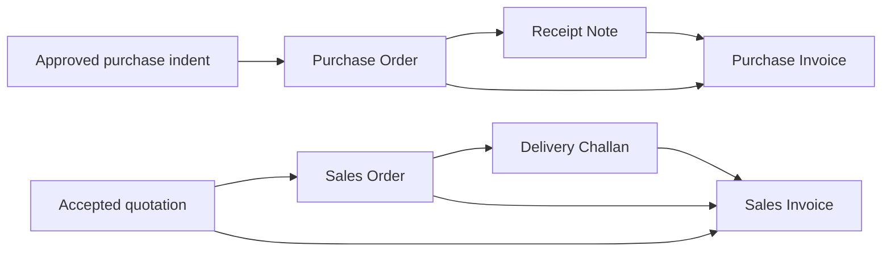

# Indents, quotations, orders and challans

**Reviewed:** 2026-10-10. **Status:** Published TallyPrime functionality research and proposed
platform requirements; no live Tally installation, private schema or application code inspected.
**Read with:** [Vouchers plan](vouchers-plan.md), [shared data model](voucher-data-model.md),
[table inventory](voucher-table-inventory.md), [invoice calculation](voucher-invoice-calculation.md)
and [India tax recording](voucher-tax-recording.md). Payroll and HR remain excluded.

## 1. What the official TallyPrime documentation establishes

| Area | Verified product behavior | Official source |
|---|---|---|
| Indent/requisition | The purchase FAQ points to a manufacturing requisition: create a custom Stock Journal type, default it to Optional and enable Manufacturing Journal. It requests manufacturing/consumption materials. This does not establish a complete general procurement approval or supplier-bidding workflow. | [Manufacturing requisition](https://help.tallysolutions.com/tally-prime/inventory/manage-inventory-in-manufacturing-tally/) |
| Quotation and Sales Order | A quotation is a printed optional Sales Order. Regular orders carry quantities, prices and lot due dates, link to delivery or invoicing, and support partial fulfillment and reasoned pre-closure. | [Sales Order and Delivery Note](https://help.tallysolutions.com/sales-order-tally/) |
| Purchase Order | Orders carry supplier, quantities, prices and scheduled due dates. Receipt Notes and purchases can reference them; unfulfilled quantities can be pre-closed. Bills-pending reports distinguish received-but-unbilled goods from billed-but-unreceived goods. | [Purchase Order and Receipt Note](https://help.tallysolutions.com/purchase-order-tally/) |
| Optional Purchase Order | Regular POs participate in order tracking and outstanding reports; optional POs do not support that receipt/purchase tracking. Neither posts to the books merely by being an order. Optional PO is therefore not evidence of a complete indent-to-order workflow. | [Purchases FAQ](https://help.tallysolutions.com/purchases-faq/) |
| Challan and direct invoicing | A Delivery Note is a goods-dispatch document/challan. A separate note is not compulsory for each sale: a direct invoice can use Tracking Number = Not Applicable. Returns after a note can use Rejections In; Tally also documents a negative-quantity delivery-note method. | [Sales FAQ](https://help.tallysolutions.com/faq-sales/) |

Tally also documents invoicing before delivery using a **new tracking number**, and linking
the later Delivery Note to it. Do not equate this with an omitted tracking number or assume
every invoice moves goods immediately. [Sales tracking workflow](https://help.tallysolutions.com/sales-order-tally/).
The documented purchase sequence similarly permits billing before receipt.
[Purchase sequence](https://help.tallysolutions.com/purchase-process-in-tallyprime/).

The remaining sections are **our proposed contracts**. Approval chains, immutable revisions,
conversion limits and effect ownership below must not be advertised as verified Tally features.
We retain native links instead of copying Tally's keyboard controls or using a tracking-number
string as a database key. Supplier RFQs, competing supplier quotations and bid comparison were
not established by these sources; storing supplier-offer evidence does not imply a sourcing module.

## 2. Document profiles and effects

| Document/profile | Representation in our common model | Operational purpose | Actual effects from preparation/acceptance |
|---|---|---|---|
| Purchase indent | Required `REQUISITION` profile of `STOCK_JOURNAL`, strictly non-posting; native purpose `PROCURE` | Internal approved demand to be converted into one or more POs | No actual stock, value, GL, tax, cash, open item, reservation or confirmed supplier commitment |
| Material requisition | Same profile, purpose `INTERNAL_ISSUE`; BOM-assisted preparation is V8 scope | Request material from stores for a supported consumption/transfer/manufacturing operation | No movement until a separately authorized execution voucher |
| Customer quotation | Required `QUOTATION` profile of `SALES_ORDER` | Versioned offer, validity and acceptance; conversion into an order or invoice draft | No actual effects or confirmed-order demand |
| Sales/Purchase Order | Respective confirmed-order profile | Commercial commitment and scheduled fulfillment | Commitment only; no actual stock or account balance change |
| Delivery Challan | Required `DELIVERY_CHALLAN` profile of `DELIVERY_NOTE` | Outward delivery evidence and later billing links | Draft/issue/print has no movement; confirmed execution moves the relevant goods once |
| Goods receipt / Receipt Note | `RECEIPT_NOTE`, referencing the supplier's external challan where supplied | Inward quantity/custody and purchase-bill matching | Confirmed execution records receipt once; not a cash Receipt voucher |
| Transfer, returnable or job-work challan | Supported transfer/custody profile of Stock Journal or Material In/Out, with a statutory/print artifact | Purpose-specific movement, ownership, custody and expected return | Movement and valuation follow that profile; the challan artifact adds no second movement |

Using a non-posting Stock Journal profile for a general purchase/material indent extends
the documented manufacturing approach. It is our design choice. Ordinary item indents do
not require a finished product or BOM; BOM expansion is enabled only with its V8 contract.
The profile cannot be made real by clearing an Optional flag. Execution creates a linked
voucher and revalidates stock, fiscal, valuation and permission rules.

These profiles do not add base kinds to the 22-kind catalogue or create indent/order/challan
document tables. Each gets discoverable forms, numbering, permissions and register filters.
Supplier RFQs and competitive quote comparison remain additional scope for a later decision.
Service procurement, if enabled, needs an explicit service/milestone fulfillment contract;
a service never receives fictitious stock allocations merely to fit this item-indent profile.

## 3. Lifecycle and native entry facts

| Workflow | Required native facts | Guarded lifecycle |
|---|---|---|
| Indent | Request purpose, requesting user/department, destination, needed-by date, priority/reason, item/specification, quantity/unit, approved revision; optional estimated cost, preferred supplier and evidence | Draft -> submitted -> approved/rejected -> partly/fully converted or closed/cancelled. Approval authorizes a quantity; conversion consumes that authorization, not physical stock. |
| Quotation | Customer/prospect identity, validity, currency, offered quantities/prices, charge/discount/tax estimates, terms and response evidence | Draft -> issued -> accepted/rejected/expired/cancelled. Accepted revisions stay immutable; revised/expired offers require explicit acceptance or override authority. Conversion is separate. |
| Order | Customer/supplier, external reference, confirmed line quantity/price, delivery schedules, payment terms, addresses/registrations, tolerance policy and approval | Draft -> issued/confirmed, with independent delivery and billing progress. Partial fulfillment, short-close and reopen are dated operations with quantity and reason. |
| Challan/receipt | Movement purpose, owner/custodian, consignor/consignee, locations, item/unit, actual quantity, batch/serial, transport reference, dispatch/receipt dates and acknowledgment/discrepancy evidence | Prepare/issue -> execute -> acknowledge/reconcile; billing progress is independent. Cancel before execution; afterwards use a linked return or correction. |

Department/requester references reuse Identity; this is purchasing authorization, not payroll.
Required customer/supplier accounting identities are resolved before a converted document can
post. An internal indent need not name a supplier. Native workflow dates and approved quantities
must not live in descriptive custom fields. Header/item custom attributes still use Identity's
typed definitions and the existing [copy/permission rules](voucher-extensibility.md).

One item line can have several scheduled quantities and dates. A schedule records planned
destination, due date, quantity/unit and permitted tolerance; it is not a stock allocation,
serial reservation or payment installment. Schedule quantities reconcile with the approved
line quantity. Rescheduling unfulfilled quantities appends approved revision/operation evidence
and preserves the original promise, actual movements and existing billing links.

Quotation/order prices, discounts, freight, taxes and payment terms are estimates or agreed
commercial terms. Conversion explicitly decides which terms are carried forward, recalculates
the target under the applicable dated rules, displays differences and obtains required approval.
Copying a quotation's tax estimate is not tax posting. An advance against an indent/order is
recorded by its own Payment/Receipt and linked allocation, never by marking the order paid.

## 4. Conversion, fulfillment and tracking

Supported paths use the same document and link structures:

The arrows represent allocated source quantities, not mandatory steps or automatic posting.
Also support a direct invoice with its own movement, and supported invoice-first transactions
followed by receipt/delivery. A later note must reference the invoice's deferred slice; it
must not add a second invoice. A note printed from an invoice that already moved goods is
an artifact of that execution, not another movement voucher.

Required link rules:

1. Pin the source/target company, voucher revision, logical line, schedule if present, unit
   conversion, relationship purpose and allocated quantity/amount. A display order/tracking
   number is evidence, never the unique identity or an authorization check.
2. Permit split and consolidated conversion: one indent into several POs, several compatible
   indents into one PO, multiple deliveries for an order, and multiple notes on one invoice.
   Consolidation validates party, currency, registration, item/unit and commercial compatibility;
   it retains separate source slices even if printing merges rows.
3. Keep separate relationship purposes for request-to-order, request-to-issue, quote-to-order,
   order-to-movement, movement-to-bill, invoice-to-later-movement and return-of. Transitive
   provenance does not consume a source twice: billing an SO converted from a quote does not
   consume the quotation again. The same physical slice cannot be billed/executed twice.
4. Enforce remaining approved quantities atomically when claiming a source slice. Draft target
   claims, conversion completion and released claims have explicit operation states. Concurrent
   convert, amend, cancel, short-close and fulfill commands must not spend the same remainder.
   Unknown Accounting outcomes keep the claim pending; timeout alone cannot release it.
5. Vouchers owns workflow claims; Accounting owns actual stock/value/financial effects. V0
   must finalize the durable command/result handshake and lock ordering across these owners.
   A report projection or two independent API calls cannot guarantee this consistency.
6. A returned item does not automatically reopen an order or cancel a bill. Record the physical
   return and any financial/tax correction separately. Replacement demand requires a reasoned
   reopen/amendment or linked replacement order, with its own approved quantity allowance.

## 5. Separate progress and balances

Keep requested/approved/converted, ordered, physically executed, acknowledged/accepted,
returned, billed, pre-closed and replacement-authorized quantities separately. Actual and
billed units may differ under the [invoice quantity contract](voucher-invoice-calculation.md);
fulfillment reconciliation uses explicit conversion/allocation, not raw subtraction across units.

For a simple same-unit order without returns or amendments:

- Remaining delivery = approved ordered quantity - confirmed execution - short-closed quantity.
- Delivered but unbilled = executed slices not yet matched to billing.
- Billed but undelivered = billed slices assigned deferred execution and not yet matched.

Do not derive the last two from the difference of header totals. For example, an order for
100 units has 40 dispatched, of which 25 are invoiced, and a separate invoice-first slice
of 20 awaiting dispatch. It has **60 still to dispatch, 15 dispatched but unbilled, and 20
billed but undelivered**. Although total billing is 45 and total dispatch is 40, their net
difference of five describes neither pending group. The pending billed 20 is included in
the 60 remaining deliveries; it is not another commitment.

Short-close only unfulfilled quantities with no incompatible active billing or execution
claim. If 40 of 100 have been delivered and 25 billed, with no invoice-first slice, closing
the remaining 60 leaves 15 delivered units still to bill. It does not reverse goods, erase
receivables, refund advances or end job-work custody/aging. Reopening appends authorization
and history rather than deleting the previous close. Cancellation of an executed document
must follow the supported correction/return and period rules.

Required registers: indent approval/conversion backlog; quote validity and conversion;
order schedule/outstanding/overdue and pre-closure history; goods moved but unbilled; billed
but unmoved; receipt/dispatch discrepancies and returns; and job-work/returnable custody
where enabled. These are rebuildable views over owner facts, with company/field permissions.
Opening outstanding orders imported at migration create commitments only and preserve
external provenance; existing stock, invoices and open items use their separate opening paths.

## 6. Shared storage and API refinements

| Shared structure | Required refinement |
|---|---|
| `voucher_type_revision`, `voucher_revision`, `voucher_line`, `voucher_item_detail` | Protected requisition/quote/order/movement profiles, native purpose/dates/terms and exact requested/approved content |
| `voucher_approval`, `voucher_operation`, `voucher_operation_transition` | Revision-bound approval, bounded convert/close/reopen/execute operations and retry/outcome evidence |
| `voucher_link` | Purpose-tagged source/target slices, claims and reversals; exact revision/line/schedule provenance and operation references |
| `voucher_fulfillment_schedule` — additional candidate | Reusable per-line planned quantity/date/destination rows for indents, orders and supported deferred fulfillment; actual outcomes remain linked operations/effects |
| `voucher_inventory_allocation`, `voucher_measurement`, `voucher_transport_detail` | Actual location/owner/lot splits, accepted/rejected observations and movement acknowledgments, tied to one execution owner |
| `voucher_reference`, `voucher_party`, `voucher_attachment`, `voucher_statutory_document`, `voucher_artifact` | External customer PO/supplier offer/challan identities, party roles, legal evidence and reproducible print output |

The schedule candidate is outside the earlier 51-table baseline until V0 normalization.
It is shared by capability and distinct from `voucher_payment_schedule` (money due dates).
No separate `indent_header`, `purchase_order_line` or `challan_item` family is proposed.
Stock custody and financial balances are still authoritative in Accounting. Profile-specific
forms expose the common sections; plain item indents do not require manufacturing sections.

Common preview/conversion APIs return eligible source slices, version tokens, proposed target
lines, price/tax differences and blockers. Committing an operation rechecks authoritative
availability. Shared `FULFILLMENT` section metadata governs native schedules/links; custom
fields cannot enable conversion, set fulfillment totals or override stock effects. List,
import and report APIs use the same scope, field permissions and bounded-input conventions.

## 7. Tax, phase and acceptance gates

India challan purpose and invoice timing remain governed by the
[tax recording plan](voucher-tax-recording.md#5-job-work-challans-and-inventory-exceptions).
Tally's ability to enter a delivery note before an invoice is not permission to defer every
GST invoice. Statutory document, e-way-bill and physical movement states remain separate;
the document title does not determine tax treatment. Retain the invoice link, applicable
legal basis and original dispatch/custody evidence through returns and order closure.

Before release, verify:

- **V0/V1:** profile/section capability rules, schedule normalization, claim/effect ownership,
  company/revision isolation, immutable approval and bounded conversion contracts.
- **V4:** direct, note-first and invoice-first movements, partial/multiple-note billing,
  no duplicate stock on print/retry, accepted/rejected quantities and linked return corrections.
- **V5:** ordinary purchase/material indents; quote/order approval/conversion; schedule splits;
  competing conversion and short-close; expired quotes; no actual effects on approval; the
  simultaneous 15-unbilled/20-undelivered example; reopen and opening-order provenance.
- **V8:** BOM-assisted requisitions, internal consumption/manufacturing execution and job-work
  material/returnable challans preserve quantities, ownership, genealogy and statutory aging.

Do not enable BOM/manufacturing execution merely because a plain non-posting requisition
uses the Stock Journal base kind. Profile delivery is separately gated. Advanced reservations,
supplier RFQs/bid comparison and service-acceptance milestones need explicit scope/contracts.

## Decision log

- 2026-10-10: User requested indent, order, quotation and challan functionality from TallyPrime.
  Verified the optional manufacturing Stock Journal requisition and order/tracking workflows;
  proposed explicit non-posting requisition profiles, common schedules, bounded source links
  and independent delivery/billing/closure progress. Preserved the 22 base kinds, common tables,
  Accounting effect ownership and exclusion of payroll. This is documentation, not implementation.
