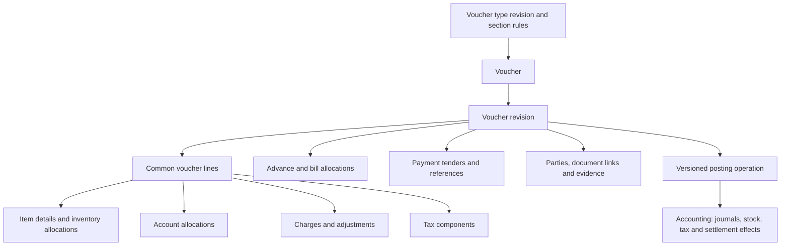

# Shared voucher data model

**Date:** 2026-10-10. **Status:** User-selected architecture; detailed schema is proposed.
**Scope:** One shared transaction-document model for all voucher kinds and company types.
No application code or migrations are implemented by this document.
**Read with:** [Vouchers plan](vouchers-plan.md), [type/custom-field extension](voucher-extensibility.md),
[India tax recording](voucher-tax-recording.md) and [Accounting contract](accounting-finance-contract.md).
**Detailed table list:** [Voucher table inventory](voucher-table-inventory.md) expands this
sketch into owner-scoped candidates, conditional details, optional operations and existing
Accounting/infrastructure reuse. Its counts describe possible scope, not a first-release minimum.
The [Tally functional review](tally-voucher-functional-review.md) records further cost-centre,
multi-party and bank-instrument design candidates outside the current inventory count.
The [invoice calculation contract](voucher-invoice-calculation.md) details Sales/Purchase
entry/effect modes and shared charge, discount, tax, valuation and settlement calculations.
The [order/fulfillment review](tally-order-fulfillment-review.md) specifies native indents,
planned schedules, bounded conversion and independent delivery/billing/closure progress.
The [implementation roadmap](voucher-implementation-plan.md#4-shared-schema-work) assigns these
structures to schema batches and requires D07 constraints/indexes before dependent migrations.
The [reviewed batch tracker](voucher-delivery-tracker.md) records their actual prerequisite
order, status and evidence; it does not create new per-kind tables or claim implemented schema.

The [financial-year contract](voucher-financial-year-design.md) requires effect-specific
company/date/period references. A March document can have April billing and May settlement;
do not force all children/effects into a header-selected year. Derive journal FY through its
authoritative period FK; any denormalized FY key must match. Preserve internal journal,
statutory document and supplier-reference identities separately in native fields/evidence.
Cross-year links use stable IDs; shared tables never become annual voucher tables.

The [account recording design](voucher-account-recording-design.md) requires exact native
source-line/component-to-journal distributions and explicit register row grains. Header,
item, tax, bill and tender rows are not interchangeable additive facts. Reuse shared effect
references; no new voucher-kind/account/year ledger table or custom-field balance authority.

The [stock capture/storage contract](voucher-stock-recording-reporting-design.md#31-what-an-execution-captures)
requires reusable inventory allocations to preserve actual/billed/measured/base quantity,
tracking/unit/source slices, mode, revision and executed effect references. Count observations
remain document evidence; only the Accounting result establishes actual stock/value changes.

## 1. Common core with reusable details

All vouchers use the same base tables. A Sales invoice, Payment, Journal, Delivery Challan,
Purchase Order and Job Work Order differ through their validated kind/profile/type revision,
required sections and workflow. Do not create separate `sales_invoice`, `purchase_invoice`,
`payment_voucher` or per-company-type document/line tables.

Use a common header, revision and line structure, with typed detail/allocation tables shared
by every kind that needs them. An unused section has no detail rows. This supports simple
vouchers without requiring empty tax, stock or payment records, and complex invoices without
packing their financial behavior into arbitrary JSON or a table with every possible column.
Company-created types reuse these structures without DDL. New implemented capabilities may
add shared structures through reviewed migrations; the physical schema is not frozen forever.

Centralized here means a common document model inside Vouchers. Accounting keeps authoritative
journals, open items, settlements, tax events and proposed stock/value effects in its own DB.
There are no cross-service SQL joins, foreign keys or shared mutable tables. A document
revision is the input/evidence for posting, never a second authority for balances.

## 2. Candidate shared tables

The [configuration storage contract](voucher-configuration-design.md#4-central-storage-and-captured-configuration-evidence)
adds shared company policy profile/revision/binding candidates and resolved-configuration
evidence. Entries retain entered/resolved defaults, owner/source versions, overrides and
accepted effect references. No live settings lookup may reinterpret an issued voucher.

Names below describe reusable responsibilities; exact columns/indexes/migrations are V0/V1
design work. They are not an instruction to create every table in V1. All transaction children
carry tenant/company/revision scope, with local composite foreign keys where applicable.
The summary below groups responsibilities; the detailed inventory also names native supporting
tables for numbering, field bindings, observations, process/transport details, scenarios,
artifacts and submission history. All remain shared across the voucher kinds that need them.

| Table | Common responsibility | Used when |
|---|---|---|
| `voucher_type`, `voucher_type_revision`, `voucher_class` | Base kind/profile, company type, versioned commercial-policy bindings, compatible class defaults and numbering rules | Every voucher pins an allowed type/policy/class revision; controls cannot widen native capability |
| `voucher_type_section` | Versioned section availability, cardinality and supported conditional rule keys | Shared form/API validation across kinds and company types |
| `voucher` | Stable identity, company/type, workflow state, current revision pointer, optimistic version and audit attribution | Every voucher |
| `voucher_revision` | Revision number/hash, dates, entry mode/profile, currency, primary party reference, terms, calculated document totals and header custom fields; native type/class/policy revision set, registry/resolver version, effective-config digest and approved override provenance | Every voucher; issued/approved content is immutable |
| `voucher_line` | Stable logical line key, revision-specific row ID, sequence, line kind, description, commercial amount where applicable and line custom fields | Any item, account, charge or adjustment line |
| `voucher_item_detail` | One-to-one ITEM detail: item/version, independently labelled planned/actual/billed quantity/units, disjoint paid/reward roles and source links, price/basis, derived discount summary, goods/service classification and inventory role | Orders, item invoices, deals/free goods, stock documents, job work and manufacturing; planned quantity is not posted stock and derived reward summaries are not extra movement |
| `voucher_account_allocation` | Account/party role, allocation purpose, amount/currency and debit/credit direction where applicable; references its common line | Account-only entries and item/charge distributions |
| `voucher_inventory_allocation` | Item-line quantities split by location, owner/custodian, lot/serial, movement leg and execute-versus-reference intent | Physical movement or an invoice referencing an existing movement |
| `voucher_charge_detail`, `voucher_charge_allocation` | Repeated canonical charge/discount/rounding components; native quantity/line/selected-line/document scope, unit denominator, dependency basis, purpose-tagged commercial/tax/cost targets and rounding evidence | Freight, packing, stacked discounts and source-linked purchase-return allocations |
| `voucher_tax_context`, `voucher_tax_component` | Native tax context and repeated supply/component inputs/analysis: registration, value/quantity basis, rate/unit/rule evidence, amounts, recoverability and override provenance; header tax entry normalizes to eligible target allocations | Taxable, exempt and other supported profiles, including purchase-return tax history; header summaries do not add tax twice |
| `voucher_bill_allocation` | Requested new open item, allocation against a prior bill/advance or permitted on-account amount, with source and authoritative result references | Invoices using advances, Receipts/Payments and other settlement workflows |
| `voucher_tender` | Individual cash/bank/UPI/card/cheque mode, amount/currency, bank/instrument/provider references and evidence state | Immediate collections/payments or explicit payment instructions |
| `voucher_party` | Typed roles such as supplier, customer, consignee, principal, worker, carrier; versioned party/address/registration evidence | Any profile requiring parties beyond the primary header role |
| `voucher_link` | Typed source/target revision/line/schedule relationships, quantity/amount claims and operation references: indent/quote/order, movement/billing, return and correction | Bounded conversion, fulfillment, manufacturing provenance and corrections |
| `voucher_fulfillment_terms` (additional shared detail) | Revision-owned requisition/order/quotation purpose, validity and required dates, destination reference and delivery/payment terms | Plain non-posting B28 capture; later schedule and conversion remain separate |
| `voucher_fulfillment_schedule` (additional candidate) | Planned line quantity/unit, due date, destination and tolerance, with stable schedule identity and revision provenance | Indents, orders and supported deferred execution; distinct from monetary payment schedules |
| `voucher_reference`, `voucher_attachment` | Typed external references and protected supporting artifacts with provenance | Customer PO, supplier invoice, challan, shipping and statutory evidence |
| `voucher_approval`, `voucher_operation`, `voucher_posting_reference` | Revision-bound approvals, idempotent commands/status and Accounting effect IDs | Guarded actions/posting across all kinds |

Existing shared outbox/inbox, idempotency, numbering, custom-field index/claim/sequence and
integration-attempt infrastructure remains reusable. These operational structures also apply
across kinds. Do not introduce a dedicated business document table just because a new type
needs a new screen, print title, statutory reference or workflow status.

The Phase 3 accounts/service invoice slice uses one `voucher_invoice_detail` for Sales,
Purchase, Credit Note and Debit Note. Its nullable `source_invoice_id` is required by the
note profiles and absent on original invoices. It identifies the original Accounting
invoice fact, so Vouchers cannot add a cross-service foreign key. Accounting retains a
same-company/tenant self-reference on `invoice_record` and validates source kind, party,
currency, supply and remaining claim before posting. A note's requested bill allocation
can target only the original invoice's native open item. These source and settlement
relationships add no per-kind document tables or independently editable balances.

### 2.1 Line identity and amount ownership

`voucher_line.line_kind` is a code-defined discriminator, initially ACCOUNT, ITEM, CHARGE
or ADJUSTMENT. A row stores the common identity; the discriminator determines allowed typed
details. For example, an ITEM line requires one item detail, may have account allocations,
and needs inventory allocations only for the supported movement/reference intent. A service
item can have quantity and price without stock movement. Pure inventory lines do not need
an invented sales amount. Tax components and tenders reference their sources; they are not
extra commercial lines to be added to the invoice a second time.

Account allocations have two distinct validated uses: explicit debit/credit input for manual
ledger entry, or revenue/expense/control distribution of a commercial line. The latter need
not be a balanced journal. Accounting derives the complete balanced posting, including party,
cash, tax and stock-value legs. Entered distributions and generated posting previews are
separately identified; an invoice amount plus its ledger distribution is one value, not two.

Each revision-specific row has its own UUID. A stable line key persists across draft revisions;
`(tenant, company, voucher_revision, line_key)` is unique. Children reference the exact parent
revision/row, and source links retain the source revision and logical line key. Two lines for
the same SKU remain distinct. No client-supplied child ID can attach a line from another voucher,
revision or company. Edits create a new immutable content revision and atomically advance the
current pointer under an expected-version check; the workflow state lives on `voucher`.

Foundation ordering: V1.2 creates minimal type/revision/section definitions before documents
reference them, and minimal typed ITEM identity/detail before V1.3 item-line customization.
V3 extends the same item detail with commercial calculation behavior. Do not postpone the
entire item-detail structure until V3 or expose an ITEM line whose required child is absent.
Unimplemented commercial/stock fields and actions remain capability-gated during foundation.

### 2.2 Native facts, evidence and metadata

Charges, tax classifications, advance allocation, payment mode/reference, job ownership and
stock movement purpose are native typed fields. Business rules never read descriptive custom
fields. Header and ITEM-line custom fields continue to use the registered entities described
in [extensibility](voucher-extensibility.md); adding custom fields to other line kinds requires
an explicit registry extension. A shared column is not permission to accept them everywhere.

Immutable calculation/master snapshots may use bounded versioned JSON for evidence, while
transaction inputs and amounts remain typed/indexable. Computed header totals are caches
bound to the revision/calculation hash, not independently editable monetary facts. Never
recompute an issued document using today's product, price, tax or field definitions.

The [posting/reporting design](voucher-posting-reporting-design.md) requires exact revision,
line/distribution and amount/quantity lineage into Accounting's journal/stock/tax/allocation
effects. Document status alone cannot determine whether money is committed. Native versioned
account classification, opening/YTD provenance and source snapshots support statements;
custom attributes cannot supply them. Reports owns reusable runs and reconstructible
projections, with no per-kind ledger tables or editable master balances.
The [stock recording/reporting design](voucher-stock-recording-reporting-design.md) further
requires canonical position, entered/base unit, lot/unit and receipt-origin lineage. Lot-date
corrections, holds and reservation histories remain owner facts; common voucher allocations
reference them so current, group-wise, expiry and residual-age reports can be reconstructed.

## 3. Sections required by type, mode and state

Expose a versioned section contract through the existing proposed type/voucher `field-set`
surfaces. Candidate section keys are ACCOUNTS, ITEMS, INVENTORY, CHARGES, TAX, BILL_ALLOCATIONS,
TENDERS, PARTIES, REFERENCES, FULFILLMENT and JOB_PROCESS. A section describes which shared structures to
use; it does not create a new table. Configuration and compiled validation share the same
code-defined capability catalogue.

Each section is FORBIDDEN, OPTIONAL or REQUIRED. Conditional requirements use supported,
typed rule keys with parameters, not arbitrary executable expressions. Examples: inventory
allocation required for a tracked item when this voucher owns dispatch; tax context required
for the selected supply profile; a bank reference required for the selected payment mode;
bill allocation required when adjusting an existing advance. REQUIRED includes explicit
minimum cardinality and stage: draft, submit, approve, issue or post. A draft can be incomplete
when the contract permits, but wrong types, cross-company references and forbidden sections
are rejected on every write.

Resolve rules in this order: implemented kind/profile capabilities -> entry mode and company
features -> company type revision (may tighten) -> transaction/state conditions -> current
actor/object/field permissions. A custom type cannot turn on an unsupported section, turn off
a statutory/stock requirement, or grant access. Hiding a section in the UI does not authorize
its payload. If a required field is denied to the actor, return an actionable permission or
workflow error; never make it optional silently. Profiles and rules are pinned on approval.
The same registry also resolves applicable company policy families and class defaults through
the common configuration contract; those layers may narrow, never widen, these requirements.

Examples of shared-table usage (conditional details remain governed by the legal profile):

| Profile/mode | Accounts | Items/inventory | Charges/tax | Advances/tenders |
|---|---|---|---|---|
| Sales/Purchase: accounts only | Required entered commercial accounts | No inventory movement; item rows not used in this mode | Supported charges; tax facts required as applicable | Optional advance adjustment and supported immediate settlement |
| Sales/Purchase: item entry | Required resolved distributions; may be derived | Item rows; stock execute/reference only where applicable | Shared charges and per-line tax analysis | Same allocation/tender structures as accounts-only mode |
| Supported mixed goods/services invoice | Entered or derived distributions by line | Goods and service item lines; only eligible goods move stock | Shared line/charge tax and total reconciliation | Partial advance, split payment and remaining credit supported |
| Journal/Contra | Required manual ledger allocations and kind-specific balancing | Forbidden for ordinary manual modes; supported transformations use their own profile | Only supported native tax/charge profiles | No fabricated invoice; settlement/instrument details only if the profile permits |
| Receipt/Payment | Cash/bank and counterpart allocations | No stock movement | Supported expense/advance/RCM/withholding profiles | Bill/advance/on-account purpose and actual tender details as applicable |
| Sales/Purchase Order or Quotation | Optional account defaults; no posting | Planned item quantities or supported account/service lines; no actual stock effect | Estimated charges/tax only | Payment terms/instructions only; actual advances use linked Receipt/Payment |
| Indent / Requisition | Optional estimated cost only; no posting | Requested item quantities and planned schedules; no execution allocations; BOM detail only with V8 support | Estimates/evidence only | No actual settlement; separate Payment/Receipt where required |
| Delivery/Receipt Note or Challan | No entered customer/supplier invoice merely for movement | Required goods/movement or source allocations | Statutory/movement-value evidence as applicable | No cash posting merely from a challan; actual collection uses a supported linked voucher |
| Rejections In/Out, Material In/Out | No assumed sale/purchase of custody stock | Required return/job material allocations | Applicable evidence; financial/tax correction or job charges linked separately | Settlement handled by linked financial documents |
| Stock Journal/Physical Stock | Derived value/variance effects as required | Transfer/consumption/output or protected count/delta detail | Supported valuation/credit-adjustment evidence | Ordinary sale/payment tenders forbidden |
| Job Work In/Out Order | Optional service pricing defaults; no posting | Planned materials/outputs; principal/worker and job references | Estimated service charges/tax | Actual movements and advance/settlement documents linked separately |
| Memorandum/scenario | Supported informational entries | Supported projected lines; no actual movement | Scenario values only | No actual settlement effect |

REJECTIONS, counts, transformation and job-work state machines remain explicit, with native
constraints and typed operations. Shared tables do not imply identical validation or that a
generic status update can perform all operations. Mixed modes ship only after their posting
and tax contracts are implemented; their representation is designed now.

The ordinary Journal inventory restriction above is our supported-profile choice, not a
universal Tally restriction. Cash/bank Journal entries require a supported profile and native
bank allocations; the kind is not intrinsically non-cash. Native cost-centre/project dimensions,
if selected, bind to account allocations and reconcile independently per category. They are
not header custom fields or additional financial amounts; see the functional-review gaps.

## 4. Complex invoice: one revision with multiple sections

An invoice can simultaneously carry account/service lines, item lines, account splits,
line/document charges and discounts, taxes, advance adjustments, split tenders and an unpaid
balance. These are independently bounded sections on the same common revision. The UI mode
changes the entry presentation and validation; it does not select an invoice-specific table.

Processing uses the versioned dependency sequence in the invoice calculation contract:
resolve line prices and inclusive/exclusive basis, declared discount/charge stages, legal
taxable bases/components and applicable rounding, then party obligation, existing credits,
recognized new settlement and remaining debt. Tax-affecting adjustments feed tax calculation;
they cannot be disguised as post-tax rounding. Every allocation retains its source, purpose
and rounding evidence. Commercial net, taxable base and landed cost are distinct amounts.
An adjustment is not an unrestricted number added to make the books balance. Recheck all
income/expense distributions, charge allocations and approved calculations before posting.

Normalize line and document discounts to shared CHARGE/ADJUSTMENT components and their
allocations. An item discount summary and a displayed discount-ledger total are derived
views of those components, not extra editable discounts. Tag allocation purpose so commercial,
tax and stock-cost distributions cannot be added together as duplicate charges. Reuse existing
price/promotion stacking, allocation and approval contracts; no second discount engine.
Stock intent explicitly distinguishes execute, existing movement reference, non-stock and
supported deferred fulfillment. Goods billed against a challan do not move a second time.

Tax entry supports source-declared values (for example, a supplier invoice) alongside the
system calculation, with typed component, taxable base, rate and amount fields. Retain both
and classify any difference. Only supported tolerance or authorized adjustment rules can
accept a difference, with reason/evidence and revalidation; entering a tax number cannot
bypass registration, eligibility or posting rules. Charges likewise have an explicit account,
calculation basis, tax treatment and allocation method. Header-level charges are shared
charge lines with allocations, not a second independently editable total.

Example with illustrative amounts, not a statutory rate rule: item/account base 1,000,
freight 100 and computed tax 198 produce gross 1,298. Applying an existing advance of 300
and a new confirmed UPI receipt of 200 leaves 798 outstanding. The advance points to an
existing Accounting credit/open item; it is not another 300 bank receipt. The UPI tender
has its own native mode, amount, bank/provider reference and evidence. Tax-on-advance
recognition/adjustment follows [the tax contract](voucher-tax-recording.md) independently
of this receivable calculation. Header gross remains 1,298 after settlement.

`voucher_bill_allocation` can apply several advances to one invoice or split an advance
across invoices. Accounting locks and checks authoritative unallocated balances by company,
party/role, currency and source. Prevent reuse, over-allocation and concurrent consumption;
Vouchers' displayed availability is a projection. Currency conversion requires a supported
FX contract and stored rate evidence; do not net different currencies as if they matched.

Reference mode and business purpose are independent native inputs. New-reference, against-
reference and on-account modes do not alone determine advance/refund/deposit tax treatment.
Bind each bill allocation to its account/party distribution, exact source/target open items,
amount/currency and business date. An invoice can apply existing advances while creating
new outstanding references for its remaining amount or installments. Preserve an internal
source ID for on-account credit even where no customer-facing bill reference is supplied.

Later assignment/reallocation uses dated operation evidence and Accounting allocation/reversal
IDs without editing the issued money document or posting cash again. A pure allocation has
no invented tender; any FX or account reclassification is a separately identified financial
effect. Ordinary allocation remains within Accounting's supported company/party/role/account/
currency scope. Multiple pairs cannot be advertised as atomic just by looping existing APIs.

Refunds and return-credit reinstatements link the source and allocation history and share
authoritative remaining-value guards with invoice application. Keep financial allocation
amounts distinct from taxable-base/component adjustments. Automatic matching preserves its
policy and candidate evidence; due-date bill selection differs from tax-aware advance FIFO.
Settlement discounts/withholding/write-offs need native lines and approved mappings so the
party amount reconciles with money actually received/paid. See the
[settlement review](tally-settlement-functional-review.md) for examples and acceptance cases.

`voucher_tender` supports multiple modes/references on one voucher. Store instrument date,
company bank/account reference and safe provider identifiers where applicable. Mode-specific
reference formats and duplicate scope are explicit: a UTR/cheque number is neither a globally
unique idempotency key nor proof of final settlement. Payment instructions and pending/unknown
attempts do not reduce actual outstanding amounts. Instrument clearance and bank reconciliation
may follow initial recording under the approved mode policy; a cheque is not automatically
equivalent to cleared bank cash. No raw card credentials are stored.

Credit terms are not a payment instrument. Under an approved card/cheque recognition profile,
party settlement may post through a clearing account before bank clearance; later provider
fees and bank settlement clear that account rather than reduce customer payment again.
Cash tendered, applied cash, change returned and a retained overpayment are separate facts.

Bank detail belongs to the relevant tender and account/party distribution, not only the
voucher header. A tender serving several distributions needs an explicit amount mapping;
do not infer the payee from a single primary-party field. Keep posting, instrument processing
and reconciliation states separate, with history outside immutable revision content. A
multi-party payment requires an Accounting command/source-evidence contract beyond assuming
that the current single-party source-document adapter can accept it. Cheque ranges, cash
denominations and opening/partial bank reconciliation are additional scope/normalization
candidates in the [functional review](tally-voucher-functional-review.md#4-gaps-and-refinements-for-our-common-model).

Choose exactly one cash-effect owner for a combined invoice and payment: the invoice's
atomic Accounting posting, or a linked Receipt/Payment voucher. Link the result and allocation
in both cases. An embedded tender and a later Receipt cannot both post the same collection.
A payment instruction on an order is not a confirmed tender; the actual advance needs its
own authorized Receipt/Payment. Likewise, item rows do not mandate stock movement: a linked
challan owns physical dispatch once, while the invoice owns billing and valuation reconciliation.

## 5. Atomicity, APIs and existing Accounting reuse

Create/edit commands validate and commit the header revision, all submitted child sections,
custom-field claims/indexes, links and outbox in one Vouchers transaction. A failure leaves
no orphan charge/tax/tender rows. PATCH has explicit replace/remove semantics and version
checks; disabling a populated section requires a reviewed draft change, not hidden data loss.
Issued content is immutable; settlement/fulfillment updates append linked operations/results
and projections instead of editing the issued revision. Later tender/charge changes use an
authorized linked voucher/correction rather than modifying a posted invoice.

Keep one `/vouchers` create/read/edit family with a typed common envelope and reusable typed
sections. The kind/profile/entry-mode discriminator selects the permitted combination; avoid
an unvalidated dictionary of arbitrary sections. `/field-set` explains section availability,
conditional requiredness and field access to both web/mobile clients. Server-side validation
applies on create, edit, import, conversion, preview, approve and posting regardless of UI.
Conversion explicitly maps source lines/sections to a new revision and revalidates the target.

Vouchers submits a bounded signed revision/operation to Accounting. Accounting independently
checks source identity, permissions, dates, calculations and current stock/open-item guards,
then commits applicable financial, stock, tax and settlement effects in its own transaction.
No workflow marks success before that result. Count/order/fulfillment guards owned in Vouchers
require the existing reliable command/result contract; two databases are not one transaction.

Reuse existing Accounting `journal`, `journal_line`, `source_document`, `journal_tax`,
`open_item` and `allocation` concepts. They already represent multiple financial kinds.
This is a compatibility mapping, not a claim that current endpoints can accept the richer
invoice immediately. Existing source documents have a single primary party/account shape;
their adapters need reviewed extensions for multiple commercial lines, mixed modes and
combined settlement. Existing journal/tax limits and tax-direction constraints must be
reconciled with aggregate voucher bounds; never truncate or silently split a promised atomic
voucher to fit today's API. Inventory/value and wider statutory workflows remain future work.

## 6. Delivery and verification

Fulfillment schedules and relationship purposes are native, shared capability data. Conversion
claims bind to approved source quantities and operation outcomes. Planned quantities are not
physical allocations; movement and billing completion remain independent. The additional
schedule candidate is outside the earlier 51-table baseline until V0 normalization. See the
[order review](tally-order-fulfillment-review.md#6-shared-storage-and-api-refinements) for the
common structures and concurrency contract; no per-kind document family is introduced.

| Gate | Work and acceptance |
|---|---|
| V0 | Finalize common core/detail schema, section matrix, amount/effect ownership and Accounting adapter limits; no per-kind document/line tables |
| V1 | Implement common identity/revisions/lines, typed section metadata and header/item customization; test company/revision isolation, forbidden sections, safe draft edits and immutable approvals |
| V2 | Shared account allocations, bill/advance allocations and tender/reference handling; authoritative race/replay and pending-payment checks |
| V3 | Accounts-only and supported mixed/item invoice preparation, charges/taxes and combined settlement; reproduce calculations and prove no duplicate advance/cash effects |
| V4 | Shared item/inventory allocations and source links for invoice, challan, receipt, transfer, return and count; prove each physical/value effect occurs once |
| V5/V8 | Orders and job work reuse the core; supported process/BOM/custody detail is shared by capability; no new per-type table families |

Release checks include no-inventory invoices, goods invoices, mixed goods/services, taxable
charges/discount apportionment, tax entered with and without authorized overrides, advance
partial/concurrent use, split tenders and remaining debt, references with mode-specific rules,
challan-linked invoicing, invalid section injection, generated-versus-entered double counting,
cross-revision child substitution, rollback and idempotent recovery. Unknown kinds/profiles
and unsupported combinations fail closed. V0 also bounds total lines, allocations, tax
components, tenders and payload size to prevent multiplicative unbounded input.

## Decision log

- 2026-10-10: Added native position/origin/date/hold references needed for stock registers.
  Common document allocations feed one Accounting effect authority; no item-specific or
  voucher-kind stock tables and no custom-field balances are introduced.

- 2026-10-10: Linked financial-reporting source requirements: line-level effect lineage,
  native classification/opening coverage and reproducible projections alongside common
  entry sections. No per-voucher reporting tables or second balance authority were added.

- 2026-10-10: Batch-readiness review clarified minimal type/section and ITEM detail ordering
  before document/custom-field use. Added the batch tracker as the execution/evidence record;
  later commercial/stock behavior extends shared structures without a second line model.
- 2026-10-10: Linked the consolidated implementation roadmap for schema dependency groups,
  typed API/command contracts, phase packages and acceptance evidence. Detailed normalization
  remains a pre-migration gate; common tables and Accounting effect ownership are preserved.
- 2026-10-10: Indent/order/challan review added a non-posting requisition section profile,
  shared fulfillment-schedule candidate and source-slice claim requirements. Kept approval,
  commitment, actual movement and billing separate, using common revisions/links/operations.
- 2026-10-10: Sales/Purchase refinement added one canonical discount/component representation,
  purpose-tagged commercial/tax/cost allocations, explicit invoice movement intent and clearing/
  split-settlement facts. Detailed calculation/profile rules live in the invoice contract.
- 2026-10-10: Payment/Receipt/advance research refined bill-allocation purpose/reference
  separation, late allocation operations, refunds/return credits, settlement differences and
  separate tax adjustment history. Shared sections and Accounting effect ownership persist.
- 2026-10-10: Tally functional research identified native dimension allocations, tender-to-party
  distribution and independent bank-instrument/reconciliation state requirements. Recorded
  these as shared capability design gates, keeping ordinary Journal inventory restrictions
  explicit as a platform choice. No per-kind tables or runtime capability were introduced.
- 2026-10-10: User requested a complete possible table list. Added the separate owner-scoped
  inventory, including counts/scenarios/process evidence and operational support. Candidate
  names are not implemented schema or an instruction to build every optional feature.
- 2026-10-10: User required centralized base tables across voucher types, including complex
  account-only/item invoices with charges, entered taxes, advances and payment modes/references.
  Selected one shared header/revision/line model with reusable typed detail tables and a
  required/optional/forbidden section contract. Preserved Accounting effect authority and
  explicit no-double-stock/cash/advance rules. Schema/API implementation remains future work.

### Financial-year planning decision - 2026-10-10

Added native fiscal/date/numbering reference requirements under D05/D07/D12.
No per-year tables, annual document copies or custom-field posting authority.

### Account-recording review - 2026-10-10

Added native journal/source distribution and register-grain obligations under D07/D11.
The common voucher entry model remains shared across kinds and years.

### Stock capture/storage review - 2026-10-10

Added exact inventory source/allocation capture obligations without per-kind entry tables.
Stock value/cost/unit state remains with the accepted Accounting owner, not Vouchers details.

### Purchase component review - 2026-10-10

Refined shared native component scopes, dependency/basis evidence, header-tax allocation
and source-linked purchase returns under the [invoice calculation contract](voucher-invoice-calculation.md).
The 51 numbered Vouchers candidates remain unchanged; D07 reviews necessary shared relations,
and Accounting retains authoritative financial/tax/stock effects. CAL01-CAL16 remain planned.

### Sales commercial-configuration review - 2026-10-10

The [commercial configuration contract](voucher-commercial-configuration.md) now requires native company Sales/Purchase
policy revisions, restrictive type/class bindings and disjoint paid/reward source evidence.
D07 finalizes shared policy/benefit relations; no per-type table or custom-field posting logic.
CAL17-CAL28 remain future implementation checks.

### All-voucher configuration review - 2026-10-10

Added shared policy storage and revision-bound effective settings to common capture/validation.
The 22-kind configuration matrix and VCF checks require native facts and shared detail tables;
posted balances stay with Accounting and cannot be rewritten through configuration.

### Phase 5 planned-quantity capture - 2026-10-11

The B28 preparatory slice adds nullable planned units to the shared ITEM detail,
separate from physical actual and billed units, and a revision-owned common
fulfillment-terms relation. Neither input grants stock or financial execution.
Schedule claims, conversion and acceptance still need their B29/B30 contracts.
