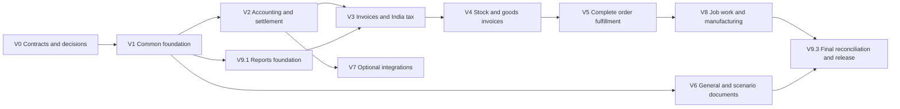

# Vouchers implementation plan

**Date:** 2026-10-10. **Status:** Phase 1 (B01-B08) and B09 export/Reports foundation verified;
release activation pending. [B09 evidence and limits](voucher-b09-execution.md) supplement
the Phase 1 execution record. Phase 2 B10-B14 money execution and statement calculations
are verified; [Phase 2 evidence](voucher-phase2-execution.md) records selected
contracts, review fixes and rollout limits. The tracker remains the status authority.
[The execution record](voucher-phase1-execution.md) separates implemented foundation code
from open batch exits. B01-B14 are complete for their recorded scope; B15 is next.
This roadmap does not imply completion of later phases or release activation.
**Entry point:** [Vouchers architecture and scope](vouchers-plan.md). That document governs
the catalogue and ownership; this document governs work packages, dependencies and release evidence.
The existing stack, service boundaries and local folder layout remain unchanged.
**Reviewed execution order:** [Batch tracker and review record](voucher-delivery-tracker.md)
maps the 38 work packages to 45 ordered batches, prerequisites, decision records and release
checkpoints. Package numbers identify scope; the tracker orders execution.
The [saved batch note](voucher-batch-note.md) provides the readable phase-by-phase scope;
the [live implementation todo](voucher-implementation-todo.md) tracks completion alongside
the tracker. Maintain these records together as implementation progresses.
The [posting and financial reporting design](voucher-posting-reporting-design.md) defines
required account ledgers, trial balance, Profit & Loss / Income & Expense, Balance Sheet,
tax/stock/party registers, report snapshots and reconciliation acceptance checks.
The [stock recording/reporting design](voucher-stock-recording-reporting-design.md) specifies
current/eligible/available stock, item/group/location ledgers, lots/expiry/age, valuation,
receipt-origin/hold histories and INV01-INV24 checks. These are required inventory deliverables.

The [company financial-year design](voucher-financial-year-design.md) adds required next-year
readiness, date/numbering/close contracts under D12 and FY01-FY24 checks. Annual profit-transfer
automation remains deferred; ordinary balance continuity is required before activation.

The [account recording/maintenance design](voucher-account-recording-design.md) specifies
native entry lineage, ledger/register row grains, daily/period balance summaries, atomic
projection updates and verified rebuilds. BAL01-BAL20 extend existing D11/AC26 and batches;
account balances remain derived from Accounting facts, never independently editable masters.

The [stock capture/storage contract](voucher-stock-recording-reporting-design.md#31-what-an-execution-captures)
now specifies execution evidence, native quantity/value/position grains, synchronous owner
balances, transfer/return claims, guarded repair and staged imports. STK01-STK20 extend the
existing INV/FY/BAL checks and stock batches; Catalog definitions are not stock execution.

## 1. Required outcome and scope

Build one Vouchers service for transaction documents and their workflows, replacing the
previously planned Billing and Payments services. Reuse Accounting's financial authority;
the proposed stock/value extension makes Accounting the atomic owner of actual effects.
Do not create another ledger or stock authority inside Vouchers.

Required scope is the 22 non-payroll base kinds in the architecture plan, delivered as an
18-kind core followed by four job-work kinds. Include explicit Requisition, Quotation and
Delivery Challan profiles, accounts-only/item/mixed invoices, advance and bill adjustment,
split tenders, charges/discounts/taxes, principal/worker job work, future company-created
types and typed header/item-line custom attributes. Payroll and related HR remain excluded.

Planning contracts already established:

| Requirement | Governing detail |
|---|---|
| Common header/revision/line and reusable typed sections; no per-kind table families | [Shared data model](voucher-data-model.md) |
| Candidate tables, owners and reuse; count is not a minimum release schema | [Table inventory](voucher-table-inventory.md) |
| Code-defined kinds/profiles, runtime company types, existing 12 custom-field data types | [Extensibility](voucher-extensibility.md) |
| Journal, stock transformation, banking and native-dimension gaps | [Journal/stock/banking review](tally-voucher-functional-review.md) |
| Payment/Receipt, reference modes, advances, refunds and dated allocations | [Settlement review](tally-settlement-functional-review.md) |
| Accounts/item entry, commercial/tax/cost allocation and settlement calculation | [Invoice calculation contract](voucher-invoice-calculation.md) |
| Indents, quotations, schedules, order conversion and goods/billing tracking | [Order and fulfillment review](tally-order-fulfillment-review.md) |
| India GST first, separate statutory dates, ITC/RCM, challans and state-VAT extension | [Tax recording plan](voucher-tax-recording.md) |
| Named financial statements, balances, opening/earnings bridges, report feeds and frozen outputs | [Posting and reporting design](voucher-posting-reporting-design.md) |
| Canonical stock positions, current balances, product/group/location/expiry/age registers and costing lineage | [Stock recording/reporting design](voucher-stock-recording-reporting-design.md) |

Each supported profile is an explicit capability with prerequisites. Required planned scope
is not permission to enable an unfinished profile. Optional provider execution, bank-statement
automation, advanced cheque controls, recurring scheduling, supplier RFQ/bid comparison and
additional VAT jurisdictions do not silently become core requirements through a table name.

## 2. Repository baseline and changes by owner

The current Windows service registry contains Identity, Audit, Catalog, Notification and
Accounting. Vouchers and Reports need their own service scaffolds and deployment wiring.
The following inspected contracts establish implementation dependencies, not runtime test results:

| Existing surface | Reuse | Required extension or check |
|---|---|---|
| [Accounting source/allocation schemas](../apis/accounting/src/accounting/schemas/subledger.py) | Journals, party documents, open items, dated allocation and reversal | `SourceCreate` has one account/counterpart/amount shape. Define a richer versioned command for compound lines, distributions, multi-bill settlement and combined effects. A loop over existing calls is not an atomic voucher. |
| [Accounting tax schemas](../apis/accounting/src/accounting/schemas/voucher_tax.py) | Decimal validation, tax analysis, GST/withholding evidence | `SourceTax` is an aggregate block; its kind restrictions do not cover all planned receipts/notes. Add line/component and event-date contracts without reinterpreting old data. |
| [Identity customization](../apis/identity/src/identity/api/customization.py) | Definitions, field policies, layout and generated native-field registries | Register voucher header/item entities and explicit service routing; do not assume the current Accounting/Catalog branches accept them. |
| [Identity posting bridge](../apis/identity/src/identity/api/posting.py) | Existing first-use/configuration reservation protocol | Preserve existing `billing`/`accounting` wire identities. Accounting remains posting caller; add only the Vouchers read/actor capabilities actually needed. |
| [Identity gateway authorization](../apis/identity/src/identity/api/login.py) | Authenticated signed actor/company context | Explicit Vouchers route/context and worker authority; no reuse of an Accounting route grants permission automatically. |
| [Windows service registry](../start/win/conf/services.json), [nginx config](../start/win/conf/bill.conf) | Local service lifecycle and gateway pattern | Register service, DB, migrations, port, env, readiness, HTTP route and separately supervised workers. Update start/stop/status/setup consistently. |
| [Client package](../clients/api-client/package.json), [generation script](../clients/api-client/scripts/generate.mjs) | Generated TypeScript client pattern | Add Vouchers and affected service contracts; establish clean baseline for existing Identity/Audit exports and Notification contract generation. |

Implementation locations follow existing conventions:

- `apis/vouchers/src/vouchers/{api,domain,models,schemas,events,tasks}/`, with tests,
  generated contracts, export tools and README in `apis/vouchers/`.
- `dbs/vouchers/` has its own Alembic environment and revision chain. Accounting/Identity/
  Catalog migrations remain in their own `dbs/<service>/` trees.
- `libs/platform/` supplies auth, idempotency, Decimal, pagination, custom-field, outbox/inbox
  and reference-data mechanisms; voucher business rules stay in the owning service.
- `clients/api-client/`, `start/win/` and the existing client application structure gain
  explicit integration. Shared form components remain in `mfes/packages/ui/`.
- Reports read models and tax exports belong in the planned Reports service; its minimum
  scaffold/contracts start early enough for the first statutory export that depends on them.

Do not bulk-rename `billing_platform`, package names, event routes or existing grants. Record
each legacy mapping, consumer, supported version and retirement condition in the V0 contract.

The [all-voucher configuration contract](voucher-configuration-design.md) governs settings, capture and effects for
all 22 kinds and required profiles. Its shared native registry/policy storage and VCF01-VCF24
are required within existing work packages. Each applicable profile proves configuration
enforcement before activation; commercial CAL checks remain a detailed subset of this framework.

## 3. Decisions and contracts before dependent implementation

Existing open policy questions are retained as gates, not silently answered here. V0 produces
the concrete contracts below. A later-phase policy does not block unrelated foundation work;
it must be resolved before its schema/posting behavior is implemented or activated.

| Gate | Required decision/output | Owner | Needed before |
|---|---|---|---|
| D01 | Confirm Accounting atomic stock/value boundary; source/effect identity, result receipt, cancellation fencing and durable recovery contract; commercial policy publication/stop and posting readiness fences; authoritative reward consumption; all-kind effective-configuration digest and owner readiness/commit verification | Architecture + Accounting/Vouchers | V1 posting protocol; stock DDL |
| D02 | Costing method/scope, receipt-origin versus cost allocation, goods-received-not-billed/delivered-not-invoiced recognition, landed-cost mappings and WIP valuation; immutable value legs, provisional/final/zero-cost evidence and conditional pool history/residual rules; purchase component capitalization and source-return credit/carrying-value variance mappings | Accounting with business policy | V4 costing and V8 manufacturing |
| D03 | Stock eligibility/hold/expiry-day/minimum-life rules, negative-stock baseline, backdating/recomputation, locks/count cutoff and transfer/transit ownership; common scope lock order, absent-position guards, source claims and fenced operational repair | Accounting + Catalog with business policy | V4; reservation extensions V5 |
| D04 | Currency/FX and multi-party support matrix; aggregate posting receipt versus legacy single-party source mapping; multi-allocation atomicity; source component return entitlements and atomic cumulative financial/tax claims; paid/reward/benefit source identity and invoice versus order-scoped award contract | Accounting | V2/V3 affected profiles |
| D05 | Native tax-event dates, registration scope, account mappings, statutory numbering and legacy tax-snapshot migration; multi-component value/quantity bases, header-tax allocation and supplier return-note adjustment evidence; configured number methods/overrides preserve allocator identity and no historical renumbering | Accounting + Identity/Catalog | V1 numbering foundation; V2 taxable advances and V3 tax release |
| D06 | Maker/checker policy, amount/tolerance limits, dimension scope, bank-instrument recognition and location authority; independent Sales/Purchase policy, type/class restrictions, free/manual/scheme controls and stack/override authority; all-kind native setting applicability, merge semantics, stage requiredness and after-use adoption; VCF01-VCF24 | Business policy + Vouchers/Identity/Accounting | V1 foundation and each dependent V2-V8 profile before activation |
| D07 | Final reusable table/column/constraint inventory, aggregate payload/line/section bounds, indexes and migration batches; native movement/position/unit/origin/value cardinalities and staged-import identity; bounded native component dependency/basis membership, scope/unit denominators and source-return allocations; native commercial-policy revision/binding and disjoint paid/reward membership manifest; shared voucher_configuration_profile/revision/binding candidates and typed effective-settings snapshots | Owning service maintainers | Each phase's first migration |
| D08 | BOM/process depth, multi-output costing, substitutions, loss/scrap tolerances, genealogy and job-work statutory profiles; principal/worker role and separate/combined consumption profile readiness and once-only source claims | Catalog + Accounting/Vouchers | V8 |
| D09 | Enabled India GST profile matrix and required evidence/exports; selected VAT states/commodities separately | Tax profile owner + Accounting/Reports | Relevant tax capability activation |
| D10 | Gateway/bank providers, reconciliation formats, cheque/cash controls and recurring scheduling selected for release | Product + integration owner | Optional V7/extension work only |
| D11 | Native statement classification, opening/YTD history coverage, unclosed-earnings bridge, snapshot/catch-up contract, report permissions and reconciliation; extend with stock/tax/WIP; account fact/summary grains, register aggregation, generation/cutover and additive balance-read semantics; stock quantity/value fact grains, day/period summaries and report versus owner rebuild separation; captured type/class/configuration lineage in registers and frozen report facts | Accounting + Reports with business policy | Initial B02/B03 contracts; B09/B14 implementation, then each dependent reporting slice |
| D12 | Company-year readiness, effect-specific dates, internal/statutory numbering years, producer close fences, authorized reopen invalidation and cross-year continuity; credit-terms effective date distinct from GL/stock/statutory dates | Accounting + Vouchers/Reports with affected source owners | Initial B02/B03 contracts; B07/B08/B10 fiscal integration, then each dependent profile |

The implementation plan recommends a bounded first deployment of each profile, with unsupported
cases rejected explicitly. It does not choose a costing method, tax jurisdiction, approval
threshold or provider on the user's behalf. Publish resolved choices in the relevant contract
and decision log; a checkbox is insufficient evidence.

V0 must deliver five reviewable artifacts, which can be sections of the existing design docs:

1. Profile capability/section matrix by action and lifecycle stage, including activation gates.
2. Owner-scoped schema and numbered migration manifest with constraints, indexes and backfills.
3. Vouchers-to-Accounting command/result schemas, fixtures, source uniqueness and failure matrix.
4. Identity/Catalog/Accounting snapshot/event and compatibility matrix, including freshness fences.
5. Scenario-to-test/release matrix, seeded company/account/item fixtures and supported limits.

These artifacts include D11 reporting contracts: owner exports must cover opening/settlement
and classification facts as well as journals. The existing financial event v1 is insufficient
by itself. Record additive version rollout, a committed snapshot barrier and exact history
coverage; report requirements cannot be postponed until source schemas have been frozen.

## 4. Shared schema work

The [table inventory](voucher-table-inventory.md) remains the detailed candidate list. Implement
it by dependency and capability, not as one migration creating all 51 baseline candidates.
Additional schedule, dimension and bank candidates are explicitly outside that baseline until
D07 normalization. No release claims an exact final table count before that review.
The reporting design adds candidate native statement metadata and reusable report definition,
run, artifact, checkpoint, reconciliation and projection structures outside that baseline.
Generalize tax run infrastructure where appropriate; do not create a table per statement.
The stock design adds lot correction, hold/event, receipt-origin/allocation and selected
reservation-history candidates outside baseline counts. Reuse common structures where
possible, but preserve their native dated semantics. Product and group masters hold no stock.

| Dependency group | Structures and work | First dependent phase |
|---|---|---|
| Foundation/configuration | Type/revision/class, section rules, field bindings, issue-time series/counters/assignments, local master projections and reuse of customization infrastructure | V1 |
| Common documents | Minimal type/revision/section definitions before document FKs; `voucher`, `voucher_revision`, `voucher_line`, minimal ITEM identity/detail, party/reference/link/attachment, approval/operation/transition/posting-reference | V1; richer link purposes V4/V5 |
| Ledger and settlement | Account allocation, bill allocation, tender, monetary payment schedule; native tender-to-distribution and instrument history design | V2 |
| Commercial calculation | Extend the V1 item identity/detail with commercial quantities/basis; canonical charge/discount detail and purpose-tagged allocation, native tax context/components/withholding | V3 |
| Physical execution | Inventory allocation, observations/counts and transport evidence in Vouchers; authoritative stock/value/lot/unit/count/period structures in Accounting | V4 |
| Planned fulfillment | Shared `voucher_fulfillment_schedule`; bounded source-slice claims and close/reopen operations on common links/operations | V5 |
| Scenarios and artifacts | Scenario/membership, template/revision/artifact; create required statutory document and export evidence earlier when V3/V4 depends on it | V3/V4 prerequisites; V6 general scope |
| Optional integrations | Payment intent/attempt, reconciliation batch/line/match, imports and schedules only for selected capabilities | V7/selected extension |
| Job/process | Shared process detail plus existing material lines, custody, genealogy, cost allocation and challan links; no second job-work stock balance | V8 |
| Statutory and Reports | Accounting tax events/components/credit/settlement, Reports return/reconciliation runs and lines; Vouchers submission/acknowledgment evidence | Incrementally with T1-T4, finalized V9 |

Additional normalization must cover `voucher_tender_allocation` where a tender serves several
ledger/bill distributions, a shared instrument lifecycle independent of immutable voucher
content, and native dimension allocation if selected by D06. These are capability details,
not Payment/Receipt-specific document families. Define dimension master ownership in Accounting;
reuse Identity's company bank masters rather than creating duplicate editable bank records.

Minimum constraints for every implemented group:

- UUIDv7 identity; tenant/company scope on transactional children; local composite ownership
  checks bind children to the exact parent revision/line. No cross-service foreign keys.
- Common line discriminator selects allowed typed child rows. Wrong/forbidden sections fail
  even on draft writes. Requiredness can increase at submit/approve/issue/post.
- Immutable issued/approved content; stable logical line/schedule keys across revisions;
  expected-version checks for changing draft/head pointers. An old approval never covers new content.
- Native Decimal amounts and quantities use the repository's four-place storage convention;
  currency/unit, business dates and rule versions accompany them. Preserve Accounting's
  separate FX-rate precision contract; do not force rates into the amount scale. No float input.
- Posted source/effect uniqueness is independent of HTTP idempotency and broker deduplication.
  Number assignments and revision hashes cannot be reused for different content.
- Child lookup, register and source-balance indexes include company and supported query keys.
  Bound fan-out across lines, allocations, taxes, tenders and links, not just header count.
- Each DDL statement gets its own Alembic revision, with matching model/schema/factory and
  downgrade or explicit irreversible-data explanation. Seed kinds/templates through seeds.

## 5. Workflow, calculation and posting contracts

### 5.1 Separate state dimensions

Use one document lifecycle plus explicit operation histories and derived progress. Do not add
one boolean for every action or equate a document's approval with a financial/physical effect.

| Concern | Contract |
|---|---|
| Content/approval | Draft -> submitted -> approved/rejected; edits create a new revision and invalidate prior approval. Policy may permit direct issue/post but still records authority. |
| Issue | Assign the permitted document series and freeze content. Issuing/printing an order or challan creates no stock or cash effect. |
| Posting operation | Queued/processing -> committed or definitive rejection/cancellation; unknown outcome remains pending/recoverable. Expose `202` and operation ID. |
| Fulfillment | Planned, claimed, executed, acknowledged, returned and short-closed quantities are separate source-linked facts. Billing progress is independent. |
| Settlement | Accounting open-item balances and allocations determine unpaid amounts; an order's payment terms or a pending tender do not settle it. |
| Instrument/provider | Booking, bank clearance, provider execution and reconciliation have distinct dated states. A card/cheque may use approved clearing accounts. |
| Statutory | Prepared/submitted/acknowledged/rejected/cancelled/filed evidence belongs to its external document/submission; GL success does not imply statutory acceptance. |

Cancellation before an effect is permitted by profile; an effect already committed requires
a linked financial/stock/tax correction with period guards. Scenario reversal never changes
actual books. Closing an order cannot erase a movement, bill, advance or job-work aging.

### 5.2 Common request and preview

Define a typed create/edit envelope with type revision, profile/mode, dates, currency,
primary party where applicable, common lines and reusable sections. Native account/item,
inventory intent, charge/tax, bill allocation, tender, party/reference, fulfillment and
job-process facts use explicit schemas. Bounded snapshots may use versioned JSON as evidence;
arbitrary JSON and custom attributes cannot determine effects.

Preview returns the revision/calculation hash, pinned rule/master versions, per-line commercial
amounts, tax bases/components, landed-cost allocation, balance/stock estimates, proposed bill
matches and validation blockers. Mask inaccessible cost/account fields. Preview does not
reserve stock/credit, consume an advance, allocate a final number or execute a provider call.

The canonical calculation sequence is price basis -> declared discount/charge stages ->
statutory bases/components -> applicable rounding -> party obligation -> existing credits ->
recognized new settlement -> remainder. Use the detailed invoice contract for inclusive prices,
mixed rates, third-party freight, actual/billed quantities and declared/computed tax differences.
The same source discount has one component authority; commercial, tax and cost allocations
are separate purposes, not three added charges. Reuse Catalog policies and Accounting tax
authority rather than create a conflicting invoice/promotion calculator in Vouchers.

### 5.3 Versioned command and result

The command contract must carry protocol version, tenant/company, stable voucher identity,
exact revision/hash, type/profile versions, server-issued operation/execution identity,
purpose, dates, currency, bounded normalized sections, source claims, rule/master versions,
actor/approval evidence and expiring signed authority. Monetary/quantity wire values are
exact decimal strings. Secrets and raw payment credentials are never embedded.

Accounting's result receipt identifies the source operation/hash and committed/rejected outcome,
final number where applicable, posting/business dates, journal/stock/tax/open-item/allocation
IDs, resulting version references and safe error details. One richer voucher may produce
many party/open-item effects without manufacturing multiple independent journals merely to
fit the legacy single-party `source_document`. D04 defines the additive receipt/source mapping.

One Vouchers transaction records approved content, guarded source claims, operation and outbox.
Accounting obtains required live authority outside its posting transaction, then validates
the signed scope/freshness, current fiscal/master guards and exact command content inside
the transaction. Its atomic commit includes all applicable financial, stock, tax, allocation,
numbering, source-receipt and outbox facts. Vouchers projects the result idempotently.

A stock/custody-only result may have no financial journal. Keep its authoritative source
receipt, stock-period guard and first-use/configuration freeze even when the GL effect is
empty; do not invent a zero-value journal or depend on journal existence for these controls.
D01/D03 define the relevant first-use and period fences. Non-posting issue/conversion does
not call Accounting with a fake empty posting merely to obtain a completed status.

Identity and Catalog authorization/configuration/reservation changes require their existing
version/fencing mechanisms; an earlier preview is not current authority. The D01 contract
must specify lock order and races among posting, fiscal close, configuration freeze, source
cancellation, stock consumption and advance allocation. Broker messages cannot hold DB locks
across services; claims are durable evidence with explicit definitive release conditions.

| Failure/race | Required behavior |
|---|---|
| Same command delivered twice, including with a new HTTP key | Return the existing source effect; no duplicate journal, number, stock, tax or cash. |
| Same business operation, different revision/hash | Conflict; never mutate the previously accepted effect. A revision ID alone cannot authorize a second primary posting. |
| Several legitimate partial executions | Each gets a server-controlled execution ID and bounded source-slice claims; retries retain that ID. |
| Accounting commits, acknowledgment is lost | Keep Vouchers pending and recover by durable source/operation identity; never create a fresh posting identity. |
| Authority expires or a master/period changes | Revalidate under current authority; stale approved calculations cannot silently become different amounts. |
| Cancel arrives before a delayed post | Accounting source guard stores the winning terminal outcome; a delayed command cannot post after a definitive cancellation. |
| Cancellation arrives after commit | Return committed references and require a supported reversal/return/credit operation. |
| One requested bill allocation or stock slice fails | Reject the promised atomic bundle; no successful prefix of independent mutations. |
| Worker crashes with pending fulfillment claims | Recover/reconcile; timeout alone cannot release a claim whose effect is unknown. |

Non-posting approval/issue/conversion remains a Vouchers workflow. Its claims never masquerade
as physical stock reservations. Actual stock and credit reservations are explicit commands
to their owners and must be consumed/released under the same race policy as posting.

### 5.4 API and permissions

Use the common company-scoped route prefix in the architecture plan. The following are
planned surfaces, not currently implemented endpoints:

| Surface | Required contract |
|---|---|
| `/voucher-kinds`, `/voucher-types`, type revisions/classes/bindings/field-set | Implemented and disabled capabilities with reasons; create derived company types without DDL; immutable configuration versions |
| `/vouchers`, detail, revisions/history and header/item field-set | Typed aggregate create/edit, expected-version checks, signed keyset lists and conservative read-deny handling |
| Voucher validate/preview/submit/approve/reject/issue | Stage-aware validation, revision-bound authority and deterministic calculation evidence |
| Voucher post/cancel/reverse and `/voucher-operations/{id}` | Durable asynchronous result; recovery view cannot expose another company's operation |
| Voucher conversion preview/convert, fulfillment schedules/claims/short-close/reopen | Bounded source slices, compatible consolidation, exact revision references and reasoned history |
| Voucher links/posting/documents and artifact generation | Trace original effects and generate protected reproducible output without posting again |
| Settlement preview/apply/reverse operations | Reuse Accounting allocation authority; no fake cash voucher for a pure bill adjustment |
| Count, transfer and process actions | Typed operation-specific inputs/cutoff/owner/location guards; generic status PATCH cannot execute them |
| Selected integration/reconciliation surfaces | Provider/statement evidence, review boundaries and action-specific permissions |

Mutations use idempotency keys and applicable expected-version checks, including approvals,
conversion and settlement. Use the shared typed error envelope; distinguish validation and
version/source conflicts from a still-pending asynchronous outcome. Reject unknown sections
and unsupported profile combinations before emitting a command. Replays recheck read/action
authority before returning any saved result.

Define permission families for read/create/edit/submit/approve/issue/post/cancel/reverse,
convert/fulfill/close/reopen, type/class administration, statutory evidence and recovery.
Synchronization includes code catalogue, system roles, feature metadata, generated field
contracts and tests. Check tenant/company, actor, voucher/type, source party/location and
changed-field scope; a cloned type grants no extra permission. Audit emits safe references
from the transaction. Downloads remain signed and expiring; histories/exports honor live denies.

## 6. Delivery order and release boundaries

Phase labels retain V0-V9 so existing documents and tax gates keep their meaning. They are
dependency labels, not an instruction to delay all reporting until the last phase.

Basic V5 document/schedule work may start after V1; priced conversion depends on V3 and full
movement fulfillment on V4. V6 scaffolding can start after V1, while conversions into actual
transactions wait for their target phase. V9.2 read models/exports are delivered alongside
each enabled transaction phase. V7 is optional and is not a prerequisite for V8 or core release.

Use the [batch prerequisites](voucher-delivery-tracker.md#3-ordered-batch-register) within
this graph. In particular, V2 allocation/instrument support precedes complete Payment/Receipt;
V4 period guards and valuation precede executable movements. V4.3/V4.5 have early and late
slices, and V9.2 has incremental reporting slices. A smaller batch may be technically verified
while its product profile remains disabled until all activation requirements pass.

| Release | Usable outcome | Required gates |
|---|---|---|
| Foundation | Configurable common drafts, typed custom fields, approval/issue and protected history; no claimed financial product release | V0/V1 and required dependency contracts |
| Accounting/service transactions | Contra, Payment, Receipt, Journal; account/service Sales/Purchase and notes, advances/settlements, supported India tax and required artifacts/registers | V2/V3, T0/T1 and relevant T4, corresponding V9.1/V9.2 evidence |
| Goods and order core | Stock movements, goods/mixed invoices, indents, quote/order conversion, challans, counts, returns and general/scenario documents; all 18 core kinds | V4/V5/V6, T2 and relevant T4; incremental client/report coverage |
| Job-work completion | Both job-work order directions, Material In/Out, supported manufacturing/BOM, custody and statutory evidence; all 22 required kinds | V8/T3, applicable T4 and final V9 reconciliation |
| Optional extensions | Provider execution/reconciliation, additional banking/scheduling or selected VAT packs | Only selected V7 capabilities or T5, with their own release evidence |

An early accounting release is not completion of the user's full scope. Required job work,
customization and order/challan capabilities remain tracked until their own exit gates pass.

## 7. Work packages

All packages are **planned**. Complete each as a reviewable change with the applicable models,
migrations, domain/API code, workers, contracts, clients, permissions and tests together.
Table groups reference section 4; acceptance IDs reference section 9. A phase is complete
only when its dependencies and evidence are recorded, not when its endpoints merely exist.

### V0 — Baseline, schema and integration contracts

| Package | Concrete work | Exit artifact/evidence |
|---|---|---|
| V0.1 | Reproduce existing service/client contract baseline in isolated environments; inventory gateway, worker, issuer/consumer and first-use dependencies; identify existing export drift without overwriting unrelated edits | Baseline report with exact commands/results and compatibility map; separate existing failures from new regressions |
| V0.2 | Resolve D01 and dependent D04-D07/D11/D12 contracts; enumerate shared tables, classification/opening coverage, cardinalities, source identity, minimum fields/indexes and migration batches; record later policy gates; define native account/source distribution and fact/summary/register grains; define stock execution capture/native cardinalities and resolve configuration workstream compatibility; finalize all-kind settings/capture/effect manifest and shared policy storage under VCF01-VCF05 | Updated common model/table manifest, profile/report matrix and explicit legacy adapter mapping |
| V0.3 | Specify bounded command/result and snapshot schemas, committed export/catch-up barriers, signing/freshness, lock/fence sequence, errors and recovery; design fixtures and deployment flags Include fiscal producer evidence/fences and date/numbering-year fixtures.; specify commit visibility, projection transactions, rebuild generations and balance API compatibility; specify owner lock/write order, transfer claims, operational repair and chunked-import completeness; effective-config command digest, readiness/adoption and publication/stop-versus-post evidence under VCF22 | Schema fixtures and failure matrix reviewed by effect/document/report owners; no unsupported distributed-atomicity or complete-feed promise |

### V1 — Shared service and document foundation

| Package | Concrete work | Exit artifact/evidence |
|---|---|---|
| V1.1 | Scaffold service/DB/Alembic, health/readiness, config, auth, outbox/inbox and separate workers; wire nginx, Identity context, audit allowlist, Windows setup/start/stop/status and generated client | Native DB/gateway/broker smoke evidence; credentials separated by service; unregistered/unauthorized requests rejected |
| V1.2 | Create minimal type/revision/section definitions before document FKs; implement common document/revision/line and minimal ITEM identity/detail, parties/references/attachments, optimistic edits, approval operations and source links; shared native commercial-policy revision/binding structures under D06/D07; shared native policy family/revision/binding and immutable resolved-configuration evidence | AC01-AC03; atomic aggregate writes, no orphan children; ITEM context exists before V1.3 custom fields; no per-kind document CRUD |
| V1.3 | Implement kind/profile/type/class registry, versioned required/optional/forbidden sections, company type cloning and separate voucher-header/ITEM-line custom entities; reuse definition adoption/index/uniqueness machinery; Sales/Purchase/type/class effective-policy validation/publication, restrictive inheritance and masked control discovery; CAL17/CAL23/CAL24/CAL27; all-kind capability/settings discovery, effective configuration, lifecycle and field-set integration; VCF01-VCF05 | Existing V1a-V1c extensibility gates; all 12 types and read/write/filter/export denies tested; runtime type creation performs no DDL |
| V1.4 | Implement durable operation/status/recovery, signed command/result adapters, source dedupe and cancellation fencing; seed unsupported profiles disabled Recheck actual posting dates/period versions on commit, including close and year-boundary retry races.; retain exact financial line/distribution/source identity in command receipts; verify typed configuration evidence and stage/current-authority rules on every operation and replay; VCF22 | AC04/AC05 contract and failure-injection evidence; actual financial profile activation waits for V2 |
| V1.5 | Implement protected artifact/template foundation and issue-time numbering; add field-set/history/register client contracts and minimum common form integration Show company/year/date resolution and separate internal, statutory and supplier references; freeze issued identity across year changes; forms/prints distinguish paid/reward/actual quantities and use effective allowed/required/editable controls; profile-specific numbering, narration and artifact/follow-up controls; VCF06/VCF23 | Reprints retain revision/template identity, never allocate new transaction effects; issued versus posting series remain separate |

### V2 — Journals, money vouchers and settlement

| Package | Concrete work | Exit artifact/evidence |
|---|---|---|
| V2.1 | Implement manual Journal and Contra profiles with compound account allocations, party references, supported cash/bank details and approved native dimension scope; use existing fiscal guards and journal authority Integrate existing fiscal generation/transition APIs, explicit new-period opening and D12 readiness/recovery.; preserve existing cumulative balance reads and define additive authoritative period/currency views | AC06 and AC05; balanced entries, account restrictions and dimension partitions; no fabricated inventory in ordinary journals |
| V2.2 | Implement Payment/Receipt purpose and reference-mode contracts, account/party distributions, on-account credits, advances, refunds, new bill references and split tenders | AC07/AC09; settlement amount reconciles to bank/cash plus explicit discounts/withholding/fees; pending instructions have no recognized settlement |
| V2.3 | Extend Accounting to execute the promised multi-bill/advance application atomically with authoritative source locks; add dated pure allocation/reversal and refund-credit reinstatement | AC07/AC08; simultaneous allocation/refund cannot consume the same amount, no second cash posting, historical as-of balances reconcile |
| V2.4 | Implement manual instrument evidence, native mode/reference/date requirements, approved clearing and post-dated recognition; retain immutable booked input with separate processing history | AC09; accepted/cleared/reconciled are distinct; physical cheque printing/provider execution remains selected extension scope |

Ordinary non-tax settlements can release when their gates pass. Taxable service advances,
withholding or other tax-bearing V2 profiles wait for the relevant V3/T1 implementation;
do not mark them supported merely because Payment/Receipt posting works.

V2.1 includes the minimum account/tender structures and validation for immediate cash/bank
entry. Deliver V2.3 atomic allocations and V2.4 instrument policy/history before completing
V2.2's bundled Payment/Receipt scenarios. Complex instrument profiles wait for V2.4. Ordinary
settlement differences are explicit account-allocation legs with native purpose, approved
account and amount; they do not depend on the V3 invoice discount engine. A tax-changing
discount/withholding flow waits for V3/T1 and the applicable note/adjustment profile, and
never silently rewrites the original invoice's commercial components or tax snapshot.

### V3 — Invoices, notes, calculation and India tax

| Package | Concrete work | Exit artifact/evidence |
|---|---|---|
| V3.1 | Implement common accounts/item/mixed entry and calculation preparation, actual/billed quantities, canonical charge/discount components, inclusive/exclusive basis, allocation purposes and deterministic rounding; repeated quantity/line/selected-line/invoice components and a bounded dependency graph under CAL01-CAL04/CAL07/CAL15; configured sales stacking and manual/automatic 10+1 preview; CAL18-CAL22/CAL27; automatic runtime needs Catalog publication/projection and atomic Accounting integration | AC10-AC12; revision-bound previews agree with authoritative calculation; commercial, tax and inventory-cost totals remain distinct |
| V3.2 | Extend Accounting tax/source contracts additively for per-line components, explicit statutory dates and immutable tax events; implement applicable GST/advance/ITC/RCM/withholding state transitions and profile blocks; header versus line tax normalization, multiple value/quantity components and supplier-return adjustment evidence under CAL05-CAL08/CAL13; independent gift/sample versus paid-supply reward tax purposes and compatible charge treatment; CAL20/CAL21/CAL23 | AC13/AC14; T0/T1 evidence, old readers/requests retain documented semantics; historical journals are not taxed twice |
| V3.3 | Enable accounts-only/service Sales/Purchase, Credit/Debit Notes and supported mixed preparation; combine advances, new settlement and remaining credit under one cash-effect owner; financial-only purchase returns use original component allocations and independent supplier-note/refund matching under applicable CAL09-CAL13 | AC10/AC16; supplier-declared tax differences classified, note provenance/reason retained; stock-bearing posting disabled until V4 |
| V3.4 | Deliver required invoice/note/tax artifacts, statutory identity/acknowledgment evidence and early Reports exports/registers; support validated external evidence where the legal profile permits | T4 and AC26/AC28; mandatory evidence gates issue/release correctly, protected deterministic reprint, export-to-tax-to-GL reconciliation |

Account/service lines need native classifications even without Catalog SKUs. In a goods
invoice, a price line is not a second expense/stock effect. Existing source endpoint kind
restrictions and one-party shape must be handled in the new contract, not bypassed by
untyped input or independent sub-postings. Pin supplier invoice reference/date and duplicate
scope; price/tax changes after approval require explicit revalidation.

### V4 — Stock, goods invoices, notes and counts

| Package | Concrete work | Exit artifact/evidence |
|---|---|---|
| V4.1 | Complete Catalog product/unit/location/tracking/group snapshots and compatible enforcement feedback; implement canonical stock positions, posting/movement/balance, owner/custody, lot/unit and receipt-origin/hold history contracts; add scoped position/unit constraints, native source allocations and execution receipts | AC17 and relevant INV checks; stale policy blocks posting, absent lot/bin cannot duplicate positions, and actual enforcement owner is identified |
| V4.2 | Implement Receipt Note, Delivery Note/Challan, transfer Stock Journal and controlled opening stock; connect common inventory allocations and transport evidence to one execution owner; persist exact actual/measured/base quantities, paired legs and shipment claims; staged opening imports reconcile once | AC15/AC17; receipt/dispatch/transfer and replay conserve quantities as required; opening value reconciles to financial openings |
| V4.3 | Implement selected cost/recognition and valuation scope, quantity-origin allocations independent from financial cost layers/pools, invoice clearing, direct goods invoices and execute/reference/deferred modes; link freight/cost sources; record immutable value legs and selected layer/pool history with explicit valuation status and exact residuals; purchase charge/discount/tax allocations reconcile payable versus landed cost and source-return carrying-value bridges under CAL09/CAL14; all-unit free/deal stock cost and atomic same-item scheme consumption; applicable CAL18-CAL24 | AC12/AC15 and INV08/INV10/INV17; stock/value/tax/settlement commit atomically, referenced movement is never repeated |
| V4.4 | Implement Rejections In/Out, financial-only versus physical returns, protected counts and supported hold/loss/quarantine/impairment/disposal; retain origin/unit history; cap cumulative source returns/corrections and retain exited-unit/count/impairment evidence; partial returns preserve original multi-component allocations, refundable/nonrefundable entitlements and final residuals; applicable CAL03/CAL10-CAL14; original paid/reward return allocation without automatic gift-list-price debt or new award; CAL25 | AC16/AC18 and INV09/INV15/INV16; physical count differs from availability, value and disposal count once, no balance overwrite |
| V4.5 | Implement stock/cost period controls, selected backdate/revaluation behavior, source-cost reversal/adjustment and stock/GL reconciliation diagnostics; fence operational repair and revalidate all quantity/value/unit/claim state; reject unsupported backdate cost recalculation | AC05/AC18; closed periods and unsupported recalculations rejected; actual/value corrections retain linked history |

Transfers across ownership/tax-registration boundaries use the supported profile's valuation
and tax rules; changing a godown is not sufficient evidence. Inventory-only documents can
have valuation consequences without creating a customer/supplier invoice. T2/T4 compliance
and movement evidence must pass before enabling the affected dispatch profile.

Execution sequence is V4.1 -> V4.5 period/first-use guard slice -> V4.3 valuation-engine slice
-> V4.2 movements/openings -> V4.3 invoice-integration slice -> V4.4 returns/counts -> V4.5
revaluation/correction/reconciliation slice. Early slices ship matching schemas/domain tests
with executable profiles disabled; later integration proves their end-to-end effects. Every
real movement already has its period and valuation guards. Unsupported backdating/revaluation
stays rejected until the selected implementation is verified. Catalog publication acknowledgements
cannot advertise a capability whose enforcing handler has not been enabled and tested.
Expiry and minimum-life checks run at allocation/posting even if no nightly job ran. Current
availability is operation-specific; overlapping holds/expiry do not subtract the same units
twice. Stock source exports retain lot revisions, receipt origins, hold transitions and
native unit/cost lineage from first execution. B27 cannot reconstruct missing history later.

### V5 — Indents, quotations, orders and fulfillment

| Package | Concrete work | Exit artifact/evidence |
|---|---|---|
| V5.1 | Implement plain procurement/internal-issue requisitions, quotation validity/response, Sales/Purchase Order terms and approval/issue; separate commitments from actual effects | AC19; no supplier commitment from indent approval, no actual balances from quotation/order acceptance; custom fields copied only through explicit mappings |
| V5.2 | Implement shared per-line fulfillment schedules, split/consolidated conversion previews, source-slice claims and compatible target draft creation | AC19/AC20; multiple due dates and many-to-many provenance; competing conversion cannot exceed approved quantity |
| V5.3 | Integrate goods-first/invoice-first/direct fulfillment, acknowledgments/discrepancies, returns, short-close/reopen/replacement and opening-order provenance; source-scoped paid/reward claims across order/challan/partial-invoice conversions; CAL26 | AC20; ordered/executed/billed/returned/closed facts reconcile independently, cancelling pending demand never undoes physical or financial effects |
| V5.4 | Implement explicitly selected stock/credit reservation commands with authority, expiry, consumption and recovery; expose pending-order and unmatched-goods/bill registers | AC21; order creation never reserves implicitly; expiry cannot race committed consumption; non-reserving workflows remain usable |

The required indent workflow does not imply supplier RFQs or bid comparison. BOM expansion
and manufacturing execution remain V8. Service-order milestones, if offered, need their own
native acceptance rules and cannot use fictitious stock quantities.

### V6 — General documents and scenarios

| Package | Concrete work | Exit artifact/evidence |
|---|---|---|
| V6.1 | Implement Memorandum and generic optional/pro-forma document profiles with safe linked conversion into a supported real draft | AC22; no actual GL, tax, stock, settlement or live reservation from optional/scenario content |
| V6.2 | Implement scenario membership, effective windows and scenario Reversing Journal; separate scenario projections and exports from actual books | AC22/AC26; expiry changes only scenario views; actual reversal requires the financial correction contract |
| V6.3 | Finish general day book/register/history/artifact coverage and retirement rules for all 18 core kinds | Capability catalogue, role/field coverage and core traceability matrix complete; no payroll templates seeded |

Post-dated evidence and eligible-date checks do not imply an unattended recurring posting
engine. If recurrence is selected, its scheduler must obtain current authority and create a
fresh reviewed operation; no stored approval token is valid forever.

### V7 — Selected banking and provider integrations

| Package | Concrete work | Exit artifact/evidence |
|---|---|---|
| V7.1 | Selected provider intent/attempt workers, signed callbacks, durable receipt, unknown-outcome queries and confirmed-result posting; explicit fee/refund/chargeback flows | AC27; duplicate/out-of-order callbacks create one effect; no network calls inside money transactions |
| V7.2 | Selected statement import/reconciliation, opening uncleared items, partial/grouped matches and audited unlinking; optional statement-created common drafts | AC27; duplicate imports and opening balances do not repost money; differences require an authorized voucher |
| V7.3 | Only if selected, native cheque book/leaf, printing/void and cash denomination controls with approved master ownership | Independent instrument/print/numbering evidence; no assumption of full Tally banking parity |

### V8 — Required job work and supported manufacturing

| Package | Concrete work | Exit artifact/evidence |
|---|---|---|
| V8.1 | Implement required Catalog BOM/process revisions and Vouchers process/requisition preparation, expected materials/outputs and compatible job-work type templates | Exact BOM/policy snapshots, unit/quantity validation and unsupported-process rejection; preparation has no actual effects |
| V8.2 | Implement Job Work In/Out Orders and Material In/Out in both principal/worker roles, direct supplier-to-worker delivery, partial/onward movements, returns and custody registers; role-pinned Material In/Out and exact separate/combined consumption source rules; VCF19/VCF20 | AC23; company-owned-at-worker and third-party-held-here quantities never merge into the wrong owner's stock/value |
| V8.3 | Implement selected manufacturing consumption/output, WIP, multiple outputs, scrap/loss, additional costs and genealogy using shared stock/cost authority; configuration-driven source/BOM/yield and additional-cost validation; VCF20/VCF21 | AC24; input/output/value reconciliation and no double capitalization of an already recorded cost; no payroll dependency |
| V8.4 | Link processing-service invoices/settlements to material jobs; implement challan chains, aging/exception review and applicable ITC-04 export evidence | T3/T4 and AC23/AC24; order closure/onward transfer cannot reset original statutory aging or invent ownership transfer |

### V9 — Incremental Reports and final release

| Package | Concrete work | Exit artifact/evidence |
|---|---|---|
| V9.1 | After V1, establish Reports and complete versioned owner exports/events for financial, classification, opening and settlement facts; add committed snapshot/catch-up barriers, scoped access, definition/run/artifact versions and reconciliation; extend feeds with each phase Pin fiscal transitions and source coverage; invalidate dependent carry caches for new runs after permitted earlier-year changes.; implement required line facts, selected daily/period summaries, atomic dedupe/checkpoints and verified generation cutover; reuse generation/checkpoint machinery for later stock quantity/value/history feeds | D11; repeatable snapshot plus catch-up, frozen run manifest and permission-safe outputs; no cross-service SQL or editable shadow books |
| V9.2 | Deliver account ledgers, trial balance, Profit & Loss / Income & Expense, Balance Sheet with opening/earnings bridges; incremental money/party/invoice/tax/stock/order/custody registers and exports; source drill-down, as-of dates, frozen versions and discrepancy workflow; include account/group daily-monthly views, gross running ledgers and registers without join multiplication; captured configuration/type/class lineage and historical-policy report behavior; VCF24 | AC26/AC28 and applicable RPT01-RPT20; TB-to-statements and GL-to-subledger/value/tax bridges reconcile at one cutoff; required outputs precede profile activation |
| V9.3 | Complete historical backfill reconciliation, load/recovery evidence, deployment runbooks, client coverage, final correctness/security review and staged activation; verify BAL01-BAL20 at selected scope, rebuild failures/cutover and supported large-account load; verify applicable STK01-STK20 storage, rollback, repair and supported-load scenarios; applicable all-kind VCF01-VCF24 release evidence | AC01-AC28 for selected scope, all required 22-kind coverage, no unresolved release-critical mismatch |

V9.2 is six delivery slices: money registers; invoice/tax working reports; stock; orders;
scenarios; and job-work/ITC working reports. Reports prepares and freezes report data/exports;
Vouchers V3.4/V8.4 owns source-document statutory artifacts, submission/acknowledgment evidence
and issue gates. Report computation does not depend on successful external submission, and
submission cannot claim success before its approved report/source version exists. The batch
tracker orders these producers and consumers to avoid a circular dependency.

The first reporting slice B14 has four tracked sub-batches: **B14a** account ledgers and
trial balance, **B14b** Profit & Loss / Income & Expense, **B14c** Balance Sheet and opening/
earnings/comparatives, **B14d** party/cash/bank registers and end-to-end reconciliation.
All four are required to verify parent B14; the 45 parent IDs and 38 package IDs stay stable.
B18 rechecks the statements with invoices/tax, B27 with inventory/COGS and B40 with WIP/job
work. B14 alone cannot claim those later profiles or historical data coverage are complete.

B27 is likewise five required sub-batches: **B27a** current stock/item ledger, **B27b** item
group/category/location summaries, **B27c** batch/serial/expiry/remaining-stock age, **B27d**
valuation/GL and movement/count/damage registers, **B27e** threshold/nonmoving exceptions,
secure APIs/exports and snapshot/rebuild reconciliation. All five complete parent B27.
Projected supply/demand arrives in B32, reservations only when B31 is selected, and job-work
custody/WIP in B40. The [stock report catalogue](voucher-stock-recording-reporting-design.md#9-required-registers-and-delivery)
defines these dependencies and the data each output needs; the 45 parent IDs remain stable.

## 8. Client and operational delivery

The plan is API-led, with client work tracked alongside the profiles it exposes. No product
release should label a profile usable merely because an internal endpoint exists.

| Client capability | Delivery requirement |
|---|---|
| Common entry shell | Select available type/profile; render authorized field-set sections and header/item custom attributes; support draft save, revision conflicts and accessible errors |
| Financial entry | Accounts-only/item/mixed modes, account distributions, charge/discount/tax analysis, supplier-declared differences, advance selector, split tenders and remaining debt |
| Workflow and history | Approval/issue/post actions, persistent pending status, safe recovery, immutable revision comparison and linked correction/conversion navigation |
| Inventory and orders | Source document selection by remaining slices, schedules, stock location/lot/unit fields, count observations, dispatch/receipt acknowledgments and separate billing/delivery progress |
| Job work | Principal/worker context, ownership/custody display, BOM expectations, material/output reconciliation, service invoice links and statutory exceptions |
| Registers and print | Authorized lean filters, correct as-of totals, source drill-down, deterministic templates and signed protected downloads |

Web and mobile use generated clients and the same server rules. Shared UI primitives/forms
and centralized styles stay in the existing design system; do not hardcode per-type copies
of financial logic. Component/form/accessibility tests cover conditional sections, permission
denies, loading/pending/error states and success. Any API-only milestone is labeled accordingly;
web/mobile enablement is recorded in the capability release matrix.

Operational requirements accompany V1 and expand with each phase:

- HTTP service, command/result consumers, outbox publishers and integration workers are
  independently supervised; separate broker credentials/allowlists and bounded retries.
- Readiness checks migration/configuration/master-snapshot readiness. A running process
  without required policy versions is not ready to accept posting.
- Record safe correlation IDs for voucher, revision, operation and source effect. Monitor
  pending operation age, outbox/inbox backlog, dead letters, unknown provider outcomes,
  replica lag and reconciliation differences without logging sensitive payloads.
- Recovery tools inspect before retry, retain the original operation identity and recheck
  current authority; no operator workaround may bypass a source guard or rewrite a posted row.
- Feature/profile switches govern new work. Disabling one does not strand in-flight operations,
  receipts, reversals, historical reads or required statutory follow-up.
- Back up before schema/data changes; document rollout order, compatible worker versions,
  replay/backfill and rollback limits. Once financial effects exist, reversal/forward repair
  replaces a destructive schema downgrade as the business correction method.

## 9. Acceptance and reconciliation matrix

These are required future test cases, not claims that tests ran during this planning change.
Use fixed Decimal fixtures, native MySQL concurrency/failure probes, broker/gateway integration
and generated-client/UI checks as appropriate; SQLite/unit tests alone do not prove locking.

| ID | Scenario and required result | Phase |
|---|---|---|
| AC01 | Cross-tenant/company/type/line/revision substitution is rejected; denied fields remain denied in preview, history, filters, artifacts and exports | Every phase |
| AC02 | Custom type cloning and all 12 field types validate without DDL; unsupported native behavior cannot be enabled through fields or type configuration; CAL17/CAL23/CAL27 require native commercial-policy restrictions distinct from form/layout fields; VCF01-VCF05 require all-kind native settings registry, reusable policies and immutable bindings | V1 |
| AC03 | Concurrent edits/approval use expected versions; issued revision and template replay reproduce content; issue and posting series never double-allocate/reuse; VCF06/VCF22 require stable numbering and configuration/adoption-versus-operation fences | V1 onward |
| AC04 | Same source with different HTTP key/broker delivery posts once; different payload conflicts; crash after Accounting commit recovers original result | V1-V4 |
| AC05 | FY date/period consistency, no implicit redating, new-year readiness and close/reopen checks meet applicable FY01-FY24; fiscal close, authority/configuration change and cancel race with post safely; stock/custody-only effects retain first-use and period fences without a dummy journal; corrections respect open periods | V1-V4 |
| AC06 | Compound Journal/Contra balances, permitted cash/bank details are required, and each selected dimension category partitions one source amount | V2 |
| AC07 | Partial advance, multi-bill application and refund compete for one remaining value; a failure cannot leave a partially applied promised bundle | V2 |
| AC08 | Late bill allocation/reallocation changes settlement history, not cash; reversal/realized FX follow Accounting's dated rules | V2 |
| AC09 | Cash/UPI/card/cheque split, clearing, change/overpayment and post-dated evidence reconcile; pending instrument/provider request never pretends to be cleared cash | V2/V3 |
| AC10 | Worked invoice gross 1,491 with advance 300, recognized cash 200 and card 400 leaves 591; freight/discount/tax totals match the detailed invoice fixture | V3 |
| AC11 | Inclusive/exclusive, mixed-rate and sequential-discount cases reproduce deterministic bases/taxes/rounding; generated allocations cannot double the commercial total; CAL01-CAL09/CAL15 require repeated quantity/line/invoice components, bounded dependency bases and header-tax normalization; CAL18-CAL22 require configured sales/free/deal calculations without repeated benefits | V3 |
| AC12 | Purchase-cost fixture yields 7,700 over 110 actual units = 70/unit; recoverable tax and third-party freight do not inflate the wrong supplier payable | V3/V4 |
| AC13 | Applicable service advance -> invoice -> partial refund/credit retains distinct financial and tax adjustments; reference mode alone never determines tax treatment | V2/V3 |
| AC14 | ITC pending/blocked/eligible/claimed and RCM liability/payment/credit remain separate; component/event/GL/return evidence reconciles across periods | V3 |
| AC15 | Direct goods invoice, note-first invoice and invoice-first deferred delivery produce each physical slice once, including partial/multiple-note links and replay | V4 |
| AC16 | Physical return and financial-only Credit/Debit Note use explicit source quantities/amounts; linked return movement is not repeated; credits/refunds preserve advance history; CAL10-CAL14 require original-component source caps, concurrent/partial-return residuals, nonrefundable charges and separate tax/stock/refund evidence; CAL25 preserves original paid/reward allocations and separately authorized correction after policy changes | V3/V4 |
| AC17 | Canonical position/serial/lot/location/owner concurrency, holds, expiry/minimum-life and selected reservations obey policy; Catalog feedback is authoritative; transfers/openings and unit allocations reconcile under INV checks; stock capture, typed position/unit/source constraints and accepted policy enforcement meet applicable STK checks | V4 |
| AC18 | Counts compare physical stock at cutoff; loss/impairment/disposal, receipt origins, date corrections and backdated cost follow D02/D03 and INV checks; no balance overwrite or hidden closed-period change | V4 |
| AC19 | Indent/quote/order approval creates no actual or implicit reservation effect; expired quote and excess/concurrent conversion blocked; accepted source revision preserved | V5 |
| AC20 | For 100 ordered, 40 moved, 25 of those billed and another 20 billed before dispatch: 60 remain to dispatch, 15 moved remain unbilled and 20 billed remain undelivered; short-close/reopen preserve the separate histories | V5 |
| AC21 | Explicit reservation expiry, fulfillment consumption and cancellation race safely; timeout with unknown posting cannot free the source claim | V5 |
| AC22 | Optional/pro-forma/memo/scenario flows never affect actual books; scenario expiry differs from actual journal reversal; conversion creates a newly validated linked draft | V6 |
| AC23 | Principal and worker flows, direct/onward supply, partial return and service invoice keep ownership/custody separate; original challan aging survives transfers/closure; VCF19-VCF21 validate job-role and combined-consumption configuration without duplicate stock effects | V8 |
| AC24 | Manufacturing consumes inputs and produces multiple outputs/scrap with genealogy, WIP and cost reconciliation; reused cost evidence is not expensed/capitalized twice | V8 |
| AC25 | Native DB migration/rollback limits, aggregate-size bounds, queue redelivery, worker restart and stale-snapshot recovery are demonstrated for the enabled scope | Every phase |
| AC26 | Snapshot/backfill plus out-of-order/duplicate events reproduce financial statements and party/tax/stock/order/scenario views; group/unit/expiry/age and financial opening/earnings, permissions and cutoff meet RPT01-RPT20, applicable INV01-INV24 and cross-year FY01-FY24; account capture/maintenance meets applicable BAL01-BAL20 with source-to-fact-to-summary reconciliation; stock quantity/value facts and summaries meet applicable STK01-STK20 without duplicated joins; VCF24 preserves captured configuration lineage in historical reporting | V9 incremental |
| AC27 | If selected: callback/import duplication, ambiguous provider result, fees/refund/chargeback, opening BRS and partial/grouped match/unmatch preserve one money effect | V7 |
| AC28 | Statutory document-year/series identity stays distinct from GL posting FY; required statutory artifact/acknowledgment gates and later rejection recovery preserve source history; approved/filed exports remain frozen and corrections are linked | V3/V4/V8/V9 |

The [reporting acceptance matrix](voucher-posting-reporting-design.md#9-batch-implementation-and-acceptance-evidence)
expands AC26 into RPT01-RPT20 without renumbering AC01-AC28. Record applicable checks and
remaining future slices per batch. Its Decimal fixture is a design expectation, not a
claim that native DB/API/report tests have passed.
The [inventory acceptance matrix](voucher-stock-recording-reporting-design.md#11-batch-integration-and-acceptance)
adds INV01-INV24 under existing AC IDs. Record implemented subcases separately from later
reservation/job-work scope; plan fixture arithmetic is not proof of an inventory API.

Every work package records the scenario IDs covered, exact commands and environment, results,
new/known failures, contract/client generation and applicable review findings. Run the affected
pytest/Ruff/strict-mypy and client/UI suites using their repository commands; native DB/broker
checks are separately recorded. Do not invent passing evidence or rerun unrelated broad suites
after all affected checks pass without a specific reason.

## 10. Migration, rollout and completion checklist

The [delivery tracker](voucher-delivery-tracker.md) is the durable batch/status/evidence ledger.
Use its entry/exit template for every batch. VERIFIED describes evidence for implemented batch
scope; profile ENABLED requires separate backend, statutory, client, reporting and operational
readiness. A shared AC scenario passes only when all its required subcases have evidence.

1. Start with V0.1 baseline and V0 contract outputs; preserve unrelated workspace changes and
   existing service paths. Assign actual Alembic revisions against the current heads at coding
   time rather than reserving numbers that may collide with concurrent work.
2. Deploy additive consumer/schema support before producers emit a new command/event version.
   Freeze/backfill required master snapshots with manifests/checkpoints, validate ownership and
   totals, and keep affected readiness/profile gates closed until catch-up completes.
3. Preserve historical journals, source IDs, tax snapshots, used numbers and current direct
   Accounting callers. Link imported existing effects without posting them again. Translate
   legacy names through an explicit versioned adapter, not a blanket rename.
4. Bring up workers with scoped credentials and tested recovery, then activate selected company
   profiles only when tax, stock, client and report prerequisites are all satisfied. Run the
   relevant AC fixtures and reconciliation on a controlled company before wider activation.
5. Complete repository-required correctness/security and simplification reviews for implemented
   code, fix findings and record evidence. A plan-only edit does not claim those code reviews ran.
6. Record each phase as planned/in progress/blocked/verified with linked evidence in the
   implementation review. Maintain a per-profile matrix of backend, statutory, web/mobile,
   register/export and operational readiness rather than one global "Vouchers complete" flag.

Full required completion means all 22 non-payroll kinds and required profiles are enabled
for the declared supported policies, the user's shared-table/customization requirements hold,
job work is delivered, relevant T0-T4/AC gates pass, and all authoritative-to-report balances
reconcile. Optional V7 or unselected VAT states neither block core/job-work completion nor
appear as supported features. No billing/payment service is reintroduced.
Required reporting includes the named financial statements and registers in the reporting
catalogue, at declared history coverage and supported profiles. Balanced posting alone does
not satisfy this requirement. Automated annual closing remains a separately deferred feature.

## 11. Decision log

- 2026-10-10: User required current stock, item/group registers and expiring stock from
  recorded data. Added the stock design, B27a-e and INV01-INV24 under existing gates/AC IDs;
  refined positions, eligibility, origin/hold/date history and source exports before posting.
  Kept 45 parents and conditional reservation scope; no application implementation began.

- 2026-10-10: Deep reporting review added the linked posting/reporting design, D11 and
  RPT01-RPT20 under AC26. Made ledgers, TB, P&L/Income & Expense and Balance Sheet explicit
  B14a-B14d deliverables with later tax/stock/WIP rechecks. Added snapshot, classification,
  opening/earnings and reconciliation contracts; kept 45 parents and all work unimplemented.

- 2026-10-10: User requested a readiness review for phased implementation. Corrected type/item
  foundation ordering, settlement dependencies, stock guard/valuation order and incremental
  reporting boundaries. Added a 45-batch tracker, decision/coverage registers and evidence
  handoff rules while retaining the 38 work-package and 28 acceptance IDs. Stock-only effects
  explicitly preserve first-use/period fences. Review findings are planning fixes, not code proof.
- 2026-10-10: User requested a detailed implementation plan after the TallyPrime reviews.
  Consolidated required scope into owner-specific schema/API/worker/client packages, explicit
  open policy gates, an atomic posting/recovery contract and acceptance/release matrix. Kept
  V0-V9 identifiers; moved minimum Reports/statutory deliverables alongside their dependent
  transaction phases and made V7 independent of required V8 job work. No application code,
  migrations, publishing or deployment is performed by this planning revision.

### Financial-year integration decision - 2026-10-10

Added D12 and the financial-year design after official Tally and current Accounting review.
FY01-FY24 extend existing AC/batch gates; the design maps each check family into the existing
45 parents and 38 work packages. No new service, annual balance-copy job or payroll scope.
Normal year readiness is required; classified annual earnings-transfer automation stays deferred.

### Account-recording review - 2026-10-10

Account review added required native lineage, balanced source/line verification, shared
account facts/summary grains, register aggregation and generation recovery under existing
D01/D04/D07/D11/D12. BAL01-BAL20 extend AC26; 45 batches/38 packages/twelve gates remain.

### Stock capture/storage review - 2026-10-10

Strengthened stock recording/storage within existing D01-D03/D07/D11/D12 and V4/V9.
STK01-STK20 extend acceptance; 45 parents/38 packages/twelve gates remain unchanged.
No cost method, negative-stock relaxation or configuration automation was activated.

### Purchase component review - 2026-10-10

Added [CAL01-CAL16](voucher-invoice-calculation.md#81-required-component-acceptance-matrix)
for stacked purchase components and source-linked purchase returns. Extended existing
D02/D04/D05/D07, V3/V4 and AC11/AC16; B18/B27/B45 retain component/report reconciliation.
No new parent batch, selected cost method or activated statutory recipe is implied.

### Sales commercial-configuration review - 2026-10-10

Added the [commercial configuration contract](voucher-commercial-configuration.md) and CAL17-CAL28 for independent
Sales/Purchase/type/class restrictions, manual versus automatic 10+1, all-unit stock/cost,
policy publication/stop fences and source-linked returns/fulfillment. D01/D04/D06/D07 and
existing V1/V3/V4/V5 packages carry the work; no new parent batch or live policy enabled.

### All-voucher configuration review - 2026-10-10

Added a common configuration registry and VCF01-VCF24 across existing V0-V9 slices.
All-kind entry capture, party/account roles, date/numbering semantics, banking, inventory,
orders/scenarios and job consumption now share versioned policies and execution evidence.
The 45-parent schedule, unresolved policy decisions and activation status remain unchanged.
