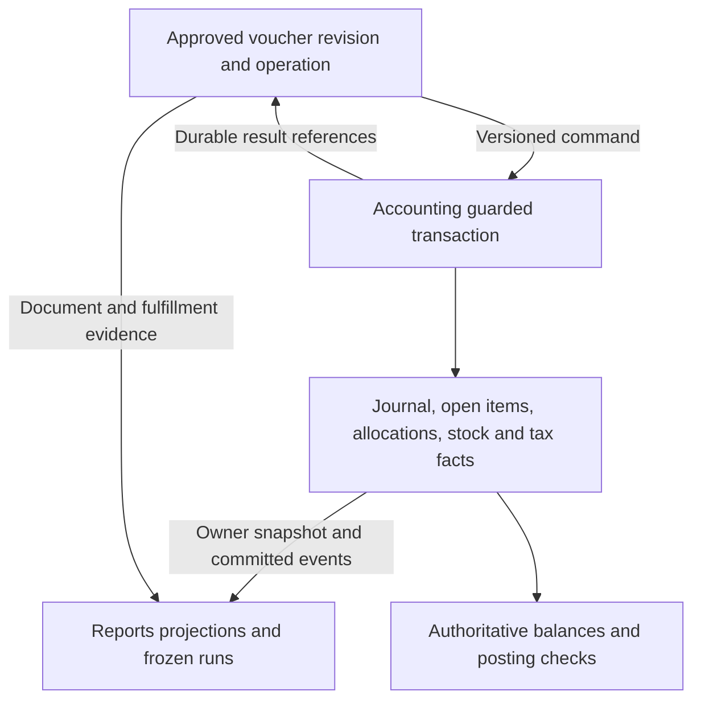

# Voucher posting, balances and financial reporting design

**Date:** 2026-10-10. **Status:** Required implementation design and saved discussion notes.
Phase 1 common Vouchers and [B09 financial export/Reports foundation](voucher-b09-execution.md)
are verified. Phase 2 verifies the B14 financial statements/registers; its
[execution record](voucher-phase2-execution.md) identifies completed verification, exact
history/currency scope and limits. Statutory/stock reports and release activation remain
their later batch obligations.

The user requires account ledgers, trial balance, balance sheet, income/expense statements,
tax registers and related reports on top of voucher entries. These are named delivery
requirements, not an assumption that storing balanced journals finishes reporting.
Read with the [architecture](vouchers-plan.md), [implementation plan](voucher-implementation-plan.md),
[batch tracker](voucher-delivery-tracker.md), [live todo](voucher-implementation-todo.md),
[Accounting finance contract](accounting-finance-contract.md) and [tax plan](voucher-tax-recording.md).
The [stock recording/reporting design](voucher-stock-recording-reporting-design.md) defines
the inventory side in detail: positions, current/eligible/available balances, item/group/
location, batch/serial/expiry/age registers, source histories and INV01-INV24 acceptance.

The [financial-year design](voucher-financial-year-design.md) extends this contract with
D12/FY01-FY24: next-year opening equals prior closing at one source snapshot; prior unclosed
earnings remain visible; old bills, advances and stock keep their origin identities. New
permitted earlier-year facts invalidate dependent derived caches for new runs, while frozen
outputs retain their inputs. Year filters must not hide older unsettled sources.

The [account recording/maintenance design](voucher-account-recording-design.md) specifies
native entry lineage, ledger/register row grains, daily/period balance summaries, atomic
projection updates and verified rebuilds. BAL01-BAL20 extend existing D11/AC26 and batches;
account balances remain derived from Accounting facts, never independently editable masters.

The [stock storage refinement](voucher-stock-recording-reporting-design.md#35-historical-facts-report-storage-and-repair)
requires immutable quantity/value history and exact source/unit/origin allocations. Financial
stock/WIP bridges reconcile to this value evidence at a shared snapshot; they do not add
remaining layers and value entries as separate assets. STK checks extend applicable INV/BAL tests.

## 1. Review evidence and missing contracts

Repository inspection establishes capability, not a particular company's installed data:

| Existing evidence | Reuse | Work still needed for reports |
|---|---|---|
| [Chart template](../apis/accounting/src/accounting/seeds/templates.py), [group metadata](../apis/accounting/src/accounting/domain/master_metadata.py) | 28 base groups, five native heads, hierarchy and gross-profit metadata | Versioned statement classification/presentation; custom-root coverage, contra balances and native EQUITY handling |
| [Ledger records](../apis/accounting/src/accounting/models/ledger.py), [balance query](../apis/accounting/src/accounting/tasks/ledger_reads.py) | Posted journal/line facts and debit-minus-credit as-of totals | Period opening/turnover/closing columns, deterministic running ledgers, compound-entry drill-down and full statements |
| [Opening workflow](../apis/accounting/src/accounting/tasks/openings.py) | Once-only entered opening journals with reconciled party bills | Distinguish migration/YTD coverage from annual carry; no second opening effect |
| [Open-item reads](../apis/accounting/src/accounting/tasks/subledger_reads.py) | Dated item balances and allocation/unallocation history | Versioned export of items/allocations and GL-to-subledger bridges, including FX |
| [Financial event v1](../apis/accounting/src/accounting/events/financial_contract.py) | Journal lines, source identity, date, number and reversal references | It only defines journal-posted and period-changed facts; it is not a complete voucher, settlement, stock, tax or report snapshot feed |
| [Tax record](../apis/accounting/src/accounting/models/voucher_tax.py) | Existing request/calculation snapshots | Native event/component/credit/settlement records and compatible historical readers |
| [Reporting rule 4.11](tech-stack.md#411-reports-read-model) | Reports owns projections; financial outputs reconcile to owner exports | Concrete export barrier, report catalogue, run metadata, security and reproducibility contracts |

Review findings RF09-RF16 address the original reporting gaps; RF33-RF40 add the account
capture, summary maintenance, register-grain and API-compatibility details. The existing company-scoped
master creation APIs remain reusable. Voucher eligibility still requires kind/profile,
account kind, party role, group ancestry, currency, status, permissions and posting policy.
It must not use ledger names as behavior. A SOURCE_ONLY account cannot become manually
postable just because it appears in a Journal selector.

The saved selection guidance is a default, not complete Tally dropdown parity: customer
receivables normally use Sundry Debtors; supplier payables use Sundry Creditors; bank/cash,
income, expense, asset and tax lines use their purpose-compatible accounts. Parties may have
both customer and supplier roles with separate accounts and no implicit netting. Ordinary
challan selection identifies the recipient without automatically creating customer debt.
Current CUSTOMER accounts require ASSET heads, SUPPLIER accounts LIABILITY heads; special
branch profiles must explicitly reconcile that constraint rather than bypass it.

**Tax classification correction:** the implemented [GST template](../apis/accounting/src/accounting/tasks/templates.py) puts recoverable input tax
under Tax Recoverables / Current Assets and output tax under Duties and Taxes / Current
Liabilities. Generic Tally group examples must not override this platform's
[tax-purpose/head contract](accounting-master-contract.md#ledgerprofile-metadata).

## 2. Authority and records

Vouchers owns documents, revisions, entry sections, approvals, source conversion/fulfillment
claims, artifacts and operation history. Accounting owns committed financial effects and
the proposed stock/value/tax-event extensions. D01 still governs acceptance of that atomic
boundary. Reports owns reproducible read models and report outputs, never a second ledger.



The shared structures and [table inventory](voucher-table-inventory.md) remain authoritative
for names; proposed names below are candidates reviewed under D07, not implemented schemas.

| Area / owner | Required records and linkage |
|---|---|
| Vouchers | Common header/revision/line, account/item/charge/tax input, bill/tender detail, source links, operation and `voucher_posting_reference` |
| Accounting financial | Existing `journal`, `journal_line`, `source_document`, `opening_batch`, `open_item`, `allocation`; additive aggregate source/effect receipt where the single-party adapter is insufficient |
| Accounting stock | Proposed posting/movement/balance, lot/unit, cost layer/allocation/value adjustment, count, stock-period and genealogy records; no separate job-work balance authority |
| Accounting tax | Existing `journal_tax` preserved; proposed event/component, credit decision/allocation and tax settlement/allocation evidence |
| Accounting classification | Existing heads/groups/closure, account and purpose mappings; native versioned statement classification where insufficient, candidate `account_statement_mapping` or equivalent metadata extension |
| Reports configuration | Candidate `report_definition` and `report_definition_revision`: fixed supported calculation kinds, column/layout definitions and approved formula versions; no arbitrary executable SQL from a template |
| Reports execution | Candidate `report_run`, `report_artifact`, `report_checkpoint`, `report_reconciliation`: request scope, source manifests, versions, frozen output/hash, checks and protected artifact references |
| Reports projections | Owner-shaped financial/settlement/stock/tax/document facts; required line-grain capability via `report_ledger_fact` or a shared fact projection; optional day/period accelerators and versioned generations, reconstructible from owner evidence |

Report candidates are outside the 51 Vouchers baseline. The existing four tax report
candidates may reuse generalized run/artifact/reconciliation infrastructure under D07;
do not create duplicate run engines or a permanent table for each register. Financial
semantics stay with Accounting; Reports may arrange and label those semantics without
reclassifying a posting. Native dimensions are separate from custom attributes.

Every source effect needs tenant/company, immutable business source and execution identity,
exact revision/hash, line/distribution links, effect kind, posting date, committed version,
original/base currency and amounts, relevant tax/stock dates and rule versions. A source line
can produce several journal/stock/tax allocations: record amount/quantity-level lineage,
not just a voucher ID on a report row. An allocation-only event needs its own source identity
even when it has no new cash or GL journal.

Posting remains preview -> approval -> durable command -> current owner validation ->
atomic effect/source receipt/outbox -> durable result -> report ingestion. Stock-only effects
retain source, period and first-use fences without a dummy journal. Retries recover the
same effect identity; independent HTTP keys cannot create a second business effect.

## 3. Effect matrix and record-once rules

| Voucher/workflow | Actual financial / stock / tax facts | Register behavior |
|---|---|---|
| Journal | Balanced account entries; party allocations and supported statutory events when required; ordinary profile has no physical stock execution | Ledger/day book/journal and affected subledgers |
| Payment / Receipt / advance | Cash/bank/clearing and counterpart entries; open credits and allocations; distinct applicable tax-advance/withholding events | Cash/bank, payment/receipt, outstanding and advance registers |
| Pure bill adjustment | Dated allocation/unallocation; any necessary FX/reclassification is an explicit separate linked effect | Bill history changes; no invented collection or expense |
| Sales / Purchase / financial notes | Revenue/expense/asset, party and tax entries; note lineage; stock execution only if the operation owns that physical slice | Invoice/note/tax registers and GL; exact source slices retained |
| Delivery / Receipt Note and returns | Physical movement once; valuation/clearing according to D02; invoice/return links and statutory evidence | Movement, pending billing/delivery and valuation registers; issuing a challan is not debt |
| Stock Journal / counts / manufacturing | Authorized quantity/cost changes, WIP/output/scrap and any required GL/tax effects | Stock/cost/count/process registers, no balance overwrite |
| Indent / quote / order | Workflow, schedule, source claims and explicit reservations only; no actual GL/stock/tax posting from issuance | Commitments/fulfillment registers separate from actual balances |
| Memo / optional / scenario | No actual effect | Dedicated provisional/scenario views, excluded from actual statements/returns |
| Job work | Owner/custody movements, original challan history, production/cost where applicable; processing bill separate | Custody/aging/WIP and service/tax registers without treating third-party stock as owned |

Settlement never charges invoice tax twice. A goods invoice referencing a dispatched slice
must not dispatch it again. Physical return, financial credit and statutory adjustment are
separate linked effects. Backfill/import of existing posted Accounting facts creates links
and projections, not new vouchers that repost their money or stock.

## 4. Account ledgers, trial balance and balance semantics

For a single company/base currency at a fixed owner snapshot W, let each posted line have
signed value `d = debit - credit`:

- Opening `O(a,S,W)` is the sum for account a before start date S.
- Period debit/credit `D(a,S,E,W)` / `C(a,S,E,W)` include dates S through E.
- Closing `B(a,E,W) = O + D - C`.
- Debit balance column is `max(B,0)`; credit balance column is `max(-B,0)`.

Reversed journals stay in the original period; their linked reversing entries affect their
own posting date. Never remove the original from an earlier historical balance. Draft,
prepared and void documents have no posted ledger effect. An Accounting-committed effect
is included even if the Vouchers acknowledgment is delayed; do not filter books by a stale
Vouchers status. Missing metadata is an explicit readiness/drill-down issue, not permission
to drop money from totals.

Ledger rows have deterministic ordering `(posting_date, owner_commit_order, journal_id,
line_sequence, line_id)` using a contracted order, not UUID/time alone. Pagination pins W
and the filters; running balances carry the prefix sum across pages. Search within an
account is a filtered movement view with stated scope, not a silently altered full balance.
Compound journals expose all authorized counterpart lines instead of inventing one party.

Trial balance shows opening debit/credit, period debit/credit and closing debit/credit by
account and group. Grand totals sum leaf accounts once, not parent rows plus children.
Group debit and credit columns sum account-side balances independently before any expressly
requested net display. Inactive accounts with history remain visible; zero-balance inclusion
is a display option. No automatic suspense entry may hide an imbalance.

For complete company books, opening sides, movement sides and closing sides reconcile.
A selected party/department/account subset is clearly partial and need not balance. Full
statements cannot drop unauthorized rows and pretend to be complete. Original-currency
views partition by currency; only recorded base amounts enter a company-wide trial balance.
Existing realized FX and any separately supported revaluation need explicit lines and bridges.

Do not store editable master balances. Guarded stock balances are owner projections used for
concurrency; report summaries are read accelerators. Historical balances use dated facts at W,
not today's balance minus an incomplete list of changes. Public totals enforce Decimal and
the repository's storage/rounding rules; rounded displays disclose any display residual.

### 4.1 Required capture and maintenance contract

The linked account design governs native source distributions, one-row-per-entry facts,
summary keys, cumulative versus period totals, future-dated current balances, filter/sort
semantics, complete effect ingestion and generation rebuild/cutover. Account-wide summaries
cannot answer party/dimension-filtered requests without equivalent facts or scoped aggregates.
Financial register rows declare their grain and aggregate each child relation before joining;
repeated invoice values on items/taxes/tenders are not additive. BAL01-BAL20 are required
applicable acceptance checks within B09/B14 and later source/reporting slices.

## 5. Income/expense statements and balance sheet

### 5.1 Classification and presentation

The baseline is single-company accrual reporting in recorded base currency. Income & Expense
is a supported surplus/deficit presentation of the same period income/expense facts; it is
not a cash receipts/payments report. Management Profit & Loss and Balance Sheet are required.
Any entity-specific statutory format, consolidation, cash-flow statement, budgets or alternate
currency translation needs an explicit selected extension; do not imply those are implemented.

Report definitions pin native head/group ancestry, statement-mapping revision, period and
comparison periods, sign/netting rules, presentation mode and calculation version. Preserve
native EQUITY even though a Tally-oriented display helper maps it to liability nature.
Rename, retirement or a new template cannot change a frozen report. A future authorized
presentation reclassification needs a dated mapping/restatement version, not mutation of
historical journal amounts or a custom attribute.

Every participating account must have an unambiguous supported classification. Custom roots,
contra-revenue/expense, depreciation contra-assets, abnormal debtor/creditor balances, bank
overdrafts and current/non-current splits need explicit treatment. Keep diagnostic unmapped
balances visible and block a COMPLETE financial statement rather than silently omit them.
Do not move every credit asset into liabilities merely by its sign; maturity/offset policy
and account purpose matter. Do not net different parties or tax registrations implicitly.

### 5.2 Profit and loss

For an eligible period, income is credit minus debit on INCOME facts and expenses are debit
minus credit on EXPENSE facts; net result is income minus expenses. Returns and reversals
retain their signs. Capital, borrowing, advances, collections and recoverable tax do not
become income/expense merely because money moved. Gross profit uses the approved direct/
indirect and cost-of-sales mappings; existing `affects_gross_profit` is input metadata, not
permission to add every ASSET stock balance as expense.

Separate operating/adjustment entries from initial-opening/YTD imports and future annual
closing transfers using native, owner-issued classifications. Ordinary P&L excludes the
closing transfers that zero nominal accounts; it must not become zero after a year-end close.
Real year-end adjusting expenses/revenue still belong in the period. The current journal
enum does not implement annual closing: its future classification and reconciliation remain
an Accounting extension, never something inferred from narration or a report template.

### 5.3 Earnings bridge and balance sheet

At the same cutoff W and date E, use the raw trial-balance signs:

```text
Assets = sum(asset closing debit-minus-credit balances)
Liabilities = -sum(liability closing debit-minus-credit balances)
Posted equity = -sum(equity closing debit-minus-credit balances)
Unclosed earnings = -sum(income and expense closing debit-minus-credit balances)
Assets = Liabilities + Posted equity + Unclosed earnings
```

The unclosed-earnings line is a derived presentation bridge with full lineage, not a posting
or a new account balance. Split prior-year unclosed earnings and current-year result using
dated source/close evidence. Before annual close, older nominal balances may still exist;
they cannot vanish merely because the report starts a new fiscal year. After a supported
closing transfer, the corresponding nominal residual is zero and retained earnings already
contains it. Never add that profit again. Loss reduces equity under the baseline presentation.

Every balance-sheet run provides its TB-to-statement bridge and links to the corresponding
P&L at identical scope/version. A mismatch is a failed reconciliation, never a balancing plug.

### 5.4 Opening balances, migration and deferred annual closing

Current entered openings are `opening_batch` plus posted journal/open-item facts, once at
books begin. Fiscal-year opening summaries, including the older `account_opening_balance`
proposal, are derived carry projections if introduced; they never add a second posting.
Either sum full history, or use a verified opening snapshot plus the strictly subsequent
movement window. Never sum a snapshot and the history already contained in it.

On the exact books-begin date the canonical ledger includes the opening journal as a dated
fact. The implemented TB and account summary display identified opening effects on the
report's start date in opening columns and exclude those same effects from period turnover.
An opening reversal retains that classification through its original-journal link; P&L
excludes both the original and correction from operating activity. The dated account ledger
still shows each journal for audit. Closing totals retain the same full-history basis.

Mid-year migration needs native coverage/provenance: books-begin date, balances covered
through date, originating fiscal year and whether imported nominal amounts represent YTD
activity. Without detailed pre-migration movements, do not invent monthly comparatives.
Distinguish a post-migration P&L from a supported YTD statement with separately disclosed
imported YTD amounts. Report periods before available history are unsupported or explicitly
partial; they are never shown as complete zero activity.

Annual closing/carry-forward automation remains deferred by the existing finance contract.
Required statements must nevertheless handle continuous multi-year history and unclosed
earnings. If later selected, closing automation needs its own explicit batch, source effects,
close classifications and tests. D11 chooses the supported coverage/presentation contract;
Accounting already permits authorized SOFT_CLOSED/CLOSED reopening; report permissions
cannot perform it, and LOCKED remains terminal. Normal next-year readiness is required
under D12; requesting reports does not select annual profit-transfer automation.

## 6. Stock, tax and subledger reconciliation

**Inventory:** reconcile owned stock/WIP carrying values by approved control-account mapping
to the GL, with explained transit/GRNI/delivered-unbilled/variance balances. Third-party goods
held here are quantity/custody facts and do not inflate owned assets. Own goods at a worker
remain distinguishable from goods already consumed or sold. A count, returned lot, landed
cost or backdated adjustment changes value only through its supported owner operation.

D02 must choose the recognition method and fixtures before stock activation. If perpetual
inventory and cost of sales are posted, the P&L uses those expenses and must not also subtract
closing stock or expense the same purchase again. A supported periodic method needs an
explicit period-end valuation/recognition bridge with owner evidence; it cannot be selected
as an arbitrary report toggle. Alternate valuation experiments belong to scenario outputs.
Initial stock quantity/value imports link to the financial opening inventory amount so its
asset value is not posted twice.
Current availability additionally requires dated hold/reservation/lot evidence and an explicit
expiry evaluation date. Receipt-age cohorts remain distinct from cost layers/pools. B27a-e
must implement the named stock outputs and unit/group rules before inventory profile activation.

**Party balances:** open debt and unapplied credit remain separate. Reconcile their net,
role, currency and base carrying amounts to party journal balances, including realized FX
and supported manual adjustments. Allocation/unallocation dates control historical outstanding
reports; a later allocation cannot rewrite an earlier aging report. Record due-date/policy
versions so aging is reproducible. Customer/supplier netting requires a separate supported
operation; report grouping is not such an operation.

**Tax:** separately reconcile commercial taxable amounts, statutory events, GL control
accounts and return allocations by registration/component/period. Invoice, posting and tax
dates differ; provide an explicit timing-difference bridge. No unexplained net number may
replace pending credit, eligible/claimed credit, blocked credit, RCM, reversal/reclaim,
advance adjustment, deposits and confirmed offsets. Supplier-declared and computed amounts
remain available with authorized differences. Historical `journal_tax` imports cannot create
a second native liability/event. GST/VAT policy versions and return schema versions are pinned.

GSTR-2B is external evidence for matching/eligibility review, not a filing produced by us;
matching does not establish every ITC condition. Outward return preparation needs invoice,
note, advance and amendment source detail, not only GST-account net balances.
[GST Portal GSTR-2B guidance](https://tutorial.gst.gov.in/userguide/returns/FAQ_gstr2b.htm),
[GSTR-1 preparation](https://tutorial.gst.gov.in/userguide/returns/Creation_of_Outward_Supplies_Return_in_GSTR-1.htm).
Required exports accompany each enabled tax profile. Selected state-VAT packs remain separate
extensions; storing VAT master metadata alone does not implement a VAT return.

**Bank:** book, instruction, clearance and statement-match states are different. Opening bank
reconciliation items must not repost opening money. Matching differences need authorized
adjustments. Optional B43 reconciliation does not block ordinary bank ledger reports.

## 7. Required report catalogue and delivery

| Report | Required output and lineage | First delivery / extension |
|---|---|---|
| Account/group ledger | Opening, dated Dr/Cr, running/closing balance, compound counterparts, source drill-down | B14 |
| Trial balance | Account/group opening, gross period Dr/Cr, closing sides; no parent double count | B14 |
| Income & Expense / Profit & Loss | Period and supported comparisons, gross/net or surplus/deficit, classified accounts and source totals | B14 engine; B18 invoices/tax; B27 stock/COGS; B40 WIP |
| Balance sheet | As-of assets/liabilities/equity, prior/current unclosed-earnings bridge, comparatives and TB reconciliation | B14 engine; B18/B27/B40 relevant facts |
| Day book / voucher registers | Number, type/profile, issue/post dates, parties, totals, separate workflow/effect statuses | B14 money, B18 invoices, B32 orders, B35 scenario |
| Cash/bank and receipts/payments | Book entries, counterpart allocations, references, recognized versus pending instruments | B14; B43 statement reconciliation if selected |
| Party statement / bill aging / advances | Role/currency/account, opening items, allocations, due dates, unapplied credit and GL bridge | B14; B18 invoice/advance-tax extension |
| Sales/purchase and note registers | Commercial net, charges/discounts, tax, gross, party obligation, source references and differences | B18; B27 goods links |
| Tax registers / working returns | Outward/inward, HSN/SAC, component/registration, pending/eligible/claimed ITC, RCM and settlement, frozen exports | B18/B19; B40/B41 job work |
| Stock/cost registers | Current physical/owned/eligible/available; item/group/location ledgers; batch/serial/expiry/receipt age; value, action and GL bridges | B27a-e; selected reservations B31 and projected supply/demand B32 |
| Order/challan/fulfillment | Ordered, executed, acknowledged, billed, returned and closed slices independently | B32 |
| Job-work/manufacturing | Original challan aging, principal/worker custody, genealogy, WIP/output/scrap and cost reconciliation | B40/B41 |
| Scenario comparisons | Actual baseline plus explicitly selected hypothetical overlay; actual source totals preserved | B35 |

B14 statements are for supported C1 records, not a claim that unfinished goods/tax profiles
are reportable. B18, B27 and B40 must extend and reverify the same statements before their
profiles activate. Keeping a feature disabled is preferable to silently omitting its balances.

## 8. Snapshot, export, API and security contracts

The report cutoff has two dimensions: business period/as-of date and **known committed source
snapshot**. A posting entered later with an earlier posting date changes a new run, not an
already frozen run. Fiscal locking alone does not freeze labels, formulas, source ingestion
or tax corrections; the older claim of byte-identical reruns from a lock alone is superseded.

Before B09, each owner must supply a consistent initial snapshot/export manifest and catch-up
contract with stream versions, partition checkpoints, counts, control totals and checksums.
An export cannot miss a commit between snapshot and subscription or observe half an effect.
Maximum UUID, timestamp or pre-commit sequence alone is not proof of a contiguous committed
boundary. D01/D11 must choose a valid owner snapshot/barrier mechanism. A sparse event sequence
requires explicit completeness evidence, not treating every unused number as a lost event.

Versioned feeds/export coverage includes master hierarchy/classification, complete journals,
source receipts, opening provenance, items/allocations and their reversals, stock/cost facts,
tax components/decisions/settlements, and document/fulfillment evidence. Financial v1 remains
readable. Missing historical fields require a controlled backfill or unavailable capability,
not fabricated values. Deltas retain immutable monetary facts and version mutable lifecycle
metadata without losing the earlier as-of state.

Ingest one owner effect bundle atomically into Reports; dedupe by source/effect identity and
version as well as message ID. Out-of-order, duplicate, incompatible and missing facts cannot
yield a COMPLETE run. Reports never queries other service databases and never relies on broker
retention as its historical archive. Failed streams quarantine evidence and expose lag.

A financial report run pins company, requested scope, dates, currency basis, available-history
coverage, per-owner manifests/checkpoints, definition/classification/rule versions, selected
dimensions, actor permission scope, reconciliation results and artifact hash. Comparison
columns pin their own periods and compatible definitions. Operational dashboards may be
explicitly PROVISIONAL; financial/statutory output is COMPLETE only after owner reconciliation.
Frozen/filed versions are retained; later corrections create linked runs/amendments.

Planned API under the company scope: report catalogue/field metadata; asynchronous run request
(`202` operation/run ID); run status/parameters/checkpoints; bounded rows and drill-down;
reconciliation differences; protected export/download. Candidate report kinds include
ACCOUNT_LEDGER, TRIAL_BALANCE, BALANCE_SHEET, PROFIT_LOSS, INCOME_EXPENSE and TAX_REGISTER.
Reuse the async run engine for CSV/XLSX/PDF rather than one execution service per format.
Pagination pins run identity. Large artifacts use workers, access checks and expiring links;
escape spreadsheet formula injection in exported free text.

Current tenant/company/field/row permissions apply to requests, rows, filters, totals,
drill-down, retries and downloads. Recheck revocation at retrieval; cache keys include scope
and policy version. A restricted reader cannot infer hidden rows by subtracting totals.
Full-company statements require authorization over all contributing inputs; otherwise reject
the request or provide a clearly scoped partial view without full totals. Reporting permissions
never authorize posting. Optional dimensions must reconcile within each category; two parallel
categories cannot double the same amount. Custom attributes may label/filter authorized
registers but cannot change statement classification or financial arithmetic.

## 9. Batch implementation and acceptance evidence

Retain 45 parent batches and 38 work packages. Add the following reviewable slices inside them;
all are PLANNED and do not indicate new completed work:

| Parent | Required slices / outputs |
|---|---|
| B01-B03 | Inventory financial feeds/exports and coverage gaps; close initial D11 statement, classification, opening and snapshot contracts alongside D01-D07 |
| B09 | Report configuration/run schema; owner snapshots and fact ingestion; version/authorization/reconciliation infrastructure before report calculations |
| B14 | B14a ledger/TB and running pagination; B14b P&L/Income & Expense; B14c Balance Sheet/earnings/opening/comparative bridges; B14d party/cash/bank registers and full financial fixture |
| B18 | Invoice/note/tax registers, tax-to-GL/return timing bridges; rerun statements including invoice and tax postings |
| B22-B27 | Cost recognition independent from quantity origins; B27a-e current/item/group/location/expiry/age/value/action registers and inventory/P&L/Balance Sheet reconciliation |
| B32/B35 | Independent commitment progress and scenario segregation at fixed report snapshots |
| B37-B41 | Custody/WIP/process facts and their financial/tax/aging bridges; rerun statements with required job work |
| B45 | Fresh rebuild/upgrade/backfill, late/reversed facts, access changes, load/recovery, source reconciliation and frozen-run replay |

D11 is the new reporting decision gate: source completeness/order, statement mappings and
presentation, migration/YTD coverage, unclosed/closed earnings compatibility, comparison and
reconciliation/permission contracts. Choices close per slice; D02 costing and D09 tax scope
stay independent. Exact tables remain D07. Annual close automation is still deferred.

The following RPT checks expand AC26 and related AC scenarios; they are **future implementation
tests**, not tests passed by this document review:

| Check | Required assertion | Batches |
|---|---|---|
| RPT01 | Financial fixtures reproduce all journal lines and source allocations; retry/new message IDs never double facts | B09/B14/B45 |
| RPT02 | Ledger opening + period Dr - Cr = closing; running totals remain correct across frozen pagination | B14 |
| RPT03 | Full TB opening/movement/closing sides balance; hierarchy counts leaves once; gross group sides survive net display | B14 |
| RPT04 | Income/expense classifications, returns, expenses, surplus/deficit and gross/net totals match posted facts | B14/B18 |
| RPT05 | Balance Sheet equation and TB/P&L bridges hold before/after a future-style tagged closing fixture without duplicate earnings | B14/B45 |
| RPT06 | Two-year unclosed profit, comparative definitions and loss handling preserve retained earnings and current result | B14/B45 |
| RPT07 | Entered opening, derived carry and mid-year YTD provenance count once; unavailable historical months are flagged | B14/B27/B45 |
| RPT08 | Backdated posting and later reversal change a new run, never an existing frozen one; earlier-date balances remain correct | B09/B14/B45 |
| RPT09 | Source snapshots plus concurrent commits/catch-up have no gaps, duplicates or half effects; missing feeds block COMPLETE | B09/B45 |
| RPT10 | Mixed currencies remain separate in original views; base TB and realized-FX subledger bridges reconcile | B14/B18 |
| RPT11 | Custom groups, inactive accounts, contra balances, native equity and mapping revisions remain correctly classified | B14 |
| RPT12 | Field/row/company denies, revoked access, cached totals, exports and compound drill-down do not leak hidden values | Every report batch |
| RPT13 | Allocation/unallocation, advance/refund and due-date history reconcile bill aging to party GL without extra cash | B14/B18 |
| RPT14 | Stock layers/openings/costs/WIP tie to owned-inventory GL; no duplicate purchase expense or closing-stock adjustment | B27/B40 |
| RPT15 | Tax components/events/GL/returns reconcile with explicit timing/eligibility bridges; historical snapshots do not double tax | B18/B40 |
| RPT16 | Invoice-register commercial totals reconcile to party obligations and settlement; fulfillment slices never sum to false net progress | B18/B32 |
| RPT17 | Quote/order/memo/scenario and pending bank instructions stay out of actual financial/stock/tax totals | B14/B32/B35 |
| RPT18 | Principal/worker ownership, original aging and processing bills reconcile custody/WIP without third-party asset inflation | B40/B41 |
| RPT19 | Full rebuild and optimized aggregates equal owner exports; artifact hashes and source drill-down reproduce the frozen run | B09/B45 |
| RPT20 | Dimensions, account/party subsets and partial-history reports disclose scope; no incomplete view is labeled a complete statement | B14/B35/B45 |

### Worked financial fixture for implementation

B14 verifies financial calculations using supported journal/open-item fixtures. The service
invoice and tax end-to-end steps below require B17/B18; extend the same expected balances
then. A future-style closing fixture tests calculation compatibility, not a newly enabled
annual-close API. Record these distinct subcases when claiming batch evidence.

Illustrative INR amounts; the tax rates and recognition below are test assumptions, not
universal statutory or costing choices. Start with a balanced capital opening: Bank Dr 20,000,
Capital Cr 20,000. Post a valid service invoice: Customer Dr 11,800, Revenue Cr 10,000,
Output CGST Cr 900, Output SGST Cr 900. Receive 4,000: Bank Dr / Customer Cr; allocate it to
the invoice. Pay a non-tax fixture expense of 2,000: Expense Dr / Bank Cr.

Expected closing debit balances: Bank 22,000; Customer 7,800; Expense 2,000. Credit balances:
Capital 20,000; Revenue 10,000; CGST 900; SGST 900. TB sides each equal 31,800. Period income
10,000 minus expense 2,000 yields 8,000 profit. Assets 29,800 equal liabilities 1,800 plus
posted equity 20,000 plus unclosed earnings 8,000. Invoice outstanding is 7,800; collection
does not create another supply tax event. Tax-register taxable value is 10,000 and output
tax is 1,800 for the assumed supported tax period.

Next fiscal year, before any new activity, those assets/liabilities remain and 8,000 is prior
unclosed earnings; current-year operating P&L is zero. A later selected closing workflow
would transfer nominal balances to equity: the raw TB total changes as nominal balances
are cleared, but assets/liabilities/net equity and the earlier operating P&L do not. Tests
must cover this future-style input contract without claiming closing automation exists.

## 10. Sources and remaining decisions

Official sources were reviewed for functional expectations, not copied as our storage model:
[Tally trial balance](https://help.tallysolutions.com/trial-balance-tally/) supports opening,
movement and grouped/ledger views; [Tally P&L and Income & Expense](https://help.tallysolutions.com/profit-and-loss-statement-tally/)
explains period results and presentations; [Tally balance sheet](https://help.tallysolutions.com/tally-prime/accounting-financial-reports/balance-sheet-tally/)
relates balances and inventory. Tally's report-time stock/opening behavior does not authorize
manual balance changes or synthetic actual GL lines here. Our selected recognition method,
immutable source facts and reconciliation contracts govern those differences.

Remaining D11 decisions include native mapping shape, supported migration/YTD imports,
snapshot/order mechanism, presentation/currency/dimension scope and complete-input permissions.
Costing, tax/VAT jurisdiction packs, special calendars, annual closing, unrealized FX and
consolidation retain their separate gates/deferred scope. No unsupported format is advertised
as a statutory financial statement merely because it is titled Balance Sheet.

## Decision log

- 2026-10-10: Linked the detailed stock recording/reporting design and B27a-e. Inventory
  balances now have explicit physical/eligible/reserved/custody semantics and native
  origin/date/hold histories, with INV checks alongside the existing RPT reconciliation.

- 2026-10-10: User required deep review and recorded report readiness. Made account ledgers,
  TB, Balance Sheet, P&L/Income & Expense and tax registers explicit deliverables; recorded
  owner facts, current implementation gaps, report candidates, snapshot/security contracts,
  earnings/opening/stock/tax bridges and 20 RPT checks. Added D11 within the existing 45-parent
  batch roadmap. Saved prior account/party selection notes and clarified input-tax grouping.
  Annual closing automation remains deferred; no code, migration, company data or posting changed.

### Financial-year planning decision - 2026-10-10

Added financial-year continuity and controlled reopen/cache integration under D12.
FY checks extend financial reporting acceptance without changing historical frozen runs.

### Account-recording review - 2026-10-10

Added the account-recording design and BAL01-BAL20 under D11/AC26. Required capture,
summary and register-grain contracts are explicit; optional accelerators remain rebuildable.
Existing RPT01-RPT20, FY checks and financial statement semantics remain in force.

### Stock capture/storage review - 2026-10-10

Linked explicit stock value facts and separate owner/report rebuild controls to the
financial reconciliation contract. Quantity-only and value-only effects remain distinct.

### Initial-opening correction review - 2026-10-12

The report engine now classifies a reversal linked to an OPENING journal as an opening
correction. Trial Balance and account summary put same-start-date opening/correction facts
in the opening column once, while P&L excludes them and Balance Sheet assigns their nominal
effects to opening earnings. Missing original reversal history is a report conflict, not
ordinary operating income. Mid-year YTD migration provenance remains a separate D11 gate.
