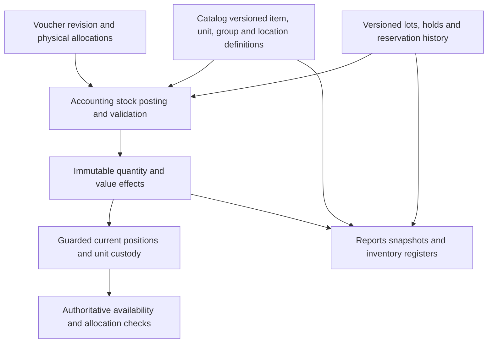

# Stock recording, balances and inventory reporting design

**Date:** 2026-10-10. **Status:** Required planning detail, not implemented stock or Reports APIs.
The user requires current product stock, inventory ledgers, group-wise stock, expiring stock
and related registers to be deliverable from recorded facts. This document specifies those
facts and their report semantics before stock migrations are implemented.

Read with the [voucher architecture](vouchers-plan.md), [implementation plan](voucher-implementation-plan.md),
[table inventory](voucher-table-inventory.md), [financial reporting design](voucher-posting-reporting-design.md),
[Catalog inventory integration](catalog-inventory-integration.md), [batch tracker](voucher-delivery-tracker.md)
and [live todo](voucher-implementation-todo.md). Existing D01/D02/D03/D07/D11 gates cover this
detail; no new service, per-voucher table family or additional parent batch is introduced.

The [financial-year design](voucher-financial-year-design.md) requires stock quantity/value,
receipt/cost origins, lots/expiry, transit and job-work age to continue across years without
a new opening movement. Stock effective dates and GL posting periods retain explicit links;
reopening GL alone cannot authorize unsupported revaluation of later locked stock periods.
B27e and dependent order/job-work slices include applicable FY01-FY24 checks.
The capture/storage review below adds sections 3.1-3.6 and STK01-STK20 under the existing
gates. Read the [account maintenance design](voucher-account-recording-design.md) for shared
report generation/checkpoint controls and financial reconciliation; operational stock balances
remain guarded Accounting state, not an eventually updated Reports cache.

## 1. Existing foundation and gaps

| Inspected source | Reusable foundation | Remaining implementation requirement |
|---|---|---|
| [Items/families](../apis/catalog/src/catalog/models/products.py) | Stable SKU/family identity, base unit and stock/nonstock definitions | Operational quantities belong to Accounting; never add editable current stock to an item |
| [Classification](../apis/catalog/src/catalog/models/classification.py), [dated family assignments](../apis/catalog/src/catalog/models/product_definitions.py) | Item-group hierarchy, dated group/category assignments and unit revisions | Complete versioned exports; pinned group/membership and unit semantics for historical rollups |
| [Warehouse groups](../apis/catalog/src/catalog/models/warehouse_groups.py), [location policies](../apis/catalog/src/catalog/models/warehouse_policies.py) | Dated warehouse grouping, restrictions and replenishment policies | Authoritative location enforcement, stock/hold/count/transfer checks and report scope |
| [Inventory profiles](../apis/catalog/src/catalog/models/inventory_templates.py), [profile schema](../apis/catalog/src/catalog/schemas/inventory_templates.py) | Lot/serial tracking, expiry/manufacture requiredness, shelf life, minimum remaining life, FIFO/FEFO issue and valuation definitions | Physical lots/units, receipt origins, cost allocations, expiry/hold evaluation and native histories |
| [Catalog stock-fact guard](../apis/catalog/src/catalog/domain/stock_facts.py) | Rejects counterfeit stock facts in Catalog custom fields/imports | Keep that boundary; descriptive fields cannot become balances, batch dates or posting controls |
| [Policy acknowledgements](../apis/catalog/src/catalog/domain/policy_release.py) | Versioned acknowledgement and bounded refusal reasons | Current consumer wire name is `billing`; add an explicit compatible Accounting adapter, not a rename or a false enforcement claim |

Catalog has definitions, not a physical inventory ledger. The Accounting stock subsystem is
still proposed. Profiles listing FIFO/FEFO or expiry fields do not establish that posting,
valuation or report execution already supports them. RF17-RF24 record this review's gaps.
RF41-RF48 extend the review to storage cardinalities, execution transactions, immutable value
facts and recovery. The inspected Accounting models still expose no implemented stock ledger;
an account's `inventory_affected` flag is not evidence of stock movement/cost support.
Warehouse/profile fields in the working tree likewise do not establish verified remote
enforcement. Preserve ongoing Catalog configuration work; reconcile its contract before activation.

## 2. One stock authority and explicit balance dimensions

Catalog owns item/group/unit/location/tracking definitions. Vouchers owns source documents,
revisions, allocations, count observations, approvals and execution requests. The proposed
Accounting extension owns stock positions, movements, holds, units, reservations, valuation
and financial linkage in its guarded transaction. Reports owns rebuilt/frozen views.

The canonical quantity position identifies:

`tenant + company + item/SKU + owner kind/reference + custody/location kind/reference +
warehouse/bin when applicable + lot when applicable + disposition`.

Owner answers whose goods they are; custody answers who/where holds them. Disposition
distinguishes usable, quarantine, damaged and other supported states. Company-owned stock
at a worker remains owned; another party's goods in our warehouse remain third-party custody.
Transit is a protected distinct position, not simultaneous stock at source and destination.
External custody and WIP have typed references; no fake warehouse is created per voucher.

A serialized unit has one position at a time, with a native position/unit relationship.
Unit allocations reconcile to the position quantity; each unit is indivisible in its stock
base unit. SKU variants remain separate items. A lot may span locations and receipts; its
header never carries a single warehouse balance. Stock groups and warehouse groups hold no
stock themselves. No cross-company quantity or value netting is permitted.

D07 must enforce a unique canonical position even for non-batch/non-bin stock: ordinary
nullable composite UNIQUE keys can admit duplicates. Use reviewed normalized keys or guarded
position identity, with collision-safe dimension equality, company-scoped constraints and
foreign keys to local projections. A hash alone cannot establish business identity.

## 3. Records to retain

The following are common structures, shared by all voucher kinds. Existing candidate names
remain proposals until their owner migration manifest is reviewed.

| Record / owner | Required native data and purpose |
|---|---|
| `voucher_inventory_allocation` / Vouchers | Revision/line, execute/reference/deferred mode, location/owner/custodian, lot/unit, entered and base quantity, linked prior movement/source slice |
| `stock_posting` / Accounting | Unique business operation/effect identity, source revision/hash, company, effective date, recorded/commit evidence, rule/profile versions, reversal/correction and optional journal references |
| `stock_movement` / Accounting | Immutable signed quantity legs, canonical position, action/reason, paired-transfer/reclassification reference, source line, actual movement date and physical-time evidence when required; costs linked separately |
| `stock_balance` / Accounting | Guarded current quantity by canonical position, version and applied source checkpoint; optional checked value cache, never a second value authority |
| `stock_lot` / Accounting | Company/SKU/source namespace and batch code, manufacturer/supplier provenance, original dates and evidence references; controlled revisions for corrections |
| `stock_unit`, `stock_unit_identifier` / Accounting | Physical unit, optional lot, identifier namespace/normalization, current position and movement lineage; no new unit on ordinary return |
| `stock_cost_layer`, `stock_cost_allocation`, `stock_value_adjustment` / Accounting | Selected costing scope, inward/consumed/remaining value, source and destination allocations, currency/FX and residuals, landed cost, impairment and linked GL effects |
| `stock_count_scope`, `stock_count_snapshot` / Accounting | Frozen/controlled scope, cutoff and book evidence; Vouchers retains observations/recounts, approvals and linked adjustment results |
| `stock_reservation` / Accounting, when selected | Source demand/schedule, stock scope, claims and dated release/consume/expiry/reallocation history; reservations never add stock |
| `stock_genealogy`, `stock_period` / Accounting | Input/output relationships and stock/value posting/close controls; shared with job work and manufacturing |
| Common report run/checkpoint/artifact / Reports | Source manifests, classification and date-policy versions, evaluation date/timezone, filters, reconciliation, protected output/hash |

Additional normalization candidates **outside the 51 Vouchers and 20 Accounting baseline
counts**, subject to D07 reuse rather than a mandatory new table for each name:

| Candidate / owner | Why the data is required |
|---|---|
| `stock_lot_revision` / Accounting | Audited manufacturer/expiry/best-before correction evidence and effective/recorded versions; old report runs retain old inputs |
| `stock_hold`, `stock_hold_event` / Accounting | Company/item/lot/unit/position scope, reason, operation block, actor, effective time and release history; support recall/inspection/safety blocks without deleting stock |
| `stock_receipt_origin`, `stock_origin_allocation` / Accounting | Receipt/opening/production cohorts, original receipt/age dates, residual quantity and transfer/issue/return links, independent of valuation method |
| `stock_reservation_event` / Accounting, when selected | Immutable reservation transitions for historical availability and demand reconciliation; may reuse the common operation/event structure |
| Stock fact and day/period aggregates / Reports, optional | Rebuildable accelerators for quantity/value/age registers; no per-product or per-register physical tables |

Origin quantities and reservation/hold histories may normalize into existing allocations or
common effect records. Their semantics cannot be dropped merely to preserve a candidate count.
Physical receipt origins are not the same thing as financial cost layers, especially under
moving average. No additional mutable `product_current_stock` authority is introduced.

Every stock command commits movement/value/unit/hold/reservation changes, source receipt,
required journal links and outbox atomically within the accepted D01 boundary. Movement
execution and posting guards use the same locks as reservation/count/hold changes. New empty
positions also participate in scope locks; a missing row must not bypass a hold or count.
Source-operation/leg uniqueness survives a new HTTP idempotency key or broker message ID.

Define stock effective date separately from financial posting date and recorded/commit time.
A future planned receipt is not current stock. Until a supported future-effective execution
contract exists, reject attempts to post tomorrow's physical movement as today's on-hand;
scheduled instructions remain pending. Late physical evidence follows D03's controlled
backdate/correction path, without silently changing a frozen ledger.

Partial holds identify exact units/positions or quantity-origin slices; a partial damaged
lot normally moves to its own quarantine position. A broad lot hold is a scoped eligibility
restriction. Neither representation may multiply held quantity when restrictions overlap.

### 3.1 What an execution captures

TallyPrime distinguishes actual supplied/received quantity from billed quantity and supports
batch-based inventory entries and physical-count adjustments. Our records therefore retain
commercial, physical and valuation evidence separately; these are functional references, not
an assertion about Tally's database schema.
[Actual and billed quantities](https://help.tallysolutions.com/tally-prime/purchase-process/purchase-goods-and-services-tally/),
[inventory entries and counts](https://help.tallysolutions.com/knowledgebase/inventory-entry-tally/).

| Captured fact | Required stored evidence |
|---|---|
| Source identity | Tenant/company, voucher and immutable revision/hash, source line/allocation, operation/action and unique effect/leg keys; partial executions get distinct bounded source slices |
| Execution dates | Physical/effective business date, recorded/committed time/order, stock period and explicit GL-period linkage; preserve physical-cutoff evidence where live counts require it |
| Item definition | SKU/base unit, accepted item/tracking/profile/pack revisions and effective warehouse policies; unchanged item IDs across years |
| Quantity | Entered unit/quantity, exact conversion numerator/denominator or measured base quantity, signed executed base quantity and declared precision/increment; billed/free/ordered quantities remain separately labelled |
| Allocation | Canonical source/destination position IDs, owner/custodian, warehouse/bin, disposition, lot and normalized unit allocations; actual quantities sum to each executed source slice |
| Tracking | Lot namespace/code and date revision; stable physical-unit IDs and validated identifier references; original receipt/production cohort and quantity provenance |
| Commercial context | Receipt/delivery/invoice/return/transfer/job references, exact fulfillment claim and selected company registration snapshots when the enabled profile requires them |
| Value | Owner cost method/scope/version, original and base currency, recorded FX, carrying value, input/output cost allocations, residuals, valuation status and linked GL/clearing references |
| Decision evidence | Requested action/reason, current permissions, actor/approval revision, count/hold/reservation scope versions and configuration first-use proof |
| Correction/import provenance | Original movement/value references, imported external row identity, covered-through date and known/assumed/unknown earlier age/cost evidence |

A scan, draft, printed challan or warehouse selection is not execution. Duplicate scans are
rejected or deduplicated with explicit feedback; changing an HTTP key cannot repeat a movement.
An EXECUTE allocation creates movement once; REFERENCE consumes a validated earlier movement
claim without creating it again; DEFERRED creates pending obligations only. Billed quantity
and rate must never overwrite the actual receipt/dispatch. Free units still move physical stock;
zero commercial price does not automatically mean zero inventory cost.

Measured dual quantities preserve count and actual weight/volume with their declared role;
do not apply a nominal pack ratio to replace a measurement. Reject nonrepresentable conversions
before SQL at the existing four-place storage boundary. Serialized allocations are indivisible
and must reconcile to the base quantity under the approved tracking profile. No reinterpretation
of old quantities when a pack/profile revision changes.

### 3.2 Storage grain, relationships and constraints

The following refinements reuse the candidate inventory; D07 fixes physical names/columns
before migrations. Each local FK/unique key includes tenant/company scope. Remote item,
warehouse, registration and policy IDs use validated local projections/version evidence,
never cross-database foreign keys.

| Structure | Grain and constraint |
|---|---|
| `stock_posting` | One accepted owner execution/effect bundle; source/action uniqueness independent of transport key; one bundle has many quantity/value/GL effects or a valid zero-GL result |
| `stock_movement` | One nonzero signed base-quantity leg against exactly one canonical position; unique posting/leg sequence and source allocation; paired legs share a transfer/reclassification effect reference |
| Position identity / `stock_balance` | One normalized item/owner/custody/location/lot/disposition key, one guarded current-quantity row; a separate `stock_position` is optional normalization, not a second balance store |
| Movement-unit allocation | One `(movement, physical_unit)` membership and its profile-defined quantity; may reuse common native allocation structure; duplicate unit IDs within an effect fail |
| Lot/unit identity | Lot belongs to the same item/company as its position; unit belongs to that item and optional lot; identifiers retain original/canonical forms and scoped uniqueness |
| Receipt-origin allocation | Native quantity relation between receipt/production/opening cohort and issue/transfer/return; residual quantities are derived/guarded state, not an overwritten age date |
| Immutable value leg | One signed inventory/WIP value effect with source, cost allocation and GL treatment; use `stock_value_entry` or equivalent shared native effect structure, independent from physical quantity |
| Cost state/history | FIFO/specific layers plus allocations, or selected moving-average pool plus versioned changes; remaining quantity/value is checked against immutable facts |
| Shipment/source claim | Exact dispatched/received/returned/lost source slice and remaining claim; common source/allocation tables may hold it; receiving cannot consume another transfer's transit quantity |
| Count/hold/reservation history | Scoped authority and version plus append-only transitions; physical-count observations/recounts stay in shared Vouchers measurement structures |

Decision 2026-10-11 (user): the initial valuation release supports **both FIFO
and moving average**. An effective, versioned stock-cost policy chooses the method
for each supported cost scope and each committed movement retains that choice.
Quantity receipt origins remain independent of FIFO layers and average pools;
FEFO/expiry issue selection does not select the cost method. D02 remains open for
the detailed recognition, capitalization, correction and native acceptance rules.

Immutable value legs cover receipts, issues, transfers, returns, production and adjustments,
not only exceptional revaluations. Value-only effects have no invented quantity movement.
For zero-cost stock, retain explicit approved valuation evidence/status even if no nonzero
value leg or GL journal exists; missing/unavailable cost is not the number zero. Retained
layers/pools and value-ledger rows are two views of one value, never additive asset totals.
Candidate `stock_cost_pool` / `stock_cost_pool_event` are conditional on MOVING_AVERAGE;
publishing that Catalog enum does not select or implement its cost engine.

Do not put quantity on a lot header, serial identifier, SKU or warehouse master. Null lot/bin
must normalize into one true position identity; collision-safe equality and native scoped
uniqueness must survive concurrent first receipts. Bin belongs to the selected warehouse;
lot/unit belongs to the selected SKU; locations and ownership cannot be inferred from display
labels. Initial identity errors are not repaired by editing a posted leg or moving its FK.

An issued/sold unit may have an off-stock lifecycle state with no on-hand position; a consumed
unit remains in genealogy. These states cannot leave a ghost unit counted in stock. A supported
return reuses the original physical unit and checks prior exit/return claims; it must not create
a second unit with the same serial. Unidentified historical returns require an explicit reviewed
onboarding/valuation path or fail as unsupported, never fabricated source provenance.

Additional value/pool/unit/source-claim and report structures are normalization candidates
outside the 20 Accounting and 51 Vouchers baseline counts. Reuse shared structures where their
constraints suffice; no per-item, per-voucher, per-warehouse or per-year table family.

### 3.3 Owner transaction and concurrency

Use the existing company posting lock as the initial authority/fiscal serialization boundary.
D01/D03 define one deterministic subordinate lock order covering stock period and warehouse/
count/hold guards, positions, units, origin/cost state and selected reservations/source claims.
Every writer, including imports, corrections and recovery, uses that order. Narrower future
locks require native race evidence and cannot silently bypass the existing company guard.

The local transaction must:

1. Resolve the stable operation/source receipt; replay a committed effect rather than execute
   again. Verify source revision, actor, period, first-use and accepted Catalog policy versions.
2. Acquire scope guards before resolving/creating empty positions, then lock all affected
   positions/units/cost/claim rows in the common order. Querying an absent row is not a lock
   on every future row in that scope; holds/counts must cover newly created positions too.
3. Recheck available quantity, unit custody, lot dates, holds, selected reservations, transfer
   remaining claims and count cutoff under those guards. Outward quantity obeys the enabled
   negative-stock policy; initially reject unsupported shortages rather than clamp them.
4. Validate source/allocation totals and obtain supported cost results before final effects.
   Write immutable quantity/value/related journal facts, update guarded positions/unit custody/
   origin/cost state and claims, and persist source result, audit and outbox in one transaction.
5. Commit before publishing acknowledgements/events. Rollback leaves no partial movements,
   changed balances, spent claims or financial effects. Unknown outcomes recover from the owner
   receipt; retry after a deadlock revalidates all predicates with the same business identity.

No network call or remote report lookup occurs under the transaction. Reports lag cannot
authorize an issue. A returned current balance is a snapshot, not a reservation guarantee.
Two concurrent issues of seven from ten cannot both pass; their balances, cost allocations
and source claims must agree with the single accepted outcome.

### 3.4 Quantity, value and execution conservation

| Action | Required conservation and source rule |
|---|---|
| Receipt/opening | Incoming physical allocation equals posted quantity and origins/units; controlled stock opening links the existing asset opening or posts it once |
| Immediate relocation/reclassification | Same-company/item/owner paired outward/inward quantities and carried value conserve totals; keep gross legs visible without classifying them as sales/purchases |
| Dispatch/partial receipt | Source -> transit, then referenced transit slice -> destination; outstanding transit equals dispatched less receipts/returns/approved losses, with no inferred receipt at invoice time |
| Invoice referencing goods | Billing/clearing effects consume exact prior receipt/dispatch claims; no second physical movement; direct goods invoice explicitly owns execution |
| Return/reversal | Link original units/quantity/cost and cap cumulative returns/reversals; unwind downstream dependencies or use a supported current-period correction |
| Impairment/disposal | Impairment changes value only; physical disposal removes quantity and remaining value, not the original already impaired cost |
| Count variance | Accepted count minus book at its protected cutoff; omission is uncounted, explicit zero is evidence; matched mislocation uses relocation where appropriate |
| Manufacturing/job work | Raw input/output quantities are SKU/unit-specific, not summed into a false zero-quantity conservation rule; actual yield, waste/scrap and declared process measures reconcile, as do WIP/input/output/overhead values |

Multi-currency purchase cost retains original amounts/FX and base carrying value; MRP, selling
price, last purchase rate and catalog estimates are not an inventory value ledger. Physical
issue choice (including FEFO) remains independent of accounting cost assignment. D02 chooses
pool scope, recognition/clearing, late landed-cost treatment and zero-cost support. Trace late
cost between remaining stock, consumed COGS and WIP as supported; do not capitalize everything
into whatever stock remains. Unsupported recalculation blocks that operation.

Receipt without supplier bill needs a declared supported provisional/final cost status and
recognition rule; absent cost cannot quietly become final zero. A later bill adjusts value/
clearing only for the linked goods. An ownership change is not an ordinary transfer. Own goods
at a worker and third-party goods in our custody retain their distinct asset treatment. Job-work
challan age and financial-year rollover never create new receipt origins or restart cost history.

### 3.5 Historical facts, report storage and repair

Owner operational balances update synchronously with their effects. Reports reuses the
[account projection generation contract](voucher-account-recording-design.md#6-projection-maintenance-late-entries-and-recovery):
complete owner snapshot/catch-up, atomic effect ingestion, unique source facts/checkpoint and
verified shadow generation cutover. It cannot rebuild operational stock while live writers
continue against an uncoordinated replacement balance.

Required movement/value-grain read capability may use `report_stock_movement_fact` and
`report_stock_value_fact` or shared owner-fact projections. Optional `report_stock_day_total`
and period totals key on company/generation/canonical position/business date/base unit, and
currency/cost scope for value. Store gross inward/outward and value deltas; opening/closing
are derived prefixes. Unit/origin/cost/hold joins must not multiply a movement's quantity/value.
Do not persist every possible item/group/lot/expiry bucket as an independently maintained fact.

A backdated supported movement changes its dated facts and affected later quantity/value
prefixes; cost recalculation is a distinct D02/D03 contract, not merely changing an average
rate. Pin effective and recorded versions of lot dates, holds, allocations and classifications
for old as-known runs. Today's unit position or mutable remaining layer cannot reconstruct
an earlier ledger by itself. Expiry eligibility additionally depends on evaluation time,
so a fully caught-up event feed may still need date-based cache invalidation.

Operational drift triggers a protected repair operation: fence affected writers, obtain an
owner-consistent boundary, rebuild quantity/unit/origin/cost/claim state from source evidence,
reconcile and atomically activate the repaired state under the same guards. Preserve evidence
and recoverability; no public stock-balance overwrite API. If the selected cost method lacks
enough historical facts to rebuild, report unsupported recovery and require reviewed migration
evidence before activation. Do not insert invented balancing movements to hide data corruption.

Bounded indexes cover company/item/position/date/order, lot/unit lookups, source claims and
cost allocations. Money/quantity retain exact storage scale; wider intermediate sums and
explicit overflow rejection avoid silent truncation. Load/recovery budgets are recorded in
B01/B03/B45, not promised without measurement. Monitor pending/unknown executions, fact lag,
negative/inconsistent positions, unit duplication, stale count freezes and source/value/GL drift.

### 3.6 Imports, API boundaries and configuration handoff

Opening/import uses a staged, versioned, resumable document with per-row source identity and
validation results; it is not bulk UPDATE of stock balances. Bounded chunks have durable
outcomes and a whole-import reconciliation barrier; partial imports cannot appear complete.
Cutover rejects overlapping coverage/repeated origins and preserves migration age/cost gaps.
Inventory opening value already in a financial opening is linked, not posted again.

Vouchers submits guarded execute/reference/deferred commands and records count/transfer/
return approvals; Accounting exposes authoritative position/eligibility, lot/unit candidates,
operation receipts and trace/source exports. Responses identify unit, ownership/custody,
physical/eligible/reserved/available quantities, effective date, source version and capability.
Cost fields are independently authorized; denied values cannot be inferred through unit rates,
aggregate differences, import errors or blind-count previews. Corrected input requires a new
authorized revision, not mutation of old posted allocations.

Catalog master/profile/warehouse changes need accepted release evidence at the effect owner.
The separate [configuration work note](company-item-configuration-todo.md) includes warehouse
registration linkage, negative-stock modes and near-expiry automation. These require an
explicit reconciliation with D02/D03/D05/D07 before operational activation; a new field or
enum alone does not provide shortage costing, remote enforcement or authority to quarantine.
The current baseline rejects negative stock, evaluates expiry at execution and records any
physical reclassification through an authorized effect. Do not silently enable broader behavior
or alter the other workstream's files as part of this planning review.

## 4. Current stock and availability are different quantities

All responses identify stock scope, source checkpoint, effective date, evaluation time,
policy/profile versions and readiness. Avoid one ambiguous `stock` or `available` field.

| Balance | Meaning |
|---|---|
| Physical on-hand at selected warehouses | All goods actually recorded there, including reserved, expired and damaged; owned and third-party columns are separate |
| Company-owned quantity | Owned quantity across included local, transit and external custody; every position counted once |
| In transit / at worker / third-party custody | Separate custody slices; never added again to a total that already includes them |
| Eligible on-hand for the requested operation | Quantity in authorized eligible local positions after ownership, disposition, holds, expiry, remaining-life and location policy checks |
| Reserved eligible quantity | Active unconsumed claims intersecting those same eligible positions and operation scope |
| Available to allocate now | Eligible on-hand minus reserved eligible quantity; future receipts and transit are excluded |
| Projected availability at horizon H | Current availability + confirmed eligible inbound by H - outstanding demand by H not already deducted as reservations, with source-slice deduplication |

Physical quantities are based on posted movements, not invoice billed quantity. Free/reward
units move stock even with zero sales price; accounts-only lines and nonstock services do not.
Paid, tax and promotional quantity analysis remains a separate commercial view.

Apply exclusion predicates as a union. One unit may be both expired and quarantined; do not
subtract it twice. Show all reasons, but use disjoint summary buckets or label reason totals
as overlapping. A location sale restriction can make sale availability zero while permitting
a controlled transfer; return the operation basis instead of calling those goods damaged.

Holds/reclassifications invalidate or release affected reservations under the owner lock.
Expiry with passage of time immediately affects eligibility even before a worker releases
old claims: intersect reservation claims with currently eligible positions, report affected
demand, and revalidate at consumption. Never subtract stale blocked reservations twice,
auto-substitute another batch, or rely on a nightly job to authorize an expired issue.

B31 remains conditional. A capability explicitly disabled with no active reservations can
report reserved zero with that status. An unavailable/stale reservation feed is UNKNOWN,
not zero. B27 can report current physical/eligible stock and configured threshold exceptions
without order forecasts; projected supply/demand requires B30/B32 and selected B31 evidence.
Claims against future supply are not reservations of present on-hand stock.
Zero is a verified balance only for a supported tracked item/scope with complete source
coverage. Inventory-disabled, nonstock/service and unavailable data return explicit capability
or applicability status, not a misleading zero-stock signal.

Initial negative-stock rejection remains the existing product-plan baseline. D03 must confirm
its exact concurrency/backdate behavior; any later relaxation needs explicit costing and
shortage contracts. Never silently clamp an inconsistent negative balance to zero or invent
a receipt origin to conceal it. One store's shortage is not satisfied by another store's stock.

## 5. Product ledger, periods and units

At a pinned committed snapshot W and date range S..E:

`opening quantity = sum(signed base movements before S)`

`closing quantity = opening + period inward - period outward`

`closing carrying value = opening value + inward value - outward value + value-only changes`

The same source/cutoff/scope applies to every term. Rows expose posting/physical dates,
recorded time, voucher/action/reason, item/base unit, entered unit/conversion revision,
owner/custody/location/disposition, lot/unit, inward/outward quantity, cost effect where
authorized, and running/closing totals. A value-only impairment has zero quantity. A
reclassification has matched quantity/value legs; it is not a purchase or a sale.

Use deterministic business-date order with commit-safe item/partition sequence and leg
tie-breakers, plus an explicit recording-order audit view. Keyset pagination pins snapshot
and scope and carries prefix balances. A whole-company snapshot needs a coherent owner
barrier, not unrelated per-item maxima. Filtered action lists disclose their subtotal;
they cannot label that subtotal a full closing balance. Monthly opening equals previous
closing at the same W. Financial and physical dates are not interchangeable.

All quantity storage follows Decimal(19,4). Retain entered quantity, native base quantity,
unit/conversion revision and any required measured secondary quantity. Conversions must
reconcile to tracking allocations at storage precision; reject unrepresentable serialized
fractions. A later pack change cannot reinterpret prior movements. Stock uses actual base
quantity, while invoice price may use an independently recorded billed quantity.

Report by SKU/base unit. Sum cross-item quantities only under a declared meaningful common
unit/basis with valid conversions; otherwise show unit-separated subtotals or no quantity
grand total. Kilograms plus pieces is not a quantity. Company-base carrying value can sum
across those items when scope and valuation basis match; sale price and MRP are not cost.

## 6. Groups, warehouses and historical classification

Item grouping reuses Catalog's dated family-to-group assignment and group hierarchy; variants
roll up through their family. Warehouse grouping uses its separate dated membership/hierarchy.
Neither is the Accounting chart of accounts. Deduplicate authorized leaf items/warehouses;
never add parent totals to their children or infer access from group membership.

For opening/movement/closing reconciliation, pin one classification date/version for all
three columns, normally the requested closing classification. A separately selected
transaction-date classification view must show transfers between groups when membership
changes, so old-group closing and new-group opening do not silently disagree. Current
classification is an explicit restated view, never a silent historical rewrite. Preserve
inactive items/locations with balances or history and show unassigned rows instead of dropping them.

Parallel category schemes and MULTIPLE memberships can overlap. Totals across categories
must deduplicate item positions, show overlap or use an expressly selected allocation basis;
adding all category subtotals can double stock. Ordinary stock-group totals remain additive.
Snapshot manifests retain the exact hierarchy, assignment and product/unit versions used.

## 7. Batches, expiry, serial trace and stock age

Expiry is a lot fact, not one date on the product. Store manufacturer/source batch identity,
manufacture date, expiry date and best-before separately, with observed/imported/derived
provenance and correction revisions. Repeat receipts may share a lot but retain their own
receipt origins. Unknown dates are UNKNOWN; never silently derive manufacturer evidence.
Mandatory tracking/date omissions block the dependent posting profile.

An expiry report selects an explicit evaluation date in company timezone, alongside the
stock snapshot W. `days_to_expiry = expiry_date - evaluation_date`; bucket boundaries must
be explicit, nonoverlapping and versioned. Show expired, expires today, future windows
(for example 1-7, 8-30, 31-60 days), beyond-window and unknown-date quantities/value separately.
D03/profile contracts must define whether issue on the printed expiry date is allowed,
minimum remaining life for the intended delivery/use date, and handling of date-only or
partial-month source labels. Do not invent those policies from a report name.

Expiry does not remove physical stock or automatically reduce its carrying value. Disposal,
supplier return and impairment require their own authorized source effects. Best-before
and expiry need distinct policy treatment. Historical expired stock uses the selected
historical date, never today's date. Quantity facts can stay unchanged while availability
changes at midnight: date-sensitive caches expire/re-evaluate at the next boundary.

FEFO selects eligible lots by expiry under the profile, with deterministic ties and a final
locked availability check. FIFO issue sequence, financial FIFO/moving-average valuation and
report age basis are distinct policies. A financial report cannot change booked valuation
merely by changing an ageing-report dropdown.

Receipt-age reports allocate **remaining quantity**, not all quantities ever purchased, to
origin cohorts. Preserve original company receipt/acquisition date through internal transfers,
job-work custody and known-origin returns; separately expose date received at this location.
Manufacturing outputs have production provenance and input genealogy; output manufacture/
expiry is explicit, never blindly copied from a consumed lot. Unknown imported opening age
appears in an unknown-age bucket unless substantiated source dates exist.

For untracked/commingled goods, cohort depletion may follow a documented analytical allocation
rule: label this assumed receipt-age basis, not observed physical trace. For tracked goods,
preserve observed lot/unit links. Quantity-origin allocations remain available under moving
average; an averaged rate cannot reconstruct them. Aging quantities reconcile to the selected
closing stock; age-bucket value needs its declared supported cost-allocation basis as well.

Serial/lot trace links opening/receipt -> transfers/holds -> issue/return -> consumption/output
or disposal. Restrict identifier visibility. Recall lookup may locate remaining custody and
affected dispatch references; a bulk recall workflow or automatic notifications needs separate
activation. No report query sends messages or changes disposition automatically.

## 8. Valuation, openings, counts and custody reconciliation

D02 decides the enabled costing and recognition scope, including per-item/location/owner
valuation, GRNI/delivered-unbilled and WIP mappings. Record physical allocations independently
from cost assignments. Transfer carries original value; freight, production overhead and
late supplier differences have separate traced cost effects and residual allocation.
Moving average needs versioned pool history; FIFO/specific needs consumed/remaining layer
links. Exact source costs and rounding reconcile to stock valuation and GL control accounts.
Fully consumed cost layers/pools must settle their supported residuals; a report cannot hide
unexplained remaining value behind zero quantity. Versioned adjustment/reconciliation handles
late costs according to whether affected stock is still held or already consumed.

Impairment and physical disposal are different: disposal removes remaining value only.
Expired stock is visible until actually removed. Third-party goods never inflate owned
assets; own goods in transit or at a job worker stay in the owned-value reconciliation.
Stock-only or zero-value effects still retain source/period/first-use evidence without a
dummy journal. Revaluation/backdating is rejected until its selected implementation is ready.

Initial stock imports reconcile to financial openings **once**. Record whether the inventory
asset amount is already present in an Accounting opening journal: link and reconcile it, or
have the authorized combined opening supply it, never both. A later stock cutover has an
explicit reconciliation/adjustment contract. Year rollover does not post another opening.

Count book quantity includes reserved and damaged stock in the declared physical scope,
not saleable quantity. Omission means uncounted, not zero. Freeze/cutoff/observations and
after-cutoff movements follow the existing integration contract. Correct locations and lot
identities through linked movements; no balance PATCH. Blind-count users cannot see book
quantity through reports, variances or exports before their authorized review stage.

## 9. Required registers and delivery

| Output | Required inputs and columns | Delivery |
|---|---|---|
| Current item stock / stock summary | SKU/base unit, physical owned/third-party, eligible, held/expired, transit/external, reservations if enabled, availability and freshness | B27a; reservation extension B31/B32 |
| Product inventory ledger / monthly movement | Opening, inward/outward, running/closing quantity/value, action/source and exact dimensions | B27a |
| Stock group / family / category summary | Dated classifications, leaf deduplication, compatible unit subtotals, authorized value and overlap explanation | B27b |
| Warehouse / godown / bin / location-group stock | Position dimensions, dated warehouse groups and actor scope; no group-level stock entry | B27b |
| Batch summary and batch ledger | Lot identity, dates, receipt origins, position balances and movements | B27c |
| Expired / expiring / minimum-life exceptions | Evaluation date, exact age-window boundaries, remaining quantity/value, affected reservations and eligibility reasons | B27c; reservation extension B31 |
| Receipt/manufacture/location stock ageing | Residual origins, chosen age basis, known/assumed/unknown provenance, nonoverlapping slabs | B27c |
| Serial/unit history and lot genealogy lookup | Unit identifiers, custody and source links; production genealogy added with manufacturing | B27c; B40 |
| Valuation and stock-to-GL bridge | Selected cost method/pool/layers, remaining value, adjustments, currency and control mappings | B27d |
| Transfers and transit pending | Dispatch/receive/return/loss/remainder identity, custody, dates and value | B27d; order links B32 |
| Count variance / damage / hold / disposal | Frozen count, observations and approved adjustments; blocked positions and separate impairment/disposal effects | B27d |
| Item sales/purchase/returns and movement analysis | Physical flow versus commercial bills, free quantities, COGS where authorized, internal transfers separated | B27d; fulfillment extension B32 |
| Nonmoving / slow-moving / threshold exceptions | Explicit observation window, last genuine consumption/sale versus transfer, eligible balances and Catalog reorder bands | B27e; projected reorder B32 |
| Reservation / committed supply / demand / replenishment | Dated claims and confirmed unfulfilled schedules, horizon and deduplicated expected receipts; no implicit PO creation | B32; B31 for reservation-dependent views |
| Principal/worker custody, WIP and production | Ownership, original dispatch, input/output/scrap, value and genealogy | B40 |

No-movement and slow-moving definitions must state which action kinds and window they use;
internal relocations do not make an unsold product fast-moving. Missing pre-migration history
cannot prove zero consumption. Forecasting, ABC optimization and automatic reorder/expiry
notifications remain separately selected extensions. Reuse the common report engine.

## 10. API, snapshots, performance and permissions

Accounting serves bounded authoritative current positions, operation-specific availability,
eligible lot/unit selection and source-ledger reads. Product pages may compose an authorized
stock summary through a gateway/client aggregate; Catalog never authors or independently
recalculates it. Expiry/hold checks run again at allocation/posting under the owner lock.
A displayed available figure is not a reservation or a posting guarantee.

Reports provides inventory report kinds through the existing planned catalogue/run/rows/
export API: STOCK_SUMMARY, ITEM_LEDGER, STOCK_GROUP_SUMMARY, LOCATION_STOCK, BATCH_SUMMARY,
STOCK_EXPIRY, STOCK_AGEING, STOCK_VALUATION and related declared kinds. Responses bind source
cutoff, evaluation date/timezone, classification date, valuation/age policies and permission
scope. Filters include item/family/group, location hierarchy, owner/custodian, disposition,
lot/unit, date/expiry range and allowed source/action fields. Unknown capability is explicit.

Owner exports include quantity/value legs, receipt-origin links, lot revisions, holds and
reservation transitions, units, counts and source/GL links; Catalog exports dated group/unit/
policy definitions. Use committed snapshot/catch-up barriers and atomic effect-bundle
ingestion from the financial-reporting contract. Clock-based expiry caches additionally
re-evaluate by date; consuming every event does not make yesterday's eligibility current.
Reports never queries another service's database. Rebuilds reconcile before COMPLETE status.

Indexes begin with tenant/company and cover declared position/item/location/lot access,
movement date plus stable sequence, active hold/reservation lookup, remaining origins and
expiry-date selection. D07 defines bounded filters, manifest sizes, index plans and load
fixtures. Large exports run asynchronously; day/month snapshots are checked accelerators.
Do not create one table/index per tenant product or scan every voucher on every stock-card read.

Warehouse/group/party/item/field scope applies to rows, totals, caches, drill-down and exports.
Cost-denied actors cannot infer value through unit rate, COGS, margin, group totals, value-age
buckets or reconciliation differences. Quantity reports may remain available without cost.
Partial authorized scope is labeled; it is not called complete company stock. Recheck access
on export retrieval. A transfer may disclose its counterpart identity without granting access
to the other location's stock or costs.

## 11. Batch integration and acceptance

Keep 45 parent batches, 38 work packages, D01-D12 and AC01-AC28. These requirements expand
AC15/AC17/AC18/AC21/AC26 and RPT14/RPT18-RPT20 through the checks below.

| Batch | Additional required scope |
|---|---|
| B02/B03/B09 | Record stock dimensions and later source contracts; make shared report runs support evaluation/classification dates and complete stock feeds |
| B20 | Canonical positions, native lot/unit/origin/hold history contracts and Catalog adapter; no execution before guards/costing |
| B21/B22 | Period/count/hold/expiry guard primitives; cost pools/layers independent from receipt-origin quantity allocation |
| B23-B26 | Opening-once, transfer/transit and source-linked movement; repeat receipts, corrections, returns, counts/impairment/disposal and complete export facts |
| B27a | Current stock, operation eligibility and item ledger/monthly balances |
| B27b | Item/family/group/category and warehouse/bin/location-group summaries with unit/security rules |
| B27c | Batch/serial trace, expired/expiring stock and residual-origin ageing |
| B27d | Valuation/GL, transfer/transit, count/damage/hold/disposal and item movement registers |
| B27e | Reorder/nonmoving exceptions, permission-safe API/export, snapshots/rebuild and full inventory fixture |
| B31/B32 | Selected reservation histories and full supply/demand/horizon projections; recheck availability/expiry conflicts |
| B38-B40 | Third-party and own-at-worker custody, WIP/production origins/genealogy and stock/value/financial reports |
| B45 | Rebuild, migration, concurrency, expiry-date boundary, authority and load evidence for enabled profiles |

All five B27 sub-batches require B09/B26 and their relevant contracts. B27b-c reuse a's
reconciled positions; d adds valuation/action registers; e verifies the combined output.
B27 alone cannot claim B31/B32 or job-work capabilities. D02/D03 decide costing/expiry/count
policies; D07 normalizes structures; D11 pins stock report coverage/mappings/snapshots.

| Check | Required assertion | First evidence |
|---|---|---|
| INV01 | Canonical position uniqueness with absent lot/bin; company/item/owner scope; serial unit in exactly one custody | B20/B23 |
| INV02 | Retry/new idempotency key/redelivery creates one source/leg effect and one current-balance change | B23/B45 |
| INV03 | Quantity and carrying-value opening/movement/closing reconcile, including zero-quantity value changes and paginated prefixes | B27a/d |
| INV04 | Concurrent reserve/issue/count/hold/location-policy changes cannot bypass stock or first-use guards, including new positions | B21-B25/B31 |
| INV05 | On-hand/owned/eligible/reserved/available/transit/external are explicit; overlapping exclusion reasons never double-subtract | B27a/B31 |
| INV06 | Lot expiry, timezone/date boundary, expiry-day policy, minimum remaining life and stale cache do not permit an invalid allocation | B21/B23/B27c |
| INV07 | Corrected/missing/derived lot dates retain provenance; old frozen expiry runs remain reproducible | B26/B27c |
| INV08 | Repeat receipts into one lot preserve distinct residual age origins under FIFO and every enabled moving-average/specific profile | B22/B27c |
| INV09 | Transfer, worker custody and known-origin return preserve age provenance; unknown imports and assumed depletion are labeled | B23/B25/B27c/B40 |
| INV10 | FEFO issue choice cannot change the costing method; returned units/cost and free quantities retain exact links | B24/B25/B27d |
| INV11 | Immediate and partial transit transfers conserve quantity/value; dispatch = received + returned + loss + transit | B23/B27d |
| INV12 | Group and warehouse reparenting has pinned/restated semantics; parents/children and overlapping categories cannot double totals | B27b |
| INV13 | Mixed units and pack revisions do not corrupt base quantity; serial fractions fail; no meaningless group quantity total | B23/B27b |
| INV14 | Stock opening and financial opening count once; year rollover has no new movement; partial migration history is explicit | B23/B27d |
| INV15 | Counts compare physical stock at cutoff, not availability; omitted rows are uncounted; late movements and blind-count scope are safe | B25/B27d |
| INV16 | Quarantine keeps quantity; impairment changes value only; later disposal removes remaining value once; expiry alone does neither | B25/B27d |
| INV17 | Quantity-origin, cost-layer/pool, value adjustment and GL totals reconcile; backdate/landed-cost correction follows selected policy | B26/B27d |
| INV18 | Own-at-worker/transit/WIP and third-party goods reconcile without losing owned assets or capitalizing another party's stock | B40 |
| INV19 | Order/bill/reference conversion does not repeat physical movement; supply/demand and reservations are deducted once | B24/B30-B32 |
| INV20 | Missing/stale/inapplicable facts are explicit; future planned receipts stay out of current stock; date-stale expiry views refresh and rebuild equals source facts | B27e/B45 |
| INV21 | Location/party/field denies and cost inference are blocked in totals, filters, caches, exports and related trace | Every inventory batch |
| INV22 | Inactive/history/zero-stock items and unknown age remain visible under declared filters; nonmoving windows exclude internal transfers | B27e |
| INV23 | Group/expiry/age quantities and allowed values reconcile to the same closing scope, cutoff and policy versions | B27b-e |
| INV24 | Large bounded queries, asynchronous exports, late/out-of-order effects and rebuild recovery preserve frozen runs and agreed performance | B27e/B45 |

### Worked quantity and value fixture

Illustrative single SKU/base unit, cost INR 10 per unit, evaluation date 2026-10-10; these are
test inputs, not a chosen company costing or expiry-day policy. Receipt on 2026-10-01 at Main: lot A 40
units expiring 2026-10-09 and lot B 60 expiring 2026-10-20. Sell 15 from B; quarantine 5 from
B; dispatch 10 good B units to Store 2 and receive 6, leaving 4 in transit.

Expected: Main holds 75 (A expired 40, B good 30, B quarantine 5); Store 2 holds 6 good B;
transit holds 4 B. Local physical stock is 81; company-owned total is 85; value is 850.
Eligible local stock is 36. With a selected valid reservation of 8 against Main's good B,
available local stock is 28. Without reservations enabled it is 36 with capability status.
Owned expiry analysis shows A expired 40 and B future 45; local-only expiry shows 40 and 41.
Those two scopes must not be confused or added together.

Write down the quarantined 5 by INR 20: quantity stays 85, total value 830. Dispose of those
5, removing remaining INR 30: owned quantity 80, value 800. Opening/receipt value 1,000 equals
closing 800 + sale cost 150 + total damage expense 50. On 2026-10-21 remaining B becomes
expired without a new movement; physically held quantity/value does not vanish. All these
checks are future implementation expectations, independently calculable during plan review.

### Storage and execution acceptance extension

STK01-STK20 extend INV01-INV24 and existing AC/FY/BAL checks; they are future implementation
requirements. Keep the 45 parent batches, 38 packages and twelve gates. B20 establishes native
grains/references, B21 guards, B22 value/cost history, B23-B26 actual execution/correction and
B27a-e complete reads. B31/B32 and B38-B40 add their selected/required source slices.

| Check | Required assertion | Batch |
|---|---|---|
| STK01 | One source execution has exact line/allocation/leg identity; repeated request/message keys cannot duplicate an effect | B07/B20/B23 |
| STK02 | Actual/billed/free/measured/converted quantities retain distinct bases; storage precision and serialized allocations reconcile | B23/B24 |
| STK03 | Scoped position uniqueness survives missing lot/bin and concurrent first receipts; item/lot/unit/bin/owner relationships cannot cross scope | B20/B23 |
| STK04 | Two competing issues cannot oversell; every writer honors common period/count/hold/policy guards, including absent positions | B21/B23/B25/B31 |
| STK05 | Failure during quantity/value/unit/claim/GL/outbox writes rolls back the whole owner effect; unknown-result replay returns the original receipt | B23-B26/B45 |
| STK06 | Immediate/dispatch/partial receipt legs conserve quantity/value; receipt consumes only its own shipment claim and rejects overreceipt/replay | B23 |
| STK07 | Lot receipts preserve separate origins; sold/consumed unit states add no ghost quantity; supported return reuses its original identity | B20/B23/B25 |
| STK08 | Every selected cost method has immutable value history and rebuildable state; FEFO choice cannot silently select costing | B22/B26 |
| STK09 | Missing/provisional cost cannot become final zero; free commercial units and later invoice recognition use supported cost/clearing contracts | B22/B24 |
| STK10 | Cost/value/source/GL allocations conserve exact amounts and terminal residuals; zero-quantity value-only effects do not create physical stock | B22/B26 |
| STK11 | Partial impairment/disposal removes remaining value once; repeated correction or return cannot exceed original eligible quantity/value | B25/B26 |
| STK12 | Count observations/recounts/omissions and cutoffs produce the right variance without a balance overwrite; unknown units require reviewed evidence | B25 |
| STK13 | Goods invoice references prior movement once; returns/late landed cost respect original claims, downstream effects and current fiscal authority | B24-B26/B32 |
| STK14 | Manufacturing preserves actual input/output/scrap genealogy and cost reconciliation without summing incompatible SKU units | B39/B40 |
| STK15 | Job-work own/third-party custody, WIP and original dispatch age stay distinct through partial processing/returns/year-end | B38-B41 |
| STK16 | Report quantity/value facts, origin/unit joins and day/period totals cannot multiply stock; pinned generation and date-based expiry remain correct | B27a-e/B45 |
| STK17 | Operational repair fences writers and restores positions/units/cost/claims consistently; Reports shadow rebuild alone cannot replace owner state | B26/B45 |
| STK18 | Chunked opening/import retries preserve row identity, cutover/coverage, once-only asset value and whole-import completeness | B23/B45 |
| STK19 | Location/cost/identifier/blind-count denies hold in owner reads, candidate selection, imports, errors, traces and report exports | Every stock batch |
| STK20 | Catalog configuration/policy versions have real owner enforcement; WARN/ALLOW/automation flags cannot activate unsupported posting behavior | B20/B21/B31/B45 |

### Worked storage and execution fixture

Separate from the earlier expiry fixture: illustrative FIFO cost allocation, INR base currency,
eligible dates and one SKU. This example does not select the company's D02 costing policy.
Receive 2 boxes of 12 = 24 actual units, billed 20 units at 12 = value 240, allocated over all
24 units at cost 10. Receive another 12 units of the same lot at total cost 180. Retain two
receipt-origin cohorts despite the shared lot; company stock is 36 units/value 420.

| Action | Main | Destination good | Destination damaged | Transit | Owned total / value |
|---|---|---|---|---|---|
| Dispatch 10 first-origin units | 26 / 320 | 0 / 0 | 0 / 0 | 10 / 100 | 36 / 420 |
| Receive 7 from that dispatch | 26 / 320 | 7 / 70 | 0 / 0 | 3 / 30 | 36 / 420 |
| Sell/dispatch 8 first-origin units from Main | 18 / 240 | 7 / 70 | 0 / 0 | 3 / 30 | 28 / 340 |
| Quarantine 2 at destination | 18 / 240 | 5 / 50 | 2 / 20 | 3 / 30 | 28 / 340 |
| Impair those 2 by value 8 | 18 / 240 | 5 / 50 | 2 / 12 | 3 / 30 | 28 / 332 |
| Dispose of the 2, remaining value 12 | 18 / 240 | 5 / 50 | 0 / 0 | 3 / 30 | 26 / 320 |
| Accept known-origin return of 1 sold unit at value 10 | 19 / 250 | 5 / 50 | 0 / 0 | 3 / 30 | 27 / 330 |

Each cell before the total is quantity / carrying value. Value-only impairment leaves quantity
unchanged. Initial 420 equals final 330 + net sale cost 70 + damage expense 20. The returned
unit preserves its original receipt age/cost; the separate invoice for the eight dispatched
units does not dispatch eight more. Replaying the receipt of seven has no effect; receiving
four more against the remaining shipment claim of three fails. After disposal and before the
return, local physical is 23 and transit 3; if three eligible Main units are explicitly reserved,
local available is 20. Without that selected capability, report its disabled status.

A separate four-place residual fixture consumes a pool of quantity 3/value 1.0000 in three
issues, allocating 0.3333, 0.3333 and 0.3334 under an explicitly supported residual rule. Final
quantity and value are both zero. Do not round a displayed unit rate and strand unexplained
value; the actual residual policy remains a D02 contract and must agree with GL recognition.

## 12. Sources and decisions

TallyPrime's official [Stock Summary](https://help.tallysolutions.com/track-your-inventory-stock-summary-tally/)
documents item/group summaries and movement drill-down. Its
[batch guidance](https://help.tallysolutions.com/manage-inventory-batch-wise-tally/) describes
batch-wise quantity and manufacturing/expiry detail; its
[stock ageing analysis](https://help.tallysolutions.com/stock-ageing-analysis-report-tally/)
supports batch-age views and configurable age periods. These establish functional expectations;
the explicit position, provenance, snapshot and accounting contracts above are our design.

Preserve pending policy selections. No blanket Tally parity, automatic recall/notification,
forecasting, consignment or negative-stock relaxation is implied. Required job work remains
in scope. Unselected policies cannot be inferred from Catalog enum defaults.

## Decision log

- 2026-10-10: User requested recording and delivery of item/current/group/expiry stock reports.
  Added canonical position and balance definitions; lot/hold/reservation/receipt-origin history;
  units, grouping, expiry/age, valuation and security contracts; B27a-e and INV01-INV24 under
  existing gates/batches. Reports reuse common runs, with one Accounting stock authority and
  shared Vouchers entries. No application code, stock balance or company policy was changed.

### Financial-year planning decision - 2026-10-10

Linked stock/GL fiscal guards and cross-year origin/value/age preservation to D12 and
FY acceptance. Ordinary rollover cannot reset cost layers, expiry dates or custody clocks.

### Stock capture/storage review - 2026-10-10

Added exact execution facts, native cardinalities/constraints, immutable value-ledger and
conditional pool history, transactional lock/write obligations, source-claim conservation,
operational versus report rebuilds and staged imports. STK01-STK20 and RF41-RF48 extend the
existing batches/gates. Linked parallel configuration work as an activation integration gate;
no negative-stock, costing or automation policy was silently selected. No application code,
stock balances, migrations or other workstream files were changed by this review.

### Negative-stock configuration decision - 2026-10-12

The [stock configuration execution plan](stock-configuration-execution-plan.md) commits
`BLOCK/WARN/ALLOW` as target modes, but retains `BLOCK` as the only executable baseline.
Catalog's existing template/item values are definitions. Accounting must supply the
position, cost and shortage true-up owner before Vouchers can execute a permissive mode;
no stock balance or release gate changes merely because this policy was documented.

### Native stock implementation decision - 2026-10-28

The user selected warehouse-specific FIFO/moving-average pools, conservative
expiry/backdate/negative-stock rules, preparation without stock and native
receipt/issue/transfer/return/reversal execution. The delivery record is
[stock-posting-delivery](stock-posting-delivery.md). Operational projection repair
uses the Accounting company posting lock, an exact preview generation/digest,
immutable source reconstruction, reconciliation and atomic audited activation;
there is no public balance overwrite route. Incomplete history fails closed.

Native committed movement handoff retains owner-issued voucher numbers and
company commit generation/leg order. Uninvoiced `DISPATCH` is distinct from `SALE`;
`REVERSAL` retains its compensating signed delta. Optional command number metadata
is omitted for legacy accepted commands to preserve their hashes. Incremental
movement delivery does not claim complete-company inventory report coverage.
Complete report source cuts/activation remain governed by B27 and INV01-INV24.
