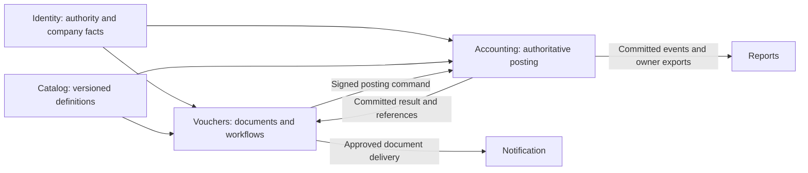

# Vouchers architecture and delivery plan

**Date:** 2026-10-10.
**Status:** B01-B14 are verified for their recorded scope, including Phase 2 ordinary money
and financial reports. [The execution note](voucher-phase2-execution.md) records the tests,
corrections and limits. Phase 3 B15 is next; release activation remains pending.
The [tracker](voucher-delivery-tracker.md) governs batch status.
**Implementation roadmap:** [Detailed work packages and release gates](voucher-implementation-plan.md)
consolidate this scope into V0-V9 schema/API/worker/client work, dependencies, migration and
rollout requirements, twelve decision gates and 28 acceptance scenarios.
The [reviewed delivery tracker](voucher-delivery-tracker.md) maps those packages to 45 batches,
records prerequisites/evidence and covers all 22 kinds. Later batches wait for their
specific decision and verification gates; implementation does not imply release activation.
**Required reporting:** Account ledgers, trial balance, Profit & Loss / Income & Expense,
Balance Sheet, party/bill/advance/aging, cash/bank, tax and stock/job-work registers.
The [posting/reporting design](voucher-posting-reporting-design.md) specifies source facts,
opening/earnings and reconciliation rules, snapshots and RPT01-RPT20 checks under AC26.
The [stock recording/reporting design](voucher-stock-recording-reporting-design.md) adds
explicit current/item/group/location, batch/serial/expiry/age and value/action registers,
with B27a-e and INV01-INV24 under the existing gates and 45 parent batches.
**Confirmed direction:** Replace the future Billing and Payments APIs with one `vouchers` API.
**Required document coverage:** Indents/requisitions, purchase orders, sales orders,
quotations and delivery challans are included. Indents, orders and quotations never change
actual stock or account balances.
**Required extensions:** Job work in both directions, future company-created voucher types,
typed custom fields on headers/item lines, and India GST plus applicable state VAT recording.
See [extensibility](voucher-extensibility.md) and [tax recording](voucher-tax-recording.md).
**Confirmed data architecture:** All voucher types share common header/revision/line tables
and reusable typed detail sections; see [the shared data model](voucher-data-model.md).
No separate document/line table family is created for each voucher kind or company type.
The [table inventory](voucher-table-inventory.md) lists candidate entry/support tables,
optional operations and existing Accounting/infrastructure reuse with explicit owners.
The [Tally functional review](tally-voucher-functional-review.md) examines Journal, Stock
Journal and banking capabilities, distinguishing documented behavior from our profile choices
and identifying dimension/instrument/reconciliation gaps before schema implementation.
The [settlement review](tally-settlement-functional-review.md) extends this to Payment,
Receipt, bill references, advances, refunds and separate financial/tax adjustment histories.
The [Sales/Purchase calculation contract](voucher-invoice-calculation.md) specifies item and
accounts-only modes, charge/discount allocation, tax, stock cost and split settlement together.
The [order and fulfillment review](tally-order-fulfillment-review.md) adds requisition approval,
delivery schedules, source conversion, challan tracking and independent delivery/billing progress.
**Proposed delivery boundary:** Keep Accounting's existing financial authority; extend its
posting transaction to stock/value effects. Detailed contracts and optional release scope
are implementation gates, not permission to start building every feature below.
**Read with:** [architecture](tech-stack.md), [Accounting finance](accounting-finance-contract.md),
[fiscal controls](fiscal-year.md), [Catalog scope](catalog-v1-scope.md) and
[inventory requirements](catalog-inventory-integration.md).

**Required financial-year behaviour:** The [company-year design](voucher-financial-year-design.md)
specifies continuous books in one company, explicit date/period resolution, distinct statutory
and posting-year numbering, next-year readiness, controlled close/reopen and cross-year
bill/advance/stock/order/job-work/report continuity. D12 and FY01-FY24 extend the existing
45 batches. No annual balance copying; automated profit-transfer journals remain deferred.

The [account recording/maintenance design](voucher-account-recording-design.md) specifies
native entry lineage, ledger/register row grains, daily/period balance summaries, atomic
projection updates and verified rebuilds. BAL01-BAL20 extend existing D11/AC26 and batches;
account balances remain derived from Accounting facts, never independently editable masters.

The [stock capture/storage contract](voucher-stock-recording-reporting-design.md#31-what-an-execution-captures)
now specifies execution evidence, native quantity/value/position grains, synchronous owner
balances, transfer/return claims, guarded repair and staged imports. STK01-STK20 extend the
existing INV/FY/BAL checks and stock batches; Catalog definitions are not stock execution.

## 1. What a voucher means

A voucher records a business transaction with its evidence, parties, dates, lines,
approvals and resulting effects. A sales invoice is a Sales voucher; a supplier bill is
a Purchase voucher; money received or paid is a Receipt or Payment voucher. An order,
stock movement or memorandum can also be a voucher without creating revenue or debt.

Keep three independent concepts:

- **Kind:** a code-defined business behavior, such as SALES, PAYMENT or STOCK_JOURNAL.
- **Type:** a company-owned configuration derived from one kind, such as Retail Sales,
  Export Sales or Bank Payment, with numbering, forms, permissions and approval policy.
- **Mode/class:** supported entry presentation or reusable allocation defaults within
  that kind. Defaults never bypass posting rules, field permissions or tax validation.

Companies may define many types; they cannot invent new financial behavior by naming a
type or writing a custom-field formula. Unsupported kinds/modes stay unavailable.
The initial 22 kinds are not a permanent cap: new kinds/profiles require reviewed implementation,
while new company types derived from supported behavior are runtime configuration.
All effects are explicit: financial journal, physical quantity/custody, inventory value,
commitment, or scenario only. Merely containing item lines does not imply a stock movement.

## 2. TallyPrime research and the count

TallyPrime's current [voucher-type guide](https://help.tallysolutions.com/tally/voucher-types-tally/)
and [Chart of Accounts guide](https://help.tallysolutions.com/tally-prime/accounting/charts-of-accounts-tally/)
describe **24 predefined types** and additional types derived from those bases.
Its longer [accounting-entry article](https://help.tallysolutions.com/accounting-entry-tally/)
also contains a conflicting count of 28. This plan therefore names every in-scope kind
instead of claiming that every TallyPrime version/configuration has one universal count.
Sources reviewed on 2026-10-10; this is published-product research, not source-code inspection.

**User scope: payroll, attendance, salary processing and related HR work are excluded.**
Our product grouping is therefore **8 accounting + 8 inventory + 4 orders + 2 general = 22**.
Tally's two payroll-related types are omitted, not held as future delivery phases.
This groups Memorandum and Reversing Journal separately for clarity; it is not a claim
that Tally uses these exact four navigation groups. The older official
[voucher security grouping](https://help.tallysolutions.com/docs/te9rel49/Data_Management/Voucher_Type_Security.htm)
enumerates the familiar families, including those two under accounting; current behavior
is checked against the TallyPrime guides linked below.

### 2.1 Accounting: 8 kinds

| Kind | Purpose in this platform | Posting effect |
|---|---|---|
| `CONTRA` | Transfer between the company's own cash/bank accounts | Balanced cash/bank movement; no sale or expense merely because funds moved |
| `PAYMENT` | Supplier settlement, expense payment, advance or customer refund | Cash/bank outflow; explicit expense, advance or open-item allocation |
| `RECEIPT` | Customer settlement, income receipt, advance or supplier refund | Cash/bank inflow; explicit income, advance or open-item allocation |
| `JOURNAL` | Accrual, provision, depreciation, reclassification or correction | Balanced ledger posting; cash/bank eligibility and required allocations follow the supported profile |
| `SALES` | Goods/service invoice, cash sale or credit sale | Revenue/tax and receivable or cash; stock effect only when this document owns fulfillment |
| `PURCHASE` | Goods/service supplier bill, cash or credit purchase | Asset/expense/tax and payable or cash; stock effect only when this document owns receipt |
| `CREDIT_NOTE` | Sales return/price reduction or a received supplier credit | Financial/tax effect follows issuer and transaction direction; physical return is separately declared or linked |
| `DEBIT_NOTE` | Purchase-return advice/commercial debit or a supported supplier tax debit | Commercial purchase reduction differs from a statutory supplier debit increasing supply/tax; native profiles enforce direction and evidence |

These are operational examples, not jurisdiction-specific tax prescriptions. The allowed
direction, original-document link and tax treatment must be validated by the supported
transaction profile. Tally's [accounting overview](https://help.tallysolutions.com/tally-prime/accounting/accounting-in-tally-prime/)
and [accounting-entry guide](https://help.tallysolutions.com/accounting-entry-tally/)
provide the conceptual baseline; our immutable posting and correction rules remain stricter.

### 2.2 Inventory: 8 kinds

| Kind | Purpose | Quantity/custody and value behavior |
|---|---|---|
| `RECEIPT_NOTE` | Receive goods before or against a purchase bill | Inward receipt; no second receipt when the bill is linked |
| `DELIVERY_NOTE` | Dispatch goods before or against a sales invoice | Outward dispatch; no second issue when the invoice is linked |
| `REJECTIONS_IN` | Record goods returned/rejected by a customer | Receive into an explicit accepted/quarantine disposition; credit note remains separate |
| `REJECTIONS_OUT` | Return rejected goods to a supplier | Outward movement linked to the receipt; debit note remains separate |
| `STOCK_JOURNAL` | Transfer, approved adjustment or supported transformation | Typed inward/outward/value legs; a reason cannot substitute for a supported operation |
| `PHYSICAL_STOCK` | Reconcile an approved physical count | Post the reviewed delta against a protected count cutoff, never overwrite a balance |
| `MATERIAL_IN` | Receive job-work materials or finished goods | Preserve owner, custodian, job order and component/output identity |
| `MATERIAL_OUT` | Send job-work materials or finished goods | Preserve ownership and custody; not automatically a sale |

The [inventory guide](https://help.tallysolutions.com/tally-prime/inventory/inventory-entry-tally/)
describes notes, rejections, transfers and physical counts. The
[job-work guide](https://help.tallysolutions.com/tally/job-work-tally/)
and [job-work setup](https://help.tallysolutions.com/job-work-setup/)
explain Material In/Out for principal and job worker roles.

An inventory voucher is not necessarily financially neutral. Our integrated valuation
policy may require stock, clearing, cost-of-goods, variance or loss journals. It must specify
when value is recognized and cleared. Third-party goods remain distinguishable from owned
stock. These are platform design requirements, not a claim about Tally's exact ledger entries.
The **Delivery Challan** is a required, explicitly selectable DELIVERY_NOTE document profile,
not an additional independent stock movement. Its draft/print step has no stock effect;
confirmed physical execution uses the guarded movement workflow described in section 2.6.

### 2.3 Orders and commitments: 4 kinds

| Kind | Purpose | Effect before fulfillment |
|---|---|---|
| `SALES_ORDER` | Customer commitment with delivery schedule | Outstanding-order quantities only; no actual stock, inventory value, ledger or party balance effect |
| `PURCHASE_ORDER` | Supplier commitment with receipt schedule | Outstanding-order quantities only; no actual stock, inventory value, ledger or party balance effect |
| `JOB_WORK_IN_ORDER` | Work accepted from a principal | Job commitment and expected materials/output; no assumed ownership transfer |
| `JOB_WORK_OUT_ORDER` | Work assigned to a subcontractor | Job commitment and expected issues/receipts; no assumed purchase or payment |

Partial fulfillment, source-line references and short-closing require explicit quantities
and reasons. Source orders remain visible after conversion. Order totals are commitments,
not receivables/payables or stock on hand. An optional separate reservation command may
affect available-to-promise or credit capacity, never on-hand quantity or posted balances;
merely creating, issuing or accepting an order does not execute that command. See Tally's
[inventory transaction chains](https://help.tallysolutions.com/tally-prime/inventory/inventory-entry-tally/)
and [job-work orders](https://help.tallysolutions.com/tally/job-work-tally/).

### 2.4 General/non-posting: 2 kinds

| Kind | Purpose | Effect |
|---|---|---|
| `MEMORANDUM` | Provisional internal transaction evidence | No actual ledger, stock, tax, settlement or reservation effect |
| `REVERSING_JOURNAL` | Time-bounded what-if adjustment for a scenario | Scenario-only entries; excluded from actual books |

Tally uses these with optional vouchers in
[scenarios](https://help.tallysolutions.com/scenarios-tally/) and
[cash-flow projections](https://help.tallysolutions.com/cash-flow-and-projection-report-tally/).
**A Reversing Journal in this sense is not the actual reversal of a posted journal.**
An actual reversal is an authorized linked correction in an open period and changes books.
Converting a memo/scenario to a real transaction creates a linked, newly validated voucher;
it never changes historical actual balances by toggling a flag.
Actual cash or stock movement must be recorded with the appropriate real voucher; a
memorandum is not a way to postpone recording an already-observed financial or physical effect.

### 2.5 Variants and supporting documents, not extra base kinds

- **Manufacturing Journal:** a supported STOCK_JOURNAL transformation mode, not a 23rd base
  kind. It requires BOM revisions, consumption/output genealogy, WIP, scrap and cost allocation.
  Tally documents this as a [Stock Journal mode](https://help.tallysolutions.com/tally-prime/inventory/inventory-and-manufacturing-faq/).
- **Optional:** a supported non-posting mode for an otherwise ordinary kind, not another
  base kind or permission bypass. No actual stock/value/tax or live reservation effects.
- **Post-dated:** scheduling metadata; no actual posting before the eligible business date
  and a fresh period/authority check. Draft, cancelled and reversed are states, not kinds.
- **POS, cash/credit/export sales, service invoices, expenses and bank receipts/payments:**
  company types or validated transaction profiles derived from the relevant accounting kind.
- **Quotation:** a required first-class document profile under SALES_ORDER, with its own
  offer lifecycle and no actual or committed-order effects until a real order is created.
  It is listed explicitly in the API/forms/registers; it is not an obscure print setting.
- **Pro forma:** a non-posting SALES-derived document variant, separate from a quotation and
  actual invoice. Acceptance creates a linked actual document draft, never balances by itself.
- **Openings:** retain Accounting's controlled opening workflow; opening stock must reconcile
  to it. Do not invent a second opening balance by calling it a normal Purchase voucher.
- **Indents/requisitions:** required non-posting REQUISITION profile of STOCK_JOURNAL, with
  native procurement/internal-issue purpose. Approval and conversion create no stock or GL
  effect; execution uses a separately authorized voucher. Plain item requests are V5 scope;
  BOM-assisted requests/manufacturing are V8. This extends Tally's optional manufacturing
  requisition approach; see the [functional review](tally-order-fulfillment-review.md).
- **Payment requests, approvals and bank reconciliation:** supporting workflows.
  Reconciliation matches evidence; any correcting entry is a separate authorized voucher.
- **Transfer dispatch/receipt, damage/quarantine and stock write-off:** native inventory
  operation profiles with custody/value rules, not arbitrary text-based Journal shortcuts.

### 2.6 Required indents, orders, quotations and challans

The user explicitly included these documents and their distinct effects. "Challan" here
means a **delivery/goods-movement challan**, not a tax-payment challan. TallyPrime documents
a quotation as an optional Sales Order and delivery through a Delivery Note; our required
profiles expose those business documents directly. This is a platform design choice, not
an assertion that Tally has separate predefined Quotation and Challan base kinds.
[TallyPrime sales orders, quotations and delivery notes](https://help.tallysolutions.com/tally-prime/sales-process/sales-order-tally/).

| Document | Required profile/base | Actual stock effect | Account balance effect | Separate information tracked |
|---|---|---|---|---|
| Purchase indent / material requisition | Non-posting REQUISITION / STOCK_JOURNAL; procurement or internal-issue purpose | None | None | Requested and approved quantities, needed-by schedule, department, conversion and closure; no supplier commitment merely from approval |
| Quotation | QUOTATION / SALES_ORDER | None | None | Proposed prices, validity, versions and customer response; not an outstanding confirmed order |
| Sales Order | Confirmed-order profile / SALES_ORDER | None | None | Committed, fulfilled, cancelled and outstanding quantities |
| Purchase Order | Confirmed-order profile / PURCHASE_ORDER | None | None | Ordered, received, cancelled and outstanding quantities |
| Delivery Challan | DELIVERY_CHALLAN / DELIVERY_NOTE | Physical dispatch/receipt changes the applicable location/custody/quantity once | No invoice, customer debt, supplier debt or cash entry merely from issuing a challan; valuation treatment follows the approved movement policy | Dispatch evidence, acknowledgements, undelivered/in-transit quantities and invoice links |

**Actual, committed, reserved and projected quantities remain separate.** Orders can appear
in outstanding-order or availability projections without altering stock on hand. A quotation
does not reserve stock/credit or become order demand. Projected revenue on a quotation/order
is not posted revenue. All these document drafts and print/reprint actions are effect-free.
Inventory recognition/valuation remains a V0 decision; a stock-only document must not be
treated as proof that every valuation policy has zero financial consequences.

Required workflows:

- **Indent/requisition:** draft -> submitted -> approved/rejected -> partly/fully converted
  or closed/cancelled. Bind approval to the exact item quantities/revision. Split an approved
  indent into several POs or consolidate compatible indents with retained source allocations.
  An internal material request links to a supported execution voucher. Do not make the request
  post by toggling Optional. Supplier RFQ/bid comparison is not implied by this workflow.
- **Quotation:** draft -> issued -> accepted/rejected/expired/cancelled. Store validity,
  currency, offer lines, terms and immutable issued revisions. Acceptance alone creates no
  stock or accounting entry. Authorized conversion creates a linked Sales Order or Sales
  draft; conversion is idempotent, tracks converted line quantities, rejects excess conversion
  and retains the exact accepted quote revision. Expired/revised offers require explicit review.
- **Sales/Purchase Orders:** draft -> issued/confirmed -> partial/full fulfillment or
  reasoned short-close/cancel. Enforce source-line quantity limits. Changing order state alone
  cannot receive/dispatch stock, invoice, pay or collect money. A customer PO reference is
  recorded on our Sales Order; our Purchase Order is addressed to our supplier.
- **Schedules and progress:** support several planned quantity/date/destination slices per
  line, distinct from payment installments. Preserve ordered, executed, acknowledged, returned,
  billed and short-closed quantities separately. Goods moved but unbilled and billed but
  unmoved can coexist; derive them from matched source slices, not net header totals.
- **Challan:** preparation/issue is separate from confirmation of physical movement. Capture
  movement purpose, sender/recipient, actual stock locations, items/units, lot/serial details
  where required, dispatch date and receipt acknowledgement. Posting retries and reprints
  cannot move goods twice. Same-company transfers conserve company-owned totals while
  changing location/custody; external deliveries follow their declared ownership policy.
- **Linking:** Quotation -> Sales Order -> Delivery Challan -> Sales Invoice; Purchase Order
  -> Receipt Note/acknowledged supplier challan -> Purchase Invoice. Direct invoicing remains
  supported when permitted, but a linked invoice never repeats an existing physical movement.
  Partial dispatches, receipts, invoices and returns reconcile by source-line allocation.
  Support invoice-first deferred execution as well as note-first/direct invoicing, with explicit
  movement intent. Concurrent conversion/closure must share guarded claims; unknown posting
  outcomes do not release claims. Closing an order does not cancel billing, refund an advance
  or erase custody. Reopening/replacements retain dated authorization and history.
- **Scope:** A supplier's challan is external evidence on our receipt, not a second inward
  voucher. Transfer/returnable/job-work challan labels must select the corresponding supported
  Stock Journal or Material In/Out workflow; a print title cannot bypass those guards or enable
  deferred job-work functionality. No statutory/e-way-bill integration is implied by the label.

The core remains **18 base kinds plus required Requisition, Quotation and Delivery Challan profiles**;
the wider plan remains 22 base kinds. These counts distinguish internal behavior from the
business document choices shown to users. These profiles require their own discoverable
metadata, validation, permissions, numbering configuration, history and register filters.

### 2.7 Job work and manufacturing: included scope

Job work is required planned coverage, scheduled after the core voucher flows rather than
left as optional product scope. Include all four kinds: JOB_WORK_IN_ORDER, JOB_WORK_OUT_ORDER,
MATERIAL_IN and MATERIAL_OUT, with supported manufacturing as a STOCK_JOURNAL mode.

| Our role | Linked workflow | Ownership and financial meaning |
|---|---|---|
| Principal outsourcing work | Job Work Out Order -> Material Out -> Material In -> Purchase service bill -> Payment | Goods at the job worker remain distinguishable as our owned stock in third-party custody; service charges are recorded separately |
| Job worker accepting work | Job Work In Order -> Material In -> manufacturing/processing -> Material Out -> Sales service invoice -> Receipt | Customer-owned material is custody stock, not our purchased inventory or sales revenue; our own consumed material is tracked separately |

Orders record expected input/output, dates and agreed service prices without posting stock,
party balances or tax. Actual issues/receipts record quantity, owner, custodian, location,
lot/serial where applicable, source order/line and movement evidence. Support partial issues,
multiple processors, direct deliveries, partial completions, unused-material returns, outputs,
scrap/by-products, loss and reasoned short-close. A print label cannot replace the underlying
Material In/Out or transfer guards. Job-work challans link to these movements and their orders.

Consumption and production record native BOM/recipe revision where required, expected versus
actual usage/yield, WIP, output genealogy and cost allocation. Reconcile quantities in compatible
units and track outstanding material by owner/job/location; do not equate unlike input/output
units or automatically expense all subcontractor-held stock. Returns and corrections retain
the original movement links. Service bills may use eligible cost capitalization under the
approved valuation policy, but never manufacture a second material receipt.

The [tax plan](voucher-tax-recording.md) adds challan chains, statutory aging, direct supply,
scrap-sale treatment and job-work service invoicing. Rates, deadlines, stock ownership, yield
and costs are native validated facts; custom attributes remain descriptive. No attendance,
employee salary, wage processing or payroll subsystem is included. Catalog definition scope
and the minimum BOM support needed for V8 are implementation decisions, not an automatic
commitment to every optional manufacturing feature in older Catalog plans.

## 3. Service ownership

The target remains seven services: Identity, Audit, Catalog, Accounting, Vouchers,
Reports and Notification. Five exist; Vouchers and Reports remain planned. There is
no future Billing or Payments service in this architecture.

| Owner | Authority |
|---|---|
| Identity | Tenant/company, actors, roles, features, field policies, company configuration and first-use reservations |
| Catalog | Product/unit/location masters, price/tax definitions, profiles and later BOM/promotion definitions |
| Accounting | Existing parties/accounts/terms, journals, fiscal controls, openings, open items, allocation, credit and tax; proposed authoritative stock/custody/value posting extensions |
| Vouchers | Company voucher types/classes, drafts and immutable revisions, entry/approval/fulfillment workflows, document links, payment-provider adapters, documents/print artifacts and posting-status projections |
| Reports | Rebuildable read models; actual books and scenario reports are explicitly separated |
| Audit | Immutable action evidence and integration history |
| Notification | Event-driven delivery and signed delivery callbacks |

Audit events accompany each owner's state changes through its transactional outbox.
Arrows represent contracts; they do not permit network calls inside posting transactions.

**Posting location is a design proposal to preserve existing Accounting ownership.**
Vouchers does not own a second ledger or independently authoritative stock balance.
One Accounting transaction commits the immutable posting snapshot, final posting number
(and any separately issued document reference),
financial entries, applicable stock/value/custody legs, open-item/credit effects, dedupe and
outbox. Inventory-only postings use the same authoritative effect store even when no GL
entries are required. Accounting remains responsible for validating effects, not merely
accepting caller-supplied debit/credit rows.

Vouchers keeps its own database and never imports Accounting models, joins its database or
wraps its transaction. Signed, versioned commands/results cross the boundary. No existing
table, path or service is moved by this plan. Inventory posting tables and the command
adapter do not exist yet; phase V0 must finalize them before migrations.

### 3.1 Reliable posting across the boundary

1. Vouchers validates current actor/company/field scope, records an immutable approved
   revision plus a posting command in its own transaction, and returns `202` with an operation ID.
2. Before opening its posting transaction, Accounting obtains any required live Identity
   authority/first-use reservation. Inside the transaction it validates bounded signed authority,
   the command/revision hash, local master/config versions, fiscal state and all effect guards.
   The contract must define revocation freshness and refuse expired/missing authority.
3. Accounting serializes posting with period close and relevant stock/credit/source guards.
   Source identity is unique independently of HTTP idempotency and broker `message_id`.
   It commits all required local effects or none, then publishes through its outbox.
4. Vouchers applies the durable result idempotently. `POSTING` remains pending on timeout;
   a lost acknowledgement is never shown as a definitive failure or retried as a new transaction.
   Recovery queries by source identity/operation ID and republishes the original command safely.
5. Posted content is immutable. A cancel racing with posting resolves at Accounting's source
   guard; once posted, correction requires an authorized reversal/credit/debit workflow.

This is asynchronous coordination with one atomic effect owner, **not a distributed SQL
transaction**. The UI may temporarily show pending status after Accounting committed; that
does not permit stock and money to disagree in their source of truth. Expired approvals,
stale references or changed input hashes require a new review, not silent recalculation.

Existing Accounting journal/settlement/charge APIs remain supported and use the same guards.
The adapter must distinguish an existing posting from a new one so an imported or linked
Accounting journal cannot be posted again through Vouchers.

### 3.2 No double stock or settlement effects

- Indents, Quotations, Sales Orders and Purchase Orders create no actual journal, stock/value
  movement, receivable/payable, cash entry or tax liability. Any optional reservation is
  explicit and separately authorized, and its availability impact is not an on-hand balance.
- Purchase Order -> Receipt Note -> Purchase: receipt owns physical quantity; the bill
  links exact receipt allocations and clears/reconciles valuation, rather than receiving twice.
- Quotation -> Sales Order -> Delivery Note/Delivery Challan -> Sales: dispatch owns physical quantity; invoicing links
  those allocations. Direct sales/purchases may combine both effects atomically.
- Service invoices have no physical stock. Partial notes/invoices preserve billed,
  received/dispatched, returned and outstanding quantities independently.
- Credit/Debit Notes can be financial-only. A linked Rejections In/Out movement cannot be
  repeated by the financial note. Returned/credited quantities cannot exceed their source.
- A cash sale and its tender must choose one settlement model: either the combined posting
  settles it, or a linked Receipt does. Never record both as independent cash receipts.
- Opening stock, physical counts and value adjustments reconcile to the financial control
  accounts under an explicit valuation policy. Backdating requires cost/period safeguards.
- Actual supplier/customer balances come from Accounting; party/type projections for Catalog
  pricing come from Accounting, replacing the old planned Billing source.

### 3.3 Payment integrations remain a capability

Payment/Receipt vouchers record money events; they do not by themselves execute a bank or
gateway transfer. Optional gateway adapters and callback endpoints live in Vouchers with
isolated workers, allowlisted providers, tokenized credentials and bounded permissions.
No provider network call occurs inside a database transaction.

Use a distinct payment-intent/attempt lifecycle for requested, pending, confirmed, failed
and unknown outcomes. Verify callbacks over the raw body, durably dedupe capture before ACK,
validate provider account/amount/currency and reconcile ambiguous results. Only a confirmed,
authorized result may request the corresponding receipt/payment posting. A duplicate callback
or replay with another key must still produce one financial effect. Gateway fees, refunds and
chargebacks need explicit linked entries; a credit note alone is not proof of a cash refund.
Provider selection/certification and banking scope remain open; no separate Payments API is needed.

### 3.4 Bill settlement and advances

Payment/Receipt are money-document kinds; advance/refund are supported business purposes,
and bill adjustment is an allocation workflow. Company types may give them distinct names
and numbering without adding per-purpose document tables or new base kinds. See the
[Tally settlement review](tally-settlement-functional-review.md) for verified workflows.

- Keep reference mode (new, against existing, on-account) separate from business purpose
  (settlement, advance, refund, deposit or other supported purpose). Normalize Tally's explicit
  Advance reference where present; an unidentified on-account amount is not automatically an advance.
- Reuse Accounting's dated allocation/reversal between compatible debt/credit open items.
  Late bill assignment does not receive/pay money again. A pure adjustment needs operation
  evidence, not a fabricated cash voucher; FX/reclassification requires its own explicit effect.
- Support partial and multi-bill allocation with unapplied remainders. Automatic due-date
  selection and eligible-advance FIFO are distinct policies; persist proposed matches and
  recheck authoritative availability before commit. Multiple-pair atomicity remains a V0 contract.
- Reconcile bank amount separately from party settlement, discounts, withholding, fees and
  authorized write-offs. A short payment does not settle the missing amount without an effect.
- Advance application, refund and return-credit reinstatement preserve source links and
  compete for available value. Reverse/refund through dated history; never increase or rewrite
  the original receipt/payment to represent a return. No concurrent double consumption.
- Financial bill allocation and statutory advance adjustment have separate amounts/events.
  Opening financial credit and opening tax-advance evidence reconcile without duplicate cash.
  GST/RCM applicability and tax dates follow the India tax plan, not a UI reference label.

### 3.5 Sales/Purchase entry and calculation

Use the [invoice calculation contract](voucher-invoice-calculation.md) for inventory-linked,
accounts-only and supported mixed modes. Item display, physical execution, financial posting
and settlement are separate decisions. An invoice may execute a movement, reference a prior
note/challan, or use an explicitly supported deferred-fulfillment profile; it never moves
goods again merely because an item appears on the bill.

One typed component pipeline resolves prices, discounts, charges, statutory bases/components,
rounding and settlement. It reuses Catalog pricing/promotion policies and Accounting authority.
Line/document discounts have one canonical component representation. Each charge/discount
declares commercial-payable, tax-base and inventory-cost treatment with independently scoped
allocations; those allocations cannot be summed as duplicate charges. Inclusive prices,
multiple tax rates, actual/billed quantities and supplier-declared differences retain evidence.

Payment terms, recognized tenders, advance application and remaining debt are independent
sections of the same invoice. Card/cheque clearing and later fees follow native recognition
profiles. Purchase supplier payable and actual landed cost reconcile independently, including
third-party costs and recoverable/nonrecoverable tax. V3/V4 must prove these cases before
enabling the corresponding modes; a common form alone does not implement them.

Purchase and purchase-return profiles require repeated discounts, charges and tax components
at quantity, line, selected-line and invoice scopes. The
[component contract and CAL01-CAL16](voucher-invoice-calculation.md#41-required-component-scopes-and-amount-bases)
define bounded dependency bases, header-tax normalization and original-allocation partial
returns. Supplier credit, tax adjustment, carrying-value reversal and refund remain separately
traceable effects. This extends shared typed sections and existing B15-B18/B22-B27 work;
no purchase-specific entry tables or additional parent batches are needed.

The [commercial configuration contract](voucher-commercial-configuration.md) makes Sales/Purchase/type/class controls
explicit for stacked components, independent free items and manual/automatic 10+1. Versioned
policies restrict supported behavior across UI/API/import; native paid/reward allocations
preserve all-unit stock/cost and return/fulfillment history. CAL17-CAL28 extend verification
within the same 45 parents; automatic schemes retain Catalog/runtime prerequisites.

The [all-voucher configuration contract](voucher-configuration-design.md) extends native settings beyond commercial
invoices: a registry and 22-kind capture/effect matrix cover accounting/banking, inventory,
orders/scenarios and job work. Shared company policy profile/revision/binding candidates and
revision-bound effective settings drive the common APIs, forms and posting validation.
VCF01-VCF24 are required within existing batches; no per-kind settings or entry tables.

## 4. Data and API shape to finalize in V0

The user selected a [shared voucher data model](voucher-data-model.md): `voucher_type`,
`voucher_type_revision`, `voucher_class`, common `voucher`, `voucher_revision` and
`voucher_line`, with reusable account/item/inventory, charge/tax, bill/advance and tender
details. Parties, references, links, approvals and operations also use shared structures.
Unused sections have no child rows. These are design concepts, not a finalized table count;
existing shared outbox/inbox, money, tax, auth and cursor mechanisms must be reused.

Each voucher carries tenant/company, kind/type/revision, document date, posting date when
applicable, original reference, party/account scope, currency, row version and audit attribution.
Quotation/challan and confirmed-order behavior is a validated native `document_profile`,
not a custom-field flag. It is immutable for an issued revision. Quotation conversions create
linked documents rather than changing a non-posting record into a posted one in place.
Typed lines retain quantities/units, Decimal amounts, tax/price provenance, locations and
lot/serial requirements. Do not accept one free-form JSON blob for every kind. Input schemas
use one common envelope with reusable typed sections, discriminated by kind/profile/entry
mode. Required/optional/forbidden section rules are validated server-side at each lifecycle
stage; incompatible fields fail validation. Account-only, item and supported mixed invoices
share storage, with inventory execution independent from item presence.

Accounting stores the immutable source revision/hash and authoritative posted number/effects.
Final posting numbering is unique by company, type/series and fiscal year and is allocated
only in the authoritative posting transaction. Quotations, orders, memos and challans may use
their own issue-time document series in Vouchers; an issued challan number is retained on its
later movement result and is not proof of movement. These series never consume the invoice
posting series. The posting receipt identifies any distinct internal effect number. Drafts use IDs.
Used numbers are never reassigned. The existing fiscal numbering policy remains governing.
Statutory profiles add their legal registration/document-category uniqueness and format checks.
Multiple company types cannot evade invoice-number uniqueness by reusing the same series/name;
finalize canonical series ownership and the registration mapping in V0/T0.

Proposed company-scoped routes (under `/v1/companies/{company_id}`):

| Surface | Responsibility |
|---|---|
| `/voucher-kinds` | Read implemented kinds, required document profiles (including Requisition, Quotation and Delivery Challan), supported modes and capability/availability reasons |
| `/voucher-types`, `/voucher-types/{id}/revisions`, `/voucher-classes` | Configure company types under allowed kinds with field metadata |
| `/voucher-types/{id}/clone`, `/voucher-types/{id}/field-bindings`, `/voucher-types/{id}/field-set` | Create derived types and configure accepted header/item definitions; metadata before draft creation |
| `/vouchers`, `/vouchers/{id}`, `/vouchers/{id}/field-set` | Typed create/list/detail/draft edit and dynamic field metadata |
| `/vouchers/{id}/items/{line_id}/field-set` | Typed metadata and field access for an individual voucher item line |
| `/vouchers/{id}/validate`, `/preview` | Explain quantity, money, tax and projected effects without posting |
| `/vouchers/{id}/submit`, `/approve`, `/reject`, `/post` | Version-bound approval and asynchronous posting request |
| `/vouchers/{id}/cancel`, `/reverse`, `/convert` | Guarded lifecycle or linked successor document; not arbitrary status updates |
| `/vouchers/{id}/links`, `/history`, `/posting`, `/documents` | Trace source allocations, evidence, authoritative result and signed artifacts |
| `/voucher-operations/{id}` | Bounded status/recovery visibility for asynchronous commands |

Operation suffixes above are relative to `/vouchers/{id}`. Physical count, transfer,
fulfillment and integration endpoints require typed subresources; a generic `/post` cannot
replace their state machines. Read APIs follow signed keyset paging, typed filters, stable
sorting and lean projections. Posted/source snapshots and generated exports obey read denies.
Every mutation takes idempotency and applicable expected-version checks, including approvals.

Permissions must cover company, kind/type, action, source object and stock location. Template
creation cannot grant posting authority. Approval separation is explicit and rechecked on the
approved revision. Approval is a configuration choice: where the effective policy does not
require it, `submit` approves in the same step and the transition history and audit event
record "approval not required by the voucher configuration", so a single-user company can
post; where it is required, nobody who created the voucher or any of its revisions
(acceptance revisions included) may approve it unless the policy allows self-approval.
`PURCHASE` submit also refuses a bill number already recorded for the same supplier in the
fiscal year (`409 duplicate_supplier_bill`) unless the request acknowledges it
([purchase review](purchase-e2e-review.md), D1, D1b, D2). New permission keys/roles/features
require synchronized contracts and tests; names in this plan do not assert that permission
keys already exist.

### 4.1 Typed custom fields and type creation

[Voucher extensibility](voucher-extensibility.md) is required V1 scope. Reuse Identity's
definition/layout/policy authority, shared typed validators and metadata-driven forms, and
Catalog's local projection/adoption/indexing pattern. Catalog continues to own item-master
attributes; Vouchers adds separate header and per-item-line custom fields with stable line IDs.
Support the existing 12 data types, company/type bindings, validated JSON values, immutable
issued snapshots and permission-aware queries/exports. Custom fields cannot drive financial,
stock, tax or approval behavior. Extend registries/contracts explicitly; these APIs do not
already exist. Runtime company types derive from supported code-defined kinds/profiles.

### 4.2 India tax recording

[Voucher tax recording](voucher-tax-recording.md) governs native tax facts, statutory profiles,
tax-event timing, input-credit reconciliation, job-work compliance and return evidence. India
is the user's selected first jurisdiction. State VAT support needs a verified state/commodity
profile; it is not implemented by renaming GST components. Keep GST/VAT registrations and
tax books separate while retaining one voucher workflow and Accounting posting authority.

Tax liability follows the supported legal supply/event rules, not the voucher's display name.
Separate posting date from statutory tax dates, actual financial balances from return status,
and ordinary money receipts from taxable advances. A challan is no general exemption from
invoicing/tax; internal stock transfers between distinct GST registrations may be supplies.
Purchaser debit notes must not masquerade as supplier-issued statutory GST credit notes.
These are proposed contract extensions; existing tax code is not claimed to cover them.

### 4.3 Shared sections for simple and complex vouchers

[The shared model](voucher-data-model.md) defines one header/revision/line core and reusable
typed sections. Invoice entry can combine accounts, item quantities, charges/discounts,
entered/calculated taxes, advance/bill allocations, split payment modes and references.
Each type revision declares allowed/required sections and supported conditional rules;
company customization may tighten those rules but cannot bypass stock, tax or access controls.
Custom types create configuration rows, not tables. Kind-specific validators/workflows remain
code-defined and execute over the common structures.

Account allocations distribute commercial lines or supply explicit manual journal input;
they are not extra invoice amounts. Tax/charge allocations retain their calculation sources.
An applied advance consumes an existing Accounting credit, while a confirmed tender records
new settlement. Pending payment instructions do not reduce actual balances. Choose one cash
effect owner for a combined invoice/tender or linked Receipt/Payment, and one physical movement
owner for goods billed after a challan. Authoritative balances and race checks stay in Accounting.

## 5. Delivery phases and acceptance gates

Recommended core scope: **18 base kinds** = 8 accounting + 6 inventory (excluding Material
In/Out) + Sales/Purchase Orders + 2 general. **Four included later kinds** = Material In/Out
and Job Work In/Out Orders. Manufacturing is a later Stock Journal mode.
The user confirmed job-work coverage; the core/job-work release sequence is a planning
recommendation. Payroll and related work are excluded by the user's explicit scope decision.

The [implementation roadmap](voucher-implementation-plan.md#7-work-packages) is the detailed
execution plan for these phase IDs: deliverables by service, schema/API/worker/client work,
dependencies and linked acceptance evidence. The table below is its scope summary. Foundation,
account/service, goods/order core and required job-work releases are distinct milestones;
an early accounting release is not completion of the user's full scope.

| Phase | Deliverable | Exit evidence |
|---|---|---|
| V0 | Baseline/compatibility audit, common schema and section matrix, effect boundary and initial command contracts; inspect Accounting adapter limits and register later policy gates | Reviewed owner/contract/migration manifest; no unresolved posting assumptions for an enabled profile; later costing/tax/provider gates resolved before dependent work |
| V1 | Common voucher/revision/line and type/class foundation; section rules; runtime types; typed header/item fields with V1a-V1c gates; numbering, permissions, audit and posting protocol | Tenant/company/revision/type/field isolation; forbidden-section checks; definition adoption and immutable revisions; duplicate-command, close/post and cancellation-race contracts; OpenAPI/client parity |
| V2 | Contra, Payment, Receipt and Journal through Accounting; shared bill/advance allocations, refunds, dated reallocation, tenders and mode-specific references | Balanced postings, partial/concurrent advance allocation and refund, unapplied remainders, cash-versus-settlement differences, pending versus confirmed payments, replay, rollback, first-use freeze and period guards; no remote calls in the transaction |
| V3 | Sales, Purchase, Credit and Debit Notes for account/service flows; shared item/mixed invoice preparation, canonical charge/discount components, taxes, advance adjustment and split settlement; India tax rules | Commercial/distribution totals agree; inclusive/multi-rate allocation and rounding, declared/computed tax reconciliation, ITC/RCM separation, statutory versus commercial notes, no duplicate cash/advance effect and linked corrections; stock-bearing posting stays disabled until V4 |
| V4 | Atomic Accounting stock/value extension; six core inventory kinds including the explicit Delivery Challan profile; integrated goods sales/purchases/returns and opening-stock reconciliation | Native concurrency, no negative/duplicate tracked stock under selected policy, challan issue/print has no movement, dispatch happens once, linked invoice does not redispatch, separate payable/landed-cost allocation, balanced valuation and actual/billed/count/transfer/correction scenarios |
| V5 | Plain purchase/material indents, Quotations, Sales/Purchase Orders, approval/conversion, delivery schedules, partial fulfillment, source-line tracking and explicit reservation commands | Indent/quote/order approval leaves actual balances unchanged; no implied reservation or confirmed demand from indent/quote; bounded split/consolidated conversion, separate delivery/billing progress, safe short-close/reopen/cancel, reservation expiry and restart recovery |
| V6 | Memorandum, scenario Reversing Journal, optional/pro-forma modes; day book, registers and artifacts | Scenario/actual segregation, safe conversion, no hidden money/stock effects, correct permissions and signed downloads; completes the 18-kind core |
| V7 | Optional bank/gateway execution and reconciliation inside Vouchers | Real provider callback/signature/replay, unknown-outcome, fee/refund/chargeback and outage recovery checks; no duplicate cash effect |
| V8 | Required job work in both directions plus supported manufacturing mode and BOM-assisted requisitions | Four additional kinds; owner/custodian separation, partial/multi-worker flows, returns/scrap, BOM/WIP/genealogy, quantity/cost reconciliation, service invoices and statutory challan/aging/ITC-04 evidence |
| V9 | Early Reports foundation; ledgers/TB/P&L/Income & Expense/Balance Sheet in B14a-d; incremental party/tax/stock/order/job-work registers; final hardening | D11 snapshots/classification/opening/earnings, RPT01-RPT20 reconciliation, required reports before profile activation, recovery and final reviews |

Each implemented phase ends with matching models/migrations/schemas/factories, current
OpenAPI and generated clients, affected tests green, Ruff and strict mypy clean. Every new
table needs tenant isolation; every route needs permission/object/field denial cases. Money
and quantity tests assert Decimal types. MySQL/RabbitMQ evidence is separate from unit tests.
Client work accompanies the enabled profiles, using field-set metadata and the shared design
system with component/form/accessibility tests. API-only milestones are labeled explicitly;
this planning change implements neither APIs nor UI. Basic V5/V6 preparation may begin after
V1, while actual conversions wait for the target posting phase. Optional V7 does not block V8.
Tax gates T0-T5 in [the tax plan](voucher-tax-recording.md#8-delivery-and-verification) attach
to V0/V1, V2/V3, V4, V8 and V9. Required statutory documents and validated return exports are
part of supported tax profiles; direct government filing/provider integrations need separate
contracts. Do not advertise an enabled jurisdiction/profile until its gates pass.

## 6. Existing work and compatibility

- Reuse Accounting journals, fiscal guards, source identities, openings, allocations,
  credit controls, tax calculation and first-use reservation machinery. Do not reset them.
- Reuse Catalog products, units, location policies, price/tax revisions and release fencing.
  Vouchers needs workflow reads; Accounting needs local posting replicas and is the trusted
  consumer whose acknowledgement proves an inventory policy is enforced.
- Reuse Identity actor/company/field context, Audit outbox delivery and Notification commands.
- Existing `billing-platform` package names, `billing_platform` imports, legacy service
  identifiers and event routes stay unchanged until an explicit compatibility migration.
- Old documents assigning work to Billing/Payments are historical input. Map document and
  gateway work to Vouchers, party/master and authoritative posting work to Accounting,
  definitions to Catalog and read models to Reports. Do not simply rename every `billing`
  identifier, grant or consumer allowlist to `vouchers`.
- Before dependent implementation, reconcile stale Identity/Audit OpenAPI artifacts and
  the missing Notification client contract identified by the preceding review. This plan
  does not claim those code/contract fixes have been made.

## 7. Decisions still needed before implementation

The [decision register D01-D12](voucher-implementation-plan.md#3-decisions-and-contracts-before-dependent-implementation)
assigns each remaining contract/policy its owner and required phase. It covers effect-boundary
confirmation, stock recognition/costing/backdating, richer Accounting source/settlement and FX
contracts, tax-date/registration migration, approval/dimension/instrument rules, schema bounds,
BOM depth, statutory profile activation, selected optional integrations and financial-report
classification, opening/history coverage, committed snapshots and complete-input permissions.

These are bounded implementation gates, not unresolved inclusion of the user's requirements.
The 22 kinds, common base tables, typed customization, India GST, job work, indents, quotations,
orders and challans remain planned scope. General/scenario documents stay in V6; required
statutory artifacts/exports arrive with their dependent transaction profiles. Extra VAT
states, provider execution, recurring scheduling and advanced banking need selected scope.

Resolve a gate before implementing its dependent behavior, with the decision and compatibility
evidence recorded in the governing contract. Later costing/provider decisions need not block
unrelated shared foundation work. No per-kind document-table alternative is left open.

## 8. Decision log

- 2026-10-10: User required item/current/group/expiring-stock recording and reports. Added
  the stock design, B27a-e and INV01-INV24; positions, availability, date/hold/origin history,
  units/grouping and valuation reconcile from shared effects. Existing owner and batch counts
  stay unchanged; no stock implementation or policy activation is claimed.

- 2026-10-10: User requested deeper planning for ledgers, TB, Balance Sheet, income/expenses
  and tax registers. Added the posting/reporting design, D11 and 20 RPT checks under AC26;
  B14 now explicitly contains four reporting sub-batches. Kept 45 parent batches and deferred
  annual-close automation; named reports require reconciliation at every relevant phase.

- 2026-10-10: User requested review and recording for phased implementation. Corrected
  foundation, settlement, stock and Reports sequencing; recorded eight planning findings,
  45 batches, kind/profile coverage, decision records and separate verification/activation
  checkpoints. Core requirements remain unchanged; no implementation evidence is claimed.
- 2026-10-10: User requested a proper detailed implementation plan after the functional
  reviews. Added owner-specific work packages, schema/API/worker/client deliverables,
  dependency/release sequencing, D01-D10 gates and AC01-AC28 acceptance cases. Reports and
  statutory output start with dependent phases; optional V7 does not delay required V8.
  Preserved settled scope and documented open policy choices without silently deciding them.
- 2026-10-10: Indent/order/quotation/challan review added a required non-posting requisition
  profile, shared fulfillment schedules and bounded conversion/closure. Physical, billing
  and commitment progress remain separate. Plain indents are V5, BOM assistance is V8;
  no extra base kinds or per-document tables, and no implementation is claimed.
- 2026-10-10: User requested Sales/Purchase with inventory and accounting-only posting, and
  more complete payment/charge/tax/discount handling. Added the invoice calculation contract,
  effect matrix, canonical discount components, separate payable/tax/cost allocations, split
  tender/advance/credit reconciliation and supplier evidence controls. No new per-kind tables.
- 2026-10-10: User requested Payment/Receipt, bill-adjustment and advance functionality in
  TallyPrime. Added a sourced settlement review and shared workflow requirements for reference
  modes/purposes, late allocations, refunds, return-credit reinstatement, settlement differences
  and financial-versus-tax advance history. Reuse Accounting's existing allocation/reversal;
  do not introduce standalone Advance/Bill Adjustment base kinds or per-kind tables.
- 2026-10-10: User requested a feature-level Tally review of accounting journals, stock
  journals and bank vouchers. Added sourced capabilities and design gaps; corrected Journal's
  overly narrow non-cash description. Bank functions reuse Payment/Receipt/Contra and shared
  bank allocations; stock transfer/manufacturing/loss require distinct supported profiles.
  Native dimensions and instrument/reconciliation refinements remain design gates, not code.
- 2026-10-10: User requested all possible voucher-entry tables. Added a candidate inventory
  distinguishing shared Vouchers documents/details, optional operations, reused infrastructure,
  existing Accounting and proposed stock/tax/reporting structures. Exact schema remains V0;
  no new implementation or optional scope was authorized merely by listing a table.
- 2026-10-10: User required common base tables across all voucher types while supporting
  complex account/item invoices, charges, tax entry, advances, payment modes and references.
  Added shared header/revision/line plus reusable detail sections and type-dependent required/
  optional/forbidden rules. Preserved typed native facts, Accounting authority and separate
  commercial, stock and settlement effects; no new application tables were implemented.
- 2026-10-10: User confirmed India tax scope. Added native GST/state-VAT tax recording,
  separate statutory dates, registration-based supply rules, advance/ITC/RCM lifecycles,
  statutory document profiles and reconciled return evidence. Existing posting-date tax
  contracts require an explicit future migration; no compliance implementation is claimed.
- 2026-10-10: User required future voucher types and typed custom attributes on vouchers/items.
  Added runtime derived types and separate header/item-line fields reusing Identity/platform/
  Catalog mechanisms. Initial kinds are extensible through reviewed code, not arbitrary formulas.
- 2026-10-10: User confirmed job works must be considered. Job Work In/Out Orders, Material
  In/Out and supported manufacturing are included later scope, superseding the earlier
  optional designation. Added principal/worker flows, partial returns, scrap, WIP and charges.
- 2026-10-10: User explicitly included Purchase Orders, Sales Orders, challans and quotations.
  Orders/quotations have no actual stock or account-balance effects. Made Quotation a required
  SALES_ORDER profile and Delivery Challan a required DELIVERY_NOTE profile; kept the 22-kind
  total without duplicate posting engines. Quotation is no longer grouped with SALES-derived
  pro forma documents. Added issue-versus-movement, conversion, line-allocation, numbering
  and no-double-stock acceptance criteria. Payroll/HR exclusion remains unchanged.
- 2026-10-10: User replaced the planned Billing and Payments APIs with Vouchers and requested
  a TallyPrime-based accounting/inventory/general voucher catalogue. The architecture now
  includes Accounting and Vouchers as separate boundaries, with seven target services.
- 2026-10-10: Enumerated 22 in-scope base kinds from the 24-type Tally reference, excluding
  payroll and related work at the user's direction; distinguished company types, modes, manufacturing,
  scenario reversing journals and actual reversals. Recorded Tally documentation's count
  discrepancy. Proposed an 18-kind core and four later optional job-work kinds.
- 2026-10-10: Proposed retaining Accounting's existing financial authority and co-locating
  stock/value effects there; Vouchers owns documents/workflows and gateway adapters. Detailed
  posting/valuation/authorization contracts remain V0 gates. No code, migration, local path,
  running service, legacy wire identity or datastore is changed by this planning revision.

### Financial-year planning decision - 2026-10-10

Added the required financial-year contract after official Tally and current-API review.
D12 covers date/numbering/readiness/close coordination; FY01-FY24 supply phase acceptance.
Twelve decision gates and existing 45 parents/38 packages retain the agreed service scope.

### Account-recording review - 2026-10-10

Required account capture/maintenance now follows the linked design: exact source entries,
shared facts/summaries, join-safe registers and BAL01-BAL20 within existing D11/batches.

### Stock capture/storage review - 2026-10-10

Stock recording/storage is now explicit through quantity/value/source facts, guarded
positions and immutable cost history. STK checks extend existing batches and activation gates.

### Purchase component review - 2026-10-10

Required multi-scope, stacked purchase components and source-linked return allocation
contracts within the existing invoice/tax/stock phases. Detailed CAL01-CAL16 and the maintained
batch/todo records capture implementation evidence; no new policy or service was selected.

### Sales commercial-configuration review - 2026-10-10

Required Tally-informed commercial controls and source-linked free/deal behavior, with
independent Sales and Purchase policy and shared native storage. Linked the detailed
configuration contract and extended acceptance to CAL01-CAL28; no settings were activated.

### All-voucher configuration review - 2026-10-10

Made all-kind configuration a common native contract with Tally research, versioned policy
resolution, required entry facts and guarded effects. Recorded three reusable storage
candidates outside the earlier numbered baseline and VCF checks without changing the 45 batches.
